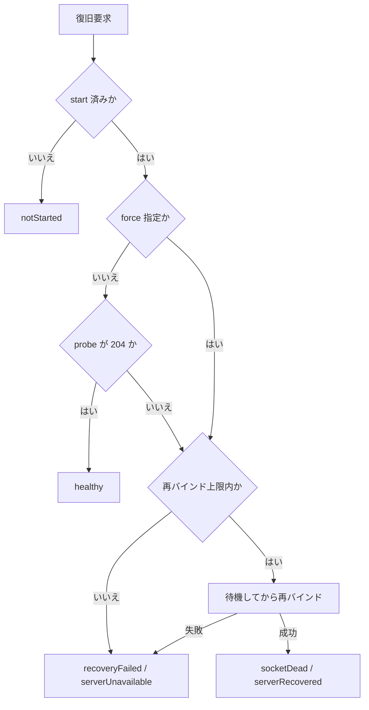

# offline_web_proxy 仕様書

Flutter アプリ内で動作するオフライン対応ローカルプロキシサーバ。
既存の Web システムをアプリ化する際に、オンライン／オフラインを意識せずに動作させることを目的とします。

本プロキシサーバは、WebView から送信される HTTP リクエストを中継し、オンライン時は上流サーバへ転送、オフライン時はキャッシュからレスポンスを返却します。また、更新系リクエスト（POST/PUT/DELETE）はオフライン時にキューに保存し、オンライン復帰時に自動送信することで、シームレスなオフライン対応を実現します。

---

## 【1】基本構成

### アーキテクチャ概要

- **ベース技術**: shelf（Dart の軽量 HTTP サーバフレームワーク）, shelf_router（ルーティング）, shelf_proxy（プロキシ機能）
- **通信経路**: WebView → http://127.0.0.1:<port> → (proxy) → 上流サーバ
- **データ永続化**: Hive を使用したローカルストレージ。Cookie、キュー、隔離、ドロップ履歴は AES-256 で暗号化して保存（【4】【5】）
- **Cache-Control 対応**: レスポンスヘッダを保存可否とフォールバック可否の判定に利用

### データ処理戦略

- **キャッシュ**: GET リクエストの成功レスポンスをファイルベースで保存。オンライン時の送信抑止には使わず、オフライン時または上流到達不能時の代替応答に限定して利用
- **キュー**: POST/PUT/DELETE リクエストを FIFO（先入先出）で管理。ネットワーク復旧時に順次送信
- **オフライン応答**: キャッシュヒット時はキャッシュを返却、未キャッシュ時はフォールバックページを表示（上流へ到達できる状態に戻るとページ自身が再読込）
- **静的リソース**: `pubspec.yaml` で宣言され `AssetManifest.json` に掲載された `assets/static/` 配下ファイルを一覧化し、同梱アセットとして配信

### 端末に保存するデータ

proxy は Hive の Box と secure storage にデータを保存します。暗号化 Box で暗号化されるのは値だけで、Box のキーは平文のまま保存されます（キュー・隔離・ドロップ履歴は保存した時刻から採番した ID、Cookie はドメイン・パス・名前など）。Hive はキーの長さを 1 バイトの欄に書くため、UTF-8 で 255 バイトを超えるキー（長いパスや名前の Cookie など）は、`sha256:` に続く SHA-256 の 16 進に置き換えて保存します。べき等性キーは、0.26.0 から長さによらず HMAC に置き換えます（【6】の「保持期間」）。`sha256:` で始まるキーも、長さによらず同じく置き換えます（`sha256:<64 桁の 16 進>` の短いキーが、別の長いキーを置き換えた値と同じ記録を指さないようにするため）。**キューと隔離は、要求のヘッダと本文をそのまま保持します。** 保存先ごとの内容、暗号化の有無、保持期間は次のとおりです。

| 保存先 | 内容 | 暗号化 | 保持期間 |
| --- | --- | --- | --- |
| `proxy_cookies_secure` | Cookie（名前、値、ドメイン、パス、有効期限、属性）。キーはドメイン、パス、名前など（UTF-8 で 255 バイトを超える場合は SHA-256） | 値のみ（AES-256） | 有効期限を過ぎたものは、送信する Cookie を探すときに削除。`clearCookies()` で削除 |
| `proxy_queue_secure` | 未送信の更新系要求（クエリを含む URL、メソッド、ヘッダ、本文、受け付けた日時、べき等性キーなど。`queueOwnerResolver` を指定した場合は持ち主の HMAC）。キーは保存した時刻から採番した ID | 値のみ（AES-256） | 送信に成功するか、隔離またはドロップ履歴へ移すまで。既定では 1000 件、50 MiB が上限で、超える要求は保存しない（【5】の「保持上限」） |
| `proxy_quarantined_requests_secure` | 上流が 4xx で拒否した要求。キューの内容（ヘッダと本文を含む）に、隔離した日時、ステータスコード、理由を加えたもの。`quarantineResponseBodyMaxBytes` を指定した場合は、断られた応答の本文の先頭も加える（【5】の「隔離に残す応答本文」） | 値のみ（AES-256） | 再送または破棄するまで。既定では 30 日、1000 件、20 MB が上限（【5】の「保持上限」） |
| `proxy_dropped_requests_secure` | キューまたは隔離から外した要求の履歴（クエリを含む URL、メソッド、日時、理由、ステータスコード、エラーメッセージ、確認済みか、べき等性キー、受け付けた日時）。ヘッダと本文は持たない | 値のみ（AES-256） | 既定では 30 日。件数の上限（既定 1000 件）は確認済みの履歴だけに適用 |
| `proxy_cache_index_secure`、`proxy_cache_body_secure` | 応答キャッシュ（既定）。メタデータの Box（`proxy_cache_index_secure`）にステータスコード・保存日時・有効期限・Content-Type・本文の大きさを、本文の Box（`proxy_cache_body_secure`）にヘッダと本文を保存する。ヘッダから `Set-Cookie` と `Set-Cookie2` は除く（0.25.0 以前の記録には残り得る）。`queueOwnerResolver` を指定した場合、利用者ごとの応答のメタデータには持ち主の HMAC（`ownerTag`。持ち主がまだ無い間は `none`）も保存する（【8】の「利用者ごとの応答」）。キーは正規化した URL の SHA-256 | 値のみ（AES-256） | stale 期間を過ぎたものと、`cacheMaxSize` を超えた分を削除。`encryptResponseCache` を無効にすると、平文へ戻さずに削除 |
| `proxy_cache_index`、`proxy_cache_body` | `encryptResponseCache` を `false` にした場合の応答キャッシュ。内容とキーは暗号化した組と同じ | なし | 暗号化した組と同じ。明示的な消去（`clearCache()`、`clearCacheForUrl()`、1 時間ごとにも実行する `clearExpiredCache()`）の後に Box を圧縮。`cacheMaxSize` による追い出しでは圧縮しないため、追い出した記録は Hive の自動圧縮までファイルに残り得る。`encryptResponseCache` を有効にすると、暗号化した組へ移して削除 |
| `proxy_cache`、`proxy_cache_secure` | 0.21.0 以前の応答キャッシュ。1 件の値にメタデータと本文をまとめた形式。`proxy_cache_secure` は 0.21.0 で `encryptResponseCache` を有効にした場合 | `proxy_cache` はなし、`proxy_cache_secure` は値のみ（AES-256） | 起動時に新しい組へ移して削除。`encryptResponseCache` を無効にした場合、`proxy_cache_secure` は移さずに削除 |
| `proxy_web_storage_secure` | `enableWebStorageInheritance` を有効にした場合に、Web ページから受け取った Web ストレージのスナップショット（【5】の「Web ストレージの受け渡し」） | 値のみ（AES-256） | 次のスナップショットで上書きされるか、`clearWebStorageSnapshot()` で削除するまで。鍵を作り直す場合と、復旧 API が鍵を削除する場合も削除 |
| `proxy_web_storage` | 0.25.0 以前の Web ストレージのスナップショット | なし | `enableWebStorageInheritance` が有効なら起動時に `proxy_web_storage_secure` へ移し（暗号化 Box に既にあれば移さない）、空にして圧縮してから削除。無効なら Box を開かずに削除 |
| `proxy_idempotency` | 上流へ届いたべき等性キーと、その記録日時。0.26.0 から、Box のキーは `h1:` にべき等性キーの HMAC-SHA256 の 16 進を付けた値（【6】の「保持期間」）で、画面が送ったキーは保存しない。0.25.0 以前の記録は送られたキーそのまま（UTF-8 で 255 バイトを超える場合は SHA-256） | なし | `idempotencyRetention`（既定 24 時間）を過ぎたものを 1 時間ごとに削除し、削除した後に Box を圧縮。0.25.0 以前の記録も同じく消える |
| `proxy_port_preferences` | ホストごとの、直前にバインドしたポート番号。`queueOwnerResolver` を指定した場合は、現在の持ち主の HMAC、鍵の指紋、ログインを転送中かどうか、書き換えを検出するタグ（【5】の「送信待ちの持ち主」） | なし | ポート番号は次のバインドで上書きされるまで。持ち主は次に保存し直すまでで、鍵の指紋が合わない値は起動時に削除。持ち主の記録を書き換えるたびに Box を圧縮 |
| secure storage の `offline_web_proxy.cookie_box_encryption_key` | 暗号化 Box の鍵。Cookie、キュー、隔離、ドロップ履歴、Web ストレージのスナップショット（と、有効にした場合の応答キャッシュ）で共有。べき等性キーと持ち主の HMAC の鍵も、この鍵から用途ごとに導出する | secure storage に保存 | `recoverEncryptedStorage()` が削除するか、判定表に従って作り直すまで（【4】の「判定表」） |
| `proxy_queue`、`proxy_quarantined_requests`、`proxy_dropped_requests`、`proxy_cookies` | 0.14.0 以前（Cookie は 0.4.0 より前）が平文で保存した内容 | なし | 暗号化 Box へ移行した後に削除。キュー・隔離・ドロップ履歴の旧 Box は、削除の前に空にする |

- **削除と圧縮**: Hive の削除は論理削除で、削除を表すフレームがファイルに残ります。暗号化しない Box（平文の応答キャッシュ、`proxy_idempotency`、`proxy_port_preferences`）は、上表のとおり削除や書き換えの後に圧縮（`compact()`）し、消した値が残る期間を短くします。平文の応答キャッシュを圧縮するのは明示的な消去（`clearCache()`、`clearCacheForUrl()`、`clearExpiredCache()`）の後だけです。`cacheMaxSize` による追い出しは保存のたびに起こり得るため Hive の自動圧縮に任せ、追い出した記録はそれまでファイルに残り得ます。削除は済んでいるため、圧縮の失敗は知らせません。圧縮とファイルの削除は、フラッシュストレージ上の完全消去を保証しません
- **暗号化の完全性**: 暗号化 Box には MAC がありません（【4】の「既知の制約」）

### プロキシ対象

上流オリジンサーバ（例: https://sample.com）への中継を行います。業務要求の転送先は 1 つのオリジンサーバです。CDN のように資源だけを配信する別 origin は、`ProxyConfig.mirroredOrigins` に列挙した場合に限り中継します。

### 別 origin の中継（mirroredOrigins）

`mirroredOrigins` に列挙した origin の資源を proxy 経由で取得し、通常のキャッシュ、オフライン代替、ウォームアップの対象にします。既定は空で、指定が無い限り別 origin には一切関与しません。

CDN から UI ライブラリを読み込む画面では、HTML 内の絶対 URL が 127.0.0.1 を経由せず WebView から直接取得されます。HTML と API を保存できても、描画を担うライブラリが読めなければ画面は動きません。

#### 中継用のパス

```
/__offline_web_proxy/ext/<scheme>/<host>[:port]/<元のパス>?<クエリ>

例）https://cdn.example.com/npm/lib@1.0.0/dist/lib.js
  → /__offline_web_proxy/ext/https/cdn.example.com/npm/lib@1.0.0/dist/lib.js
```

元の origin をパスの一部として保つため、その資源が持つ相対 URL（CSS 内の `url(../fonts/x.woff)` など）は同じ origin 配下へ解決されます。

#### HTML と CSS の書き換え

proxy が返す `text/html` と `text/css` の応答について、`mirroredOrigins` に一致する絶対 URL を中継用のパスへ書き換えます。

- HTML の対象は `<script src>`、`<link href>`、`` と、`<style>` 要素内の `url()` / `@import` です。`<link>` は `stylesheet` など資源を指す `rel` だけを対象とします。照合は属性名 `src` と `href` で行うため、`data-src` のような接頭辞付きの属性も同じ扱いになります
- CSS の対象は `url()`（引用符なし、`"`、`'` のいずれも）と `@import "..."` / `@import url(...)` です。`@import` と引用符の間の空白は省略できます。コメント（`/* */`）内の URL は書き換えません。`content: "/*"` のような文字列はコメントの開始とみなしません。Google Fonts のように、CSS が別 origin のフォント本体を `@font-face { src: url(...) }` で参照する構成では、CSS とフォント本体の両方の origin を列挙するとフォントもオフラインで使えます
- ウォームアップの参照抽出と同じ判定を使うため、**書き換えた資源は必ず `warmupCache(followReferences: true)` の対象になります**
- 相対 URL は応答の URL を基準に解決してから判定します。設定済み origin から返した HTML / CSS 内の相対 URL は書き換えません。中継した CSS 内では、`/img/x.png` のように `/` で始まるルート相対 URL を中継用のパスへ書き換えます。そのまま残すと、ブラウザが proxy 経由で設定済み origin へ要求してしまうためです。`../img/x.png` のようなパス相対 URL は、中継用のパスの下でブラウザが正しく解決するため書き換えません（本文を変えず `integrity` を保つため）
- 書き換えは保存時ではなく応答時に行います。キャッシュには書き換える前の本文（gzip は解凍した本文）を保持するため、オンラインとオフラインのどちらの経路でも同じ変換を通せます。設定から origin を外せば、保存済みの応答も元の URL に戻ります
- 本文は `latin1` で読み書きします。対象の構文と URL は ASCII の範囲に収まるため、文字コードが何であってもバイト列を保てます
- 対象は 200 応答かつ `Content-Encoding` を持たない場合に限ります。上流が gzip で圧縮した本文は、解凍してから書き換えます（【7】）。解凍できなかった本文と、proxy が求めない方式（br など）で圧縮された本文は解釈できません

#### 中継の扱い

| 項目 | 扱い |
| --- | --- |
| メソッド | `GET` と `HEAD` のみ。ほかは `405` を返し、キューにも載せません |
| 許可外の origin | `404` を返します。設定済み origin へ素通しさせません |
| キャッシュ | キャッシュキーは中継先の URL です。TTL、stale 期間、保存判定は設定済み origin と同じ規則で働きます |
| `forceCachePaths` | 照合対象は proxy が受け取ったパスです。中継経路を対象にする場合は `/__offline_web_proxy/ext/**` の形で指定します |
| Cookie | Cookie Jar のうち中継先のドメインに一致するものだけを送ります。中継先が返す `Set-Cookie` も自身のドメインで保存します。ただし、設定済み origin のホストへも送られる範囲の Cookie は保存しません（【4】の「上流の Set-Cookie の受け入れ規則」）。WebView が送った Cookie は中継先へ送らず、中継先の `Set-Cookie` は WebView へ返しません。WebView は受け取った Cookie を proxy の origin の Cookie として保存し、設定済み origin への要求でも送るためです（【14】の「Set-Cookie ヘッダ」） |
| `Authorization`、`Origin`、`Referer` | 中継先へは送りません |
| redirect | `Location` が設定済み origin かミラー対象を指す場合は proxy URL へ書き換えます |
| 遷移解決 | `resolveNavigationTarget()` はミラー対象の URL を `inWebView` と判定し、`ProxyNavigationReason.mirroredOriginUrl` を返します |

#### 設定値の検証

`mirroredOrigins` の各要素はスキーム、ホスト、ポートだけを持つ HTTP(S) の origin である必要があります。パス、クエリ、フラグメント、ユーザ情報を含む値は `ProxyStartException` で起動を止めます。誤った値のままでも書き換えと中継が静かに行われないだけで動作は続くため、設定の誤りに気付けるようにしています。

一致判定はスキーム、ホスト、実効ポートの完全一致です。`https://cdn.example.com` は `http://cdn.example.com` にも別ホストにも一致しません。

中継用のパスは要求元が自由に組み立てられるため、次の形も受け付けません。

- `user@host` のように認証情報を含む形。host が一致していても、その値が中継先への認証として送られるため
- proxy 自身を指す形。自分への転送になり、入れ子にすると段数が際限なく増えるため

#### 制限

- 実行時に JavaScript が組み立てる URL は書き換えられません
- `Content-Security-Policy` を返す画面では、書き換え後の URL が proxy と same-origin になるため `'self'` の許可が必要です
- サブリソース完全性（`integrity`）は、書き換えで本文が変わらない資源（JavaScript、画像、書き換え対象の URL を含まない CSS）では維持される想定ですが、ブラウザでの実測は行っていません。**ミラー対象 origin を指す絶対 URL、または中継した CSS 内のルート相対 URL を含む CSS は本文が変わるため、`integrity` を付けた `<link>` では検証に失敗します**
- `srcset`、`<source>`、`style` 属性内の `url()`、CSS の文字列（`content: "url(...)"` など）の中の URL は対象外です。CSS の `image-set()` のように `url()` を使わず文字列で書いた URL も対象外です
- 対象は proxy が返す 200 の `text/html` と `text/css` の応答です。上流から取得した応答とそのキャッシュに加え、`offlineFallbackHtml` で差し替えたオフライン応答も含みます。`gatewayTimeoutHtml` は 504 のため対象外です。`assets/static/` から配信する同梱 HTML も、静的リソースとして先に返すため対象外です。同梱 HTML から別 origin を参照する場合は中継用のパスを直接書きます
- `/__offline_web_proxy/ext/` は proxy が予約する名前空間です。`mirroredOrigins` が空でも上流へは転送しません

### 設定のパスパターン記法

`ProxyConfig` でパスを指定する設定は、共通の glob 記法で照合します。利用側が正規表現を直接指定できるようにすると、設定の誤りが proxy 全体を止め得るため、記法は次に限定します。

| 記法 | 意味 |
| --- | --- |
| `*` | `/` を含まない 1 セグメント内の任意文字列 |
| `**` | `/` を含む任意文字列 |
| （メタ文字なし） | 完全一致 |

- 照合対象はパスだけです。クエリ文字列とフラグメントは含みません
- 大文字と小文字は区別します
- パターンとパスの双方を、次の順で同じ形にそろえてから比較します。同じ資源を指す書き方の違いで、ログインのパス（`authResumePaths`）やキューへ入れない規則（`queueExcludePaths`）、`forceCachePaths` の照合をすり抜けないようにするためです
  1. 先頭に `/` が無い場合は補う
  2. 各セグメントの `;` 以降（`;jsessionid=...` などのパスパラメータ）を取り除く
  3. 非予約文字（`A-Z a-z 0-9 - . _ ~`）を表す `%XX` だけを復号する（`%6C` → `l`）。それ以外の `%XX` は 16 進を大文字にそろえ、符号化したまま残す（`%2F` は `/` にしない）。16 進数 2 桁が続かない `%` はそのまま残す
  4. `/` の重複を 1 つにまとめる
  5. 末尾の `/` を取り除く（ルート `/` を除く）
- 末尾の `/*` と `/**` は、その手前のパスそのものにも一致します（`/js/*` は `/js` と `/js/` にも一致）。末尾の `/` を取り除いて比較するため、0.25.0 までの「`/js/*` は `/js/` に一致する」動作を保つためです
- `.` と `..` のセグメントは照合では解決しません。符号化などで隠した `.` と `..` を含む要求は、照合の前に `400` で拒否します（【2】の「パスの検証」）
- パターンは起動時に一度だけ組み立て、リクエストごとの生成は行いません
- 0.26.0 での変更: 0.25.0 までは書き方の違いを区別していたため、`/api/login` は `/api/login;jsessionid=1`、`/api/login/`、`/api/%6Cogin` に一致しませんでした。0.26.0 からは一致します。また `/js/**` が `/js` にも一致します

```
/api/registers/auth.json … /api/registers/auth.json のみに一致（;jsessionid=… や末尾の / を付けても一致）
/js/*                   … /js/haori.js に一致、/js/vendor/haori.js には一致しない
/js/**                  … /js/vendor/haori.js にも一致
```

## 【2】ポート・接続仕様

### ポート管理

- **自動割当**: システムが利用可能なポートを自動選択。ポート衝突を回避
- **戻り値**: プロキシサーバ起動時に実際に使用されるポート番号を返却
- **バインド先**: `ProxyConfig.host`（既定 `127.0.0.1`）。ループバック（`127.0.0.0/8`、`::1`、`localhost`）以外は指定できません（「待ち受けるホストの制限」を参照）

### セキュリティ考慮

- **HTTPS 不要**: localhost はブラウザでセキュアコンテキストとして扱われるため、HTTP でも十分
- **外部アクセス制限**: 127.0.0.1 バインドにより、デバイス外からのアクセスを完全に遮断
- **端末内の別プロセス**: ループバックでは、端末内の別アプリやブラウザのページからも到達できます。既定では、WebView だけが知る秘密値を持たない要求を拒否します（「到達の制限」を参照）
- **DNS rebinding**: 別のサイトのページが自分のホスト名をループバックへ向けると、そのページから proxy へ要求が届きます。`Host` ヘッダが proxy 自身を指さない要求は、秘密値の検査より前に拒否します（「Host ヘッダの照合」を参照）

### 到達の制限

proxy はループバックで待ち受けますが、要求がどのプロセスから来たかをソケットから確かめる手段は一般にありません。秘密値の検査が無いと、端末内の別アプリやブラウザのページからも到達でき、転送経路では Cookie Jar のセッションを付けて上流へ送ります。このため `ProxyConfig.requireAccessToken` の既定は `true` で、WebView だけが知る秘密値を持たない要求を拒否します（0.25.0 までの既定は `false`）。`false` にするのは、端末内の別アプリやページから到達されない環境（テストなど）に限ってください。

- **秘密値**: `start()` のたびに、暗号論的乱数 32 バイトを base64url（パディングなし、43 文字）にした値を生成し、`OfflineWebProxy.accessToken` で返します。自動復旧の再バインドでは変えません。停止中と起動に失敗した後は `null` です。HTTP では返しません
- **受け取り方**: Cookie `__offline_web_proxy_token`（`OfflineWebProxy.accessTokenCookieName`）またはヘッダ `X-Offline-Web-Proxy-Token`（`OfflineWebProxy.accessTokenHeaderName`）のどちらかが一致すれば許可します。同じ名前の Cookie が複数ある場合は、いずれかが一致すれば許可します。比較は定数時間で行います
- **拒否**: `403`（`text/plain`、`Cache-Control: no-store`）を返します。CORS ヘッダは付けず、統計にも数えません。要求ログには出力します（`GET` の状態通知は従来どおり出力しません）
- **対象**: 転送経路、同梱アセット、別 origin の中継経路、WebStorage の橋渡し、状態通知、管理エンドポイント
- **対象外**: `GET` / `HEAD` の `healthCheckPath` だけです。情報を返さず、`probe()` と外部の死活監視が使うためです
  - 判定はルーターと同じくパスの完全一致です。末尾に `/` を付けたパスは検査します。先頭の `/` の重複は 1 つにまとめてから判定するため、`//__offline_web_proxy/health` は稼働確認として扱います
  - CORS の preflight（`OPTIONS`）は Cookie を送らないため、`healthCheckPath` 宛てを含めて拒否します
  - `warmupCache()` など proxy 自身が上流へ送る要求は、この経路を通りません
- **除去**: 設定にかかわらず、秘密値の Cookie とヘッダは検査の後に取り除いてから処理します。上流や中継先への転送、キューへの保存、再送のいずれにも含めません
  - 上流の応答の `Set-Cookie` のうち同じ名前の Cookie は、WebView の秘密値を上書きさせないよう WebView へ返しません。この Cookie は上流自身の Cookie として Cookie Jar には保存し、以後の転送で上流へ送ります
- **利用側の手順**: 既定で必須のため、WebView が最初のページを読み込む前に、ネイティブの Cookie 管理（Android の `CookieManager`、`flutter_inappwebview` の `CookieManager.setCookie` など）で、proxy の origin（`baseUri`）へ **HttpOnly** の Cookie として置きます。同じ origin で動くスクリプトから値を読めないようにするためです。置かずに読み込むと、稼働確認を除く全ての要求が `403` になります。`start()` し直した後は、新しい値を置き直してから読み込みます
  - `webview_flutter` の `WebViewCookieManager.setCookie` は HttpOnly を指定できません。使う場合はページのスクリプトから値を読めることを前提にしてください
  - Cookie はホストごとに保持されます。WebView が `127.0.0.1` と `localhost` の両方を使う場合は、それぞれに置きます
  - Cookie はポートを区別しません。再バインドでポートが変わっても置き直す必要はありませんが、同じホストの別ポートのサーバへも秘密値が送られます
  - `SameSite=Strict` にすると、別サイトのページから proxy への遷移では Cookie が送られません。一方、外部ログインのリダイレクトや `form_post` のように別サイトから戻る遷移も `403` になります。`Lax` でも、別サイトからの `POST` では送られません。ページが使う遷移に合わせて選んでください
  - `fetch` の `credentials: "omit"` のように Cookie を送らない要求は、ヘッダを付けない限り `403` になります
- **残るリスク**: WebView 内で動くスクリプト（第三者のスクリプトを含む）は、同一 origin の要求として秘密値付きで到達できます。端末の root 権限や WebView のデバッグ接続を持つ者も防げません

### 待ち受けるホストの制限

- `ProxyConfig.host` は、`localhost`（大小文字は区別しない）、`127.0.0.0/8` の IPv4 アドレス（`127.0.0.1`、`127.0.0.2` など）、IPv6 の `::1` のいずれかです。それ以外（`0.0.0.0`、`::`、`192.168.1.10` などの端末のアドレス、`localhost.` のような末尾にドットを付けた名前、他のホスト名）では、`start()` が `ProxyStartException` を投げます
- proxy は秘密値の Cookie や Cookie Jar のセッションを付けて上流へ要求するため、端末の外から届く要求を受け付けません。この制限を外す設定はありません（0.25.0 までは任意のアドレスで待ち受けられました）

### Host ヘッダの照合

- 稼働確認（`healthCheckPath`）を含む全ての要求について、`Host` ヘッダが proxy 自身を指すことを確かめます。秘密値の検査より前に行います
- **ホスト名**: `ProxyConfig.host`、`127.0.0.1`、`localhost`、`[::1]` のいずれかに一致すること。大文字と小文字は区別しません。IPv6 は角括弧で囲んだ形（`[::1]:8080`）で比べ、`[0:0:0:0:0:0:0:1]` のような別の書き方は一致しません。末尾にドットを付けた名前（`localhost.`）は別の名前として扱い、一致しません。`ProxyConfig.host` が `127.0.0.2` の場合は `127.0.0.2` も一致します
- **ポート**: 稼働中のポート（`OfflineWebProxy.port`）と一致すること。再バインドでポートが変わるため、要求ごとに、その要求を受けた接続のローカルポートと比べます（待ち受けを始めてからポートを記録するまでの間に届いた要求も正しく比べるため）。ポートを書かない `Host` は、稼働中のポートが 80 の場合だけ一致します
- `Host` ヘッダが無い要求、複数ある要求、形式に合わない要求（空のポート、数字以外のポート、角括弧で囲まない IPv6 など）は一致しません
- 要求行が絶対 URL（`GET http://evil.example/ HTTP/1.1`）の場合は、その URL のホストとポートも同じ規則で確かめます。userinfo（`http://u:p@127.0.0.1:8080/`）を持つ場合も一致しません
- `X-Forwarded-Host` か `X-Forwarded-Proto` を持つ要求は、値にかかわらず一致しません。dart:io はこれらの値を `scheme://host` の位置へそのまま埋め込んで要求の URL を組み立てるため、値にパスや userinfo を含めると（`X-Forwarded-Host: 127.0.0.1:8080/injected` など）、proxy が照合するパスや、上流へ渡すパス・クエリ、イベントに載る URL まで書き換えられます。WebView はこれらのヘッダを送りません（他の要求元を名乗るヘッダは拒否せず、上流へ渡さないだけです。【14】の「要求元を名乗るヘッダ」）
  - 値に `#` を含む場合など、dart:io が組み立てた URL を shelf が受け付けない場合は、ミドルウェアより前に shelf が `400` を返します
- **拒否**: `403`（`text/plain`、`Cache-Control: no-store`）を返します。CORS ヘッダは付けず、統計とイベントにも数えません。要求ログには出力します

### パスの検証

- dart:io は要求行を解釈する際に、`/` で区切った `.` と `..`（`%2E` で書いたものを含む）を先に解決し、ルートより上へは戻しません。また、16 進数 2 桁が続かない `%` は `%25` に符号化し直します
- 一方、区切りを符号化した `..%2F`、`%2E%2E%2F`、`%5C..`、`..%5C` や、パスパラメータを付けた `..;` は解決されないまま届き、上流のサーバが復号や `;` の除去をしてから解決すると、proxy が照合したパス（内部エンドポイント、`queueExcludePaths`、`authResumePaths` など）とは別の資源を指します
- そこで、`Host` ヘッダの照合と秘密値の検査の後、ルーターより前に、パスをセグメントごとに `%XX` を復号し、`/` と `\` で分けた各部分（`;` 以降を除く）が `.` か `..` になる要求を `400`（`text/plain`、`Cache-Control: no-store`）で拒否します。`%` の後に 16 進数 2 桁が続かない場合も拒否します
  - `%` の検査（`malformedPercentEncoding`）は多重防御です。通常は dart:io が不正な `%` を `%25` に直してから渡すため起きません
- 拒否すると `errorOccurred`（`phase: requestPath`、`reason` に `dotSegment` か `malformedPercentEncoding`、`method`）を発行します。統計には数えません
- **ミドルウェアの順序**: 要求ログ → `Host` ヘッダの照合 → 秘密値の検査 → パスの検証 → CORS → 統計 の順に通します。秘密値を持たない要求はパスによらず `403` になり、このイベントも出ないため、秘密値を持たない端末内の別アプリが `errorOccurred` を大量に出させることはできません
- `a%2Fb` や `%5Cb` のように、区切りを符号化していても `.` と `..` を伴わないパスは受け付け、符号化したまま上流へ渡します
- 復号はバイト単位で行うため、この検査では UTF-8 として不正なバイト列を理由に拒否しません。ただし、不正な UTF-8 を含むパス（`%82%A0` など）は、shelf がミドルウェアより前に `400` にします（この場合 `errorOccurred` は発行しません）
- 上流が多重に復号する場合（二重に符号化した値を復号する、`%5C` をパスの区切りとして扱うなど）の解釈のずれは、この検証の対象外です

### CORS ヘッダ

- 既定（`ProxyConfig.addCorsHeaders: false`）では、proxy は CORS ヘッダを付けません。WebView のページは proxy と同一 origin のため、CORS ヘッダを必要としません（0.25.0 までの既定は `true` で、全 origin へ `Access-Control-Allow-Origin: *` を付けていました）
- `true` にした場合は、`ProxyConfig.corsAllowedOrigins` に挙げた origin にだけ、内部エンドポイントを除く応答へ CORS ヘッダを付けます
  - 要求の `Origin` が一覧のいずれかと一致した場合に限り、`Access-Control-Allow-Origin` にその `Origin` の値を返し、`Access-Control-Allow-Methods`、`Access-Control-Allow-Headers` を付けます。一致しない要求と `Origin` の無い要求には付けません
  - 応答が `Origin` によって変わるため、一致しない要求への応答を含め、`Vary: Origin` を付けます。上流が `Vary` を返した場合は末尾に `Origin` を加えます（既に `Origin` か `*` を含む場合は変えません）
  - 一覧が `['*']` の場合だけ、全ての要求へ `Access-Control-Allow-Origin: *` を返します。この場合は `Vary` を付けません
  - `Access-Control-Allow-Credentials` は付けません
  - 上流が同じ名前のヘッダを返した場合は、上流の値を優先します
- `corsAllowedOrigins` の各値は、パス・クエリ・フラグメント・ユーザー情報を持たない `http` / `https` の origin（例 `https://app.example.com`、`http://localhost:8080`）か、`'*'` 単独です。scheme とホストの大小文字は区別せず、既定ポート（`http` は 80、`https` は 443）は書いても書かなくても同じ origin とみなします。末尾の `/` だけは許します
- 次の場合、`start()` は `ProxyStartException` を投げます
  - `addCorsHeaders` が `true` で `corsAllowedOrigins` が空
  - `corsAllowedOrigins` に origin として解釈できない値がある、または `'*'` と他の値が混在している（`addCorsHeaders` が `false` でも検証します）
- **秘密値の検査との関係**: `requireAccessToken` が有効な間（既定）、別 origin のページは通常は秘密値を送れず（同じ WebView 内で `credentials: 'include'` により秘密値の Cookie を送れる場合は除く）、Cookie を送らない preflight（`OPTIONS`）も `403` になります。秘密値の検査は CORS ヘッダの付与より前に行うため、この `403` には CORS ヘッダが付きません。また `Access-Control-Allow-Headers` に `X-Offline-Web-Proxy-Token` を含めず、`Access-Control-Allow-Credentials` も付けません。このため CORS ヘッダは、実質 `requireAccessToken: false` の場合にだけ意味を持ちます。無効にする危険は「到達の制限」を参照してください
- **上流自身の CORS ヘッダ**: 上流が自ら返した CORS ヘッダ（要求の `Origin` を反射した `Access-Control-Allow-Origin` と `Access-Control-Allow-Credentials: true` など）は proxy の制御外で、設定にかかわらずそのまま返します。上流がそうしたヘッダを返す場合、既定の設定でも別 origin のページから proxy の応答を読める余地が残ります（`requireAccessToken` が有効な間、秘密値の Cookie を送れない別 origin のページは秘密値の検査で拒否されます。同じ WebView 内の別 origin のページが `credentials: 'include'` で Cookie を送れる場合は、この検査を通ります）

### 死活監視

- proxy は稼働確認用のヘルスチェックエンドポイントを提供します。既定パスは `/__offline_web_proxy/health` で、`ProxyConfig.healthCheckPath` により変更できます。
- ヘルスチェックは `GET` と `HEAD` のみを受け付け、`204 No Content` と `Cache-Control: no-store` を返します。それ以外のメソッドは通常のプロキシ経路として扱います。
- `healthCheckPath` は `/` で始まる固定パスとします。パスパラメータ記法（`<`、`>`）、`?`、`#`、空白を含む値は起動時に `ProxyStartException` で拒否します。空文字を指定した場合は既定パスを使用します。
- ヘルスチェック要求は上流サーバへ転送せず、キャッシュ、キュー、Cookie 処理、統計カウンタの対象外とします。
- ヘルスチェック・状態通知・管理の各エンドポイントとして扱う（統計と CORS ヘッダの対象から外す）のは、ルーターがそれぞれのハンドラへ渡す要求、つまりメソッドとパスがルーターの登録と一致する要求だけです。Web ストレージの受け渡し（`/__offline_web_proxy/web_storage` とその下）は例外で、設定とメソッドによらず上流へ転送しないため、常に内部エンドポイントとして扱います（【5】の「Web ストレージの受け渡し」）。要求ログから外すのは、そのうち `GET` / `HEAD` の稼働確認と `GET` の状態通知だけです。`POST` の状態通知や、登録していない管理のパスやメソッドは、ルーターと同じく転送経路として扱い、統計・CORS ヘッダ・要求ログの対象にします。
- パス先頭の `/` の重複（`//__offline_web_proxy/status` など）は、ルーターより前で 1 つにまとめます。ルーター、秘密値の検査、統計、転送のいずれも、まとめた後のパスで扱います。なお、dart:io は `//X/...` の先頭セグメントをホスト名として解析するため、その部分の大文字小文字は保たれない場合があります。
- `probe()` は現在バインドしているポートのヘルスチェックパスへ要求を送り、`204` を受け取った場合のみ稼働中と判定します。既定タイムアウトは 2 秒です。接続失敗、タイムアウト、想定外のステータスは停止と判定します。
- `isRunning` は内部状態のフラグのみを返し、ソケットが実際に応答するかは保証しません。実応答の確認には `probe()` を使用します。
- 「ソケット死亡」状態を再現するため、内部状態を変更せずソケットのみを閉じる `closeServerSocketForTesting()` を `@visibleForTesting` として提供します。テスト以外の用途では使用しません。

### ソケット死亡と自動復旧

端末のサスペンドやプロセス再開により、内部フラグ上は稼働中でもソケットが応答しない状態が発生します。本仕様ではこの状態を「ソケット死亡」と呼びます。

- `ensureRunning()` は `probe()` を実行し、失敗した場合に限りサーバを再バインドします。キャッシュ、キュー、Cookie の永続化領域は閉じずに維持します。
- 再バインド時のポート選択順序は次のとおりです。
  1. `ProxyConfig.port`（0 より大きい場合はこのポートのみを試行）
  2. 直前にバインドしていたポート
  3. `ProxyConfig.preferredPort`
  4. 自動割当（0）
- 再バインド後のポートが直前と異なる場合は、結果の `portChanged` を `true` とします。
- `ensureRunning()` はアプリが表示中の URL を知らないため、`reloadUri` は常に `null` です。ポートが変化した場合は `portChanged` と `port` を参照し、読み込む URL はアプリ側で組み立てます。
- `ensureRunning(force: true)` は `probe()` の結果にかかわらず再バインドします。
- `start()` を実行していない状態で呼ばれた場合は再バインドを行わず、`cause` を `notStarted` として返します。
- 復旧に成功した場合は `serverRecovered` イベント、復旧できなかった場合は `serverUnavailable` イベントを発行します。
- 結果とイベントの `downtimeMs` は、その呼び出しで `downtime` が渡された場合にのみ設定します。他の復旧結果へは引き継ぎません。診断情報の `lastDowntimeMs` は最後に渡された値を保持します。

図: 復旧判定フロー



### 復旧試行の抑制

- 復旧処理は同時に 1 つだけ実行し、実行中に再要求された場合は進行中の処理の結果を共有します。
- 連続失敗時の待機時間は 0、1、2、5、10 秒の順で増加し、以降は 10 秒を維持します。
- 直近 1 分間の再バインド回数は既定 5 回を上限とし、超過した場合は再バインドを行わず `recoveryFailed` を返します。上限値は `ProxyConfig.maxRestartAttemptsPerMinute` で変更できます。
- 復旧に成功した時点で、連続失敗回数と待機時間はリセットされます。
- `maxRestartAttemptsPerMinute` に 0 以下を指定した場合は再バインドを行わず、常に `recoveryFailed` を返します。
- 復旧処理と停止処理は排他で実行します。`stop()` が先に完了した場合は復旧を中止して `recoveryFailed` を返し、再バインドが先に完了した場合は続く `stop()` でソケットとバックグラウンドタイマーを確実に停止します。停止後に再バインドしたソケットやタイマーが残ることはありません。
- `stop()` では復旧の実行制御状態（試行履歴、連続失敗回数、進行中の復旧）のみを初期化し、再バインド回数や最終復旧種別などの診断値は次回 `start()` で初期化します。

### 旧ポート URL の読み替え

アプリ再起動やポート自動割当により、WebView が保持する URL のポートが現行ポートと異なる場合があります。

- `resolveReloadUri(String lastUrl)` は、対象 URL が loopback ホスト（`127.0.0.1` または `localhost`）で、ポートのみが現行ポートと異なる場合、現行ポートへ読み替えた URL を返します。パス、クエリ、フラグメントは保持します。
- ポートが現行ポートと一致する場合は、その URL をそのまま返します。
- 読み替え後のホストは `ProxyConfig.host` に正規化します。`localhost` 表記で保持されていた URL は設定ホストの表記へ揃えます。
- 読み替え対象とするポートは、このインスタンスが起動後にバインドしたポート、永続化された直前のバインドポート、および `ProxyConfig.preferredPort`（0 より大きい場合）に限ります。別ポートで動作する他のローカルサーバへの遷移を奪わないための制限です。
- loopback 以外のホスト、`http` 以外のスキーム、解析できない文字列、上記以外のポート、サーバ停止中（現行ポート不明）の場合は `null` を返します。
- 遷移判定 API（`resolveNavigationTarget`、`recommendMainFrameNavigation`、`recommendNewWindowNavigation`）でも、ポートのみが異なる loopback URL を `ProxyNavigationReason.stalePortUrl` として扱い、現行ポートへ読み替えた proxy URL の読み込み（`loadProxyUrl`）を推奨します。

### WebView エラーからの復旧

- `recoverFromWebResourceError()` は WebView が報告した失敗 URL を評価し、次のいずれかに該当する場合のみ復旧を試みます。
  - 失敗 URL のホストとポートが現行 proxy と一致する
  - 失敗 URL が loopback ホストで、ポートのみが現行ポートと異なる
- 上記以外の URL（上流サーバや外部サイト）では復旧を行わず、`cause` を `unrelated` として返します。`failingUrl` が未指定の場合も `unrelated` を返します。
- `errorCode` と `isMainFrame` は診断情報として記録するだけで、復旧するかどうかの判定には使用しません。
- 復旧を試みた場合、`reloadUri` には `failingUrl` を現行ポートへ読み替えた URL を格納します。ポートが変化していない場合も同じ URL を格納します。復旧できなかった場合は `null` とします。
- 本 API は利用者向けの表示文言を返しません。利用者への通知内容はアプリ側の責務とします。

### アプリライフサイクル連動

- `ProxyLifecycleGuard` は `WidgetsBindingObserver` として登録し、アプリが `resumed` へ遷移した際に `ensureRunning()` を実行します。
- 再バインドが発生した場合のみ `onRecovered` を呼びます。`probe()` が成功した場合はコールバックを呼びません。
- 復旧できなかった場合は `onFailed` を呼びます。未指定の場合は何も行いません。
- `paused` へ遷移した時刻を保持し、`resumed` までの経過時間をイベントおよび診断情報の `downtimeMs` として記録します。
- `currentUrlProvider` を指定した場合、復旧後の `reloadUri` はその関数が返す URL を現行ポートへ読み替えた値になります。未指定でポートも変化していない場合は `reloadUri` は `null` です。
- WebView の再読込は本ライブラリでは行いません。`onRecovered` が渡す `reloadUri` を用いて、アプリ側が読み込みを実行します。`reloadUri` が `null` の場合は、アプリ側が現在の URL を再読込します。

### 定期ヘルスチェック

- `ProxyConfig.healthCheckInterval` が 0 より大きい場合、その間隔で `probe()` を実行し、失敗時に自動復旧を試みます。既定は 0（無効）です。
- 定期確認の稼働確認タイムアウトは `healthCheckInterval` に連動させ、500 ミリ秒以上 2 秒以下にクランプします。
- バックグラウンド中はタイマーが動作しない前提とし、長時間放置後の復旧は `ProxyLifecycleGuard` による `resumed` 契機の確認を主経路とします。

### keep-alive とアイドルタイムアウト

- 内部 HTTP サーバのアイドルタイムアウトは `ProxyConfig.serverIdleTimeout`（既定 120 秒）で設定します。
- 設定時間を超えて要求が来ない keep-alive 接続は、サーバ側から切断します。

## 【3】静的リソース判定

### 判定ロジック

起動時に `AssetManifest.json` を走査し、`pubspec.yaml` で宣言されて `assets/static/` 配下に存在するファイルから静的リソース一覧を構築します。proxy はその一覧に一致する URL だけを静的リソースとして扱い、一覧に存在しない通常の same-origin URL は upstream 転送または proxy URL 解決を優先します。実行環境で manifest を読み込めない場合は、静的リソース一覧を空として起動を継続します。

### 一覧化ルール

ローカル資産と proxy URL の対応関係：

```
ローカル資産: assets/static/app.css
           ↓
起動時に一覧化: /app.css
           ↓
リクエスト: http://127.0.0.1:8080/app.css
           ↓
判定結果: 静的リソース
           ↓
同梱アセットの内容を 200 で返却
```

### 配信仕様

- **対象メソッド**: `GET` と `HEAD` のみ。同名パスへの更新系は静的扱いにせず、上流へ転送します
- **Content-Type**: 拡張子から判定します
- **ETag**: アセット内容の SHA-256 先頭 16 桁を付与します。`If-None-Match` が一致した場合は `304` を返します
- **Cache-Control**: `no-cache` を付与します。アプリの更新でアセットが入れ替わるため、WebView 側にも毎回検証させます
- **読み込み失敗時**: 一覧に載っていてもアセットの実体を読み込めない場合は `404` を返さず、上流への転送へ委ねます
- **付帯ヘッダ**: 判別用に `X-Static-Resource: true` を付与します
- **`ETag` の算出**: 同梱アセットはプロセス実行中に変化しないため、初回の算出結果を asset key ごとに保持します
- **`HEAD` の制約**: 本文を返さないため `Content-Length` は 0 になります。Range 要求には対応していません

### URL 正規化処理

- **スラッシュ圧縮**: `//` を `/` に変換
- **相対パス解決**: `../` や `./` を適切に解決
- **一覧ベース判定**: 起動時に作成した一覧に一致した URL だけを静的扱いする
- **通常 URL 優先**: 一覧に存在しない `.js`、`.css`、画像拡張子付き URL でも upstream 解決を優先する

### 処理フロー

1. 起動時に `AssetManifest.json` または実行環境上の同等 manifest を読み、`assets/static/` 配下のファイルを proxy URL 一覧へ変換
2. リクエスト URL を正規化
3. `GET` / `HEAD` かつ一覧に一致する場合: 同梱アセットを配信（読み込めない場合は 4 へ）
4. 一覧に存在しない場合: 上流サーバへプロキシ転送または proxy URL として解決

### パフォーマンス最適化

- **起動時インデックス**: `assets/static/` 一覧を起動時にメモリへ展開
- **Content-Type キャッシュ**: 拡張子ベースの Content-Type 判定結果をキャッシュ

### セキュリティ対策

- **パス制限**: `assets/static/` 配下から生成した一覧だけを proxy ローカル静的リソースとして扱う
- **誤判定抑止**: 一覧に無い URL は upstream 優先にし、拡張子だけでは local-only にしない
- **パストラバーサル防止**: 配信対象は起動時の一覧との完全一致で決めます。リクエストのパスをファイルシステムのパスへ連結しないため、`../` を含む URL は一覧に一致せず、上流解決へ回ります

### Content-Type 自動判定

拡張子に基づく自動 Content-Type 設定：

```
.html → text/html; charset=utf-8
.css  → text/css; charset=utf-8
.js   → application/javascript; charset=utf-8
.json → application/json; charset=utf-8
.png  → image/png
.jpg  → image/jpeg
.woff2 → font/woff2
（その他） → application/octet-stream
```

## 【4】Cookie Jar 永続化と保護

### ストレージ戦略

- **永続化必須**: 全ての Cookie をファイルベースで永続化。アプリ再起動後も保持
- **暗号化**: AES-256 を使用して Cookie データを暗号化してから保存（Box 名 `proxy_cookies_secure`）。暗号化されるのは値だけで、キー（ドメイン・パス・名前など）は平文
- **鍵管理**: 暗号化鍵は secure storage（`offline_web_proxy.cookie_box_encryption_key`）に保存し、キュー・隔離・ドロップ履歴の暗号化 Box（【5】）と共有する
- **旧平文 Box の移行**: 既存の平文 `proxy_cookies` は、保存領域の初期化の段階 1 で 1 回だけ移行する。暗号化 Box に同じキーの Cookie が既にあれば書き写さない（新しいセッションを古い値で上書きしないため）。旧 Box を読めない、書き写せない、または削除できない場合は `CookieOperationException`（`operation: migrateLegacy`）とし、`start()` は `ProxyStartException` の `cause`、Cookie API は `CookieOperationException` の `cause` に持つ
- **鍵喪失時**: 暗号化 Box を開く前に鍵と照合する。Cookie Box だけに問題がある場合は Cookie Box を破棄して続け、再ログインが必要になる。キュー・隔離・ドロップ履歴の Box に問題がある場合は、何も消さずに起動失敗とする（「暗号化鍵の管理と照合」）
- **メモリキャッシュ**: ファイルから読み込んだ Cookie を高速アクセスのためメモリ上にキャッシュ

### 暗号化鍵の管理と照合

Hive は鍵が合わない暗号化 Box を開くと、先頭フレームの CRC 不一致を破損とみなしてファイルを切り詰めます。そのため proxy は、暗号化 Box（Cookie・キュー・隔離・ドロップ履歴）を開かずにファイルを読んで鍵と照合し、判定表に従って、そのまま開く・Cookie Box を破棄する・起動を失敗させる、のいずれかを選びます。暗号化した応答キャッシュ（`encryptResponseCache`）は照合しません。上流から取り直せるため、鍵と合わなければ Hive の切り詰めに任せて空にし、鍵を作り直すときと復旧 API が鍵を削除するときは削除します（【16】の「応答キャッシュの暗号化」）

#### 初期化の直列化

保存領域の初期化は 2 段に分け、同じ isolate にある proxy のインスタンスすべてで 1 つの直列化の中で行います。新規インストール直後に Cookie API を同時に呼んでも、鍵が 2 つ生成されたり Box が重ねて開かれたりしないようにするためです。各段階の処理と、実行する API は次のとおりです。

| 段階 | 処理 | 実行する API |
| --- | --- | --- |
| 段階 1（鍵） | 保存先の特定、鍵の読み取りと照合、判定表に従う鍵の生成と Cookie Box の破棄（鍵を作り直す場合は暗号化した応答キャッシュも削除）、Cookie Box のオープン、旧平文 Cookie Box の移行 | `start()` と Cookie API（起動前・停止後にも呼べる） |
| 段階 2（業務データ） | Web ストレージ・べき等性キーの Box と、キュー・隔離・ドロップ履歴の暗号化 Box のオープン、旧平文 Box の移行（【5】） | `start()` だけ |

- 失敗した段階は、その段階で開いた Box を閉じ、結果を共有せずに次の呼び出しで再試行する。段階 2 の失敗後も、段階 1 の結果（Cookie Box）は使える
- `stop()` は段階 1・段階 2 の結果を捨てる。停止後に呼んだ Cookie API と次の `start()` は、段階 1 から照合し直す
- Cookie API は初期化の失敗を、`CookieOperationException`（`cause` に元の例外）として返す
- 直列化するのは同じ isolate の中だけで、複数のインスタンスを同時に使う構成は想定しない（【17】の「インスタンスと isolate」）
- 応答キャッシュは段階 2 では開かず、`start()` の後に裏で開く（【8】の「開く時機」）。`encryptResponseCache` に従って平文か暗号化かを選び、切り替えた場合は移すか削除するのも、このときに行う

#### 保存先と中身の判定

- **保存先**: ポート設定の平文 Box（`proxy_port_preferences`）を開き、そのファイルの親ディレクトリを Hive の保存先とする。Hive の保存先は公開されておらず、アダプタ 0 が登録済みの場合は proxy が `Hive.initFlutter()` を呼ばないため、path_provider で求めた場所とずれ得る
- **中身のある Box**: 保存先の `<Box 名>.hive`（無ければ `<Box 名>.hivec`）が 0 バイトより大きいもの。`.lock` だけのものと 0 バイトのものは、中身なしとみなす

#### 鍵の状態の区分

secure storage から鍵を読んだ結果は、次のように区分します。

| 区分 | 条件 | `StorageIntegrityFailure` |
| --- | --- | --- |
| 一時的に読めない | iOS / macOS で `isCupertinoProtectedDataAvailable()` が `false`（端末のロック中など）。このときは読み取りの `null` も例外も判定に使わない。戻り値が `null`（iOS / macOS 以外）の場合と、値を取得できなかった場合は利用可能とみなす | `temporarilyUnavailable` |
| 読み取り不能 | 読み取りが例外で失敗した | `keyUnreadable` |
| なし | 読み取りの結果が `null` | `keyMissing` |
| 形式不正 | ASCII の空白を除くと空文字、Base64 として読めない、または 32 バイトでない。値そのものの問題のため読み直さない | `keyInvalid` |
| あり | 上記以外 | — |

- 保存された値は、ASCII の空白（空白、タブ、改行、復帰など。末尾の改行を含む）を除いてから Base64 として読む。手作業での登録などで末尾に改行が付いた鍵も「あり」になる
- 形式不正のときのエラー（`StorageIntegrityException` の `error` と `cause`）は `FormatException('Invalid encryption key encoding')` か長さの不一致を示す `FormatException` で、鍵の文字列や位置を含まない。`StorageIntegrityException.toString()` にも鍵の文字列は出ない

#### 読み直し

中身のある暗号化 Box があり、最初の読み取りが「なし」か「読み取り不能」の場合だけ、500 ミリ秒間隔で 3 回まで読み直します。中身のある暗号化 Box が無い場合は、失うものが無いため読み直しません。

- 1 回でも値を読めた場合（形式不正を含む）は、その値で判定を続ける
- すべて同じ結果（すべて `null`、またはすべて例外）の場合だけ、その状態が続いているとみなす
- 結果が `null` と例外で入り混じる場合、または読み直しの途中で一時的に読めない状態に変わった場合は、一時的に読めないものとして扱う

#### 暗号化 Box の照合

鍵が「あり」の場合、中身のある暗号化 Box ごとに次の手順で照合します。

1. **先頭フレームの照合**: 先頭フレームの CRC32 を、鍵から求めた値（Hive の `HiveAesCipher.calculateKeyCrc()` と同じ値）を初期値として計算し、フレームに記録された値と比べる。一致すれば、後ろは走査しない（先頭フレームが 1 MiB を超える場合は、別の isolate でファイル全体を読んでから照合する）
2. **走査**: 先頭フレームが一致しない、または完結していない（フレーム長の欄がファイルの残りを超える）場合は、ファイル全体から鍵と一致するフレームを探す
   - CRC を計算する位置は、Hive のフレーム構造に合う位置に絞る。キーの型が文字列でキー長が 1〜255 の位置のうち、キュー・隔離・ドロップ履歴はキーが数字と `-` だけのもの、Cookie はキーが ASCII だけのものを候補にする。移行はキーを保つため、v0.11.0 より前の 13 桁・16 桁のキーも候補に含まれる
   - UI の isolate を止めないよう、別の isolate で走査する
   - 判定が端末の速さで変わらないよう、バイト数では打ち切らない。異常な場合の安全装置として、時間の上限（Box ごとに 10 秒。ファイルの読み込みと isolate の起動にかかる時間は含まない）だけを設ける。4 つの Box は順に照合する
3. **結果**: 次の表のいずれかになる

| 結果 | 条件 | `StorageBoxCheckResult` |
| --- | --- | --- |
| 中身なし | ファイルが無いか 0 バイト | `empty` |
| 一致 | 先頭フレームが鍵と一致した | `match` |
| 不一致なし | 先頭フレームが完結しておらず、鍵と一致するフレームも無い。最初の書き込みの途中で止まった Box とみなす（開くと Hive が切り詰める） | `noMismatch` |
| 不一致 | 先頭フレームが鍵と一致せず、鍵と一致するフレームも無い | `mismatch` |
| 破損 | 先頭フレームは一致しないが、後ろに鍵と一致するフレームがある。鍵は正しく、先頭側が壊れている | `corrupted` |
| 照合打ち切り | 走査が時間の上限を超えた | `aborted` |
| 未照合 | 使える鍵が無いため照合していない（中身はある） | `notVerified` |

以降の「問題なし」は、中身なし・一致・不一致なしのいずれかを指します。

#### 判定表

中身のある暗号化 Box が無い場合は、次のとおりです。

| 鍵 | 動作 |
| --- | --- |
| 一時的に読めない | 起動失敗（`temporarilyUnavailable`） |
| あり | そのまま開く |
| なし・形式不正・読み取り不能 | 鍵を作り直して書き込む（業務データの暗号化 Box に中身が無いため失うものは無い。暗号化した応答キャッシュは削除する）。書き込みに失敗した場合は、Box を作らずに起動失敗（`keyWriteFailed`） |

中身のある暗号化 Box がある場合は、次のとおりです。

| 鍵 | キュー・隔離・ドロップ履歴の Box | Cookie Box | 動作 |
| --- | --- | --- | --- |
| 一時的に読めない（読み直しの規則による場合を含む） | 問わない | 問わない | 起動失敗（`temporarilyUnavailable`）。何も消さない |
| あり | すべて問題なし | 問題なし | そのまま開く（0.14.0 からの通常の更新はこの行か、上の表の「あり」の行） |
| あり | すべて問題なし | 不一致・破損・照合打ち切り | Cookie Box を破棄して続ける。通知する |
| あり | 1 つ以上が不一致・破損・照合打ち切り | 問わない | 起動失敗（`keyMismatch`・`corrupted`・`verificationAborted`。複数ある場合はこの順に優先）。何も消さない |
| 形式不正、または なし・読み取り不能（読み直しても続く） | すべて中身なし | 中身あり | 鍵を作り直して書き込んでから、Cookie Box を破棄して続ける。通知する。書き込みに失敗した場合は、何も消さずに起動失敗（`keyWriteFailed`） |
| 形式不正、または なし・読み取り不能（読み直しても続く） | 1 つ以上が中身あり | 問わない | 起動失敗（`keyInvalid`・`keyMissing`・`keyUnreadable`）。何も消さない |

- 破損したキュー・隔離・ドロップ履歴の Box を起動時に自動で直さないのは、先頭側の記録が失われるため。利用者の確認を経て、復旧 API で作り直す
- Cookie Box だけを失う場合に破棄して続けるのは、Cookie の喪失は再ログインで済み、版を上げただけでアプリが起動しなくなる事態を避けるため。0.14.0 までは、鍵が無く Cookie Box が残っている場合に起動失敗としていた

#### Cookie Box の破棄と通知

- Cookie Box を破棄したときは、`ProxyEventType.cookieStorageDiscarded` を発行する。`data['reason']` に `StorageIntegrityFailure` の名前が入る
- 照合で問題なしとなっても、Hive が Cookie Box を開けない場合や、Cookie として読めない値がある場合（途中の記録が壊れている）は、`corrupted` として破棄して続ける。鍵と他の暗号化 Box はそのまま使う
  - 0.21.0 以前の版が、UTF-8 で 255 バイトを超えるキーで書いた記録が該当する。Hive はキーの長さを 1 バイトの欄に書き、assert が無効なリリースビルドでは長さを桁あふれさせたまま書くため、次の起動で開けなくなっていた
  - CRC は正しいため、Hive は破損として切り詰めず、キーの続きを値として読む。その結果は復号した値の先頭で決まり、`HiveError` や `RangeError` で開けないか、別の型の値として開けてしまう。そのため、ファイルを開けない場合（`FileSystemException`）を除くすべての失敗と、proxy が書かない値を破損として扱う
  - Hive は開けなかった例外を、proxy が捕まえた後もゾーンの未処理の例外として報告する
  - 0.4.0 より前の平文 Cookie Box（`proxy_cookies`）が同じ理由で開けない場合は対象外で、従来どおり起動に失敗する。その版でも起動できなかった状態のため
- 破棄は `start()` や、起動前・停止後に呼んだ Cookie API の中で起きる。イベントはブロードキャストのため、後から購読したアプリには届かない
- 起動後は `ProxyDiagnostics.lastCookieStorageDiscardedAt` と `lastCookieStorageDiscardReason` で照会できる（インスタンスごとの値）
- 復旧 API による削除では `cookieStorageDiscarded` を発行せず、診断情報も変えない
- 起動前の `restoreCookies()` の中で古い Box を破棄した場合も、復元した Cookie は新しい Box に残る

#### 起動失敗

- `start()` は `StorageIntegrityException`（`ProxyStartException` のサブクラス）を包まずに送出する。Cookie API は `CookieOperationException` の `cause` に持つ
- `failure` に種別、`boxResults` に Box ごとの照合結果（Cookie Box を含む）、`error` に元のエラー（鍵の読み取りで起きた例外など。`Exception` でないものを含む）を持つ
- 何も消していない。`temporarilyUnavailable` と `keyWriteFailed` は、時間をおいて `start()` を再試行する。それ以外の種別で再試行しても続く場合は、利用者の確認を経て復旧 API を呼ぶ
- この例外は保存領域を開く前に送出するため、起動に失敗した後の `getStats()` は、キュー・隔離・ドロップ履歴の件数に 0 を返す

#### 復旧 API

`recoverEncryptedStorage()` は、利用者の確認を経てアプリが呼び出します。

- **前提**: この isolate の proxy のいずれかが稼働中または起動処理中の場合は、何もせずに `proxyActive` を返す。初期化と同じ直列化の中で実行するため、Cookie API がきっかけの初期化とも重ならない
- **起動との重なり**: 復旧 API が照合を始めた後に呼ばれた `start()` は、復旧が終わるのを待ってから、保存領域の初期化を段階 1 からやり直す
- **判定**: 削除の直前に、`start()` と同じく鍵を読み直し、同じ時間の上限で照合する

復旧 API の動作は次のとおりです。

| 状況 | 動作 | 戻り値 |
| --- | --- | --- |
| 鍵を一時的に読めない（読み直しの規則による場合を含む） | 何もしない | `rejection: temporarilyUnavailable` |
| 鍵があり、キュー・隔離・ドロップ履歴の Box に不一致・破損・照合打ち切りが無い | 何もしない（Cookie Box だけの問題は `start()` が破棄して続けるため） | `rejection: startWillSucceed` |
| 鍵があり、キュー・隔離・ドロップ履歴の Box に不一致・破損・照合打ち切りがある（Cookie Box も同じ規則で扱う） | 鍵を残し、Box ごとに扱う（下の表） | `performed: true` |
| 形式不正、または なし・読み取り不能（読み直しても続く）で、キュー・隔離・ドロップ履歴の Box に中身がある | 暗号化 Box（Cookie・キュー・隔離・ドロップ履歴と、暗号化した応答キャッシュ、Web ストレージのスナップショット）をすべて削除してから、鍵を削除する | `performed: true`、`keyDeleted: true` |
| 形式不正、または なし・読み取り不能で、キュー・隔離・ドロップ履歴の Box に中身が無い | 何もしない | `rejection: startWillSucceed` |

- 鍵を書き込めずに起動に失敗した場合（`keyWriteFailed`）も、消す必要のある Box が無いため `startWillSucceed` になる。時間をおいて `start()` を再試行する

鍵がある場合の Box ごとの扱いは、次のとおりです。照合打ち切りと破損の Box は、Box を閉じた後のファイルを、Box ごとに 2 分を上限として走査し直してから扱いを決めます。どれかの Box の走査し直しが 2 分を超えた場合は、何も削除・作り直しせずに `rejection: verificationTimedOut` を返します（異常に大きなファイルで復旧 API が戻らなくならないようにするため。端末の負荷が下がってから再試行する）。

| 照合結果 | 扱い | 戻り値の分類 |
| --- | --- | --- |
| 不一致 | 削除する | `deletedBoxes` |
| 破損 | 鍵と一致した最初のフレームより前のバイトを捨てて作り直す。失うのは先頭側の記録だけで、その件数は分からない | `rebuiltBoxes` |
| 照合打ち切りで、走査し直した結果が不一致なし | 0 バイトに切り詰める。鍵と一致する記録が無く、開けば Hive も同じく切り詰めるため失うものは無い（残すと、再試行した `start()` が再び打ち切りで失敗する） | `rebuiltBoxes` |
| 問題なし（中身あり） | 残す | `keptBoxes` |

- 照合打ち切りの Box を走査し直した結果が不一致・破損の場合は、それぞれの行に従う
- **作り直しの手順**: 残す部分を `<Box 名>.hivec` へ書いてディスクへ書き出し、`<Box 名>.hive` へ名前を変えて置き換える。置き換えるまで元の `.hive` は消さない。Hive は開くときに `.hive` があれば `.hivec` を削除するため、置き換えの前に止まっても元の Box が使われる
- **Box を閉じる**: 削除・作り直しの前に、proxy の Box をすべて閉じる（別のインスタンスが開いている暗号化 Box を含む）。残骸の `.hivec`（`.hive` がある暗号化 Box のもの）は、閉じた後に削除する
- **予期しない失敗**: Box のファイルや鍵を削除できないなどの予期しない失敗は、`StorageRecoveryException` を送出する
- **再実行**: 途中で止まっても、再実行すれば残りを処理し、ファイルは最初の実行が終わった場合と同じ状態になる。戻り値は同じにならず、前回までに削除・作り直しを済ませた Box は `deletedBoxes`・`rebuiltBoxes` に含まれない。鍵を使えない場合の経路で、暗号化 Box を消した後に鍵の削除だけが失敗していた場合は、再実行は `startWillSucceed` を返す（使えない鍵は次の `start()` が作り直す）
- **旧平文 Box**: 削除しない。鍵が無くても読めるため、次の `start()` で移行する。鍵を削除した場合、次の `start()` は鍵を生成するため、【5】の遅らせる移行になる
- **終了後**: 共有していた初期化の結果を捨てるため、プロセスを再起動せずに `start()` できる
- **件数**: 暗号化された記録の件数は読めないため返さない。`StorageIntegrityException` で起動に失敗した後の `getStats()` は 0 件を返すため、確認画面の根拠に使わない

#### 既知の制約

- **MAC が無い**: Hive は値を AES-256-CBC で暗号化しますが、メッセージ認証コード（MAC）は付けません。フレームの CRC は偶発的な破損を検出するだけで、改ざんは改ざんとして検出できません。保存先のファイルを書き換えられる者は、値を読めなくしたり、ブロック単位で別の値として読ませたりできます。鍵は secure storage に置き、ファイルの保護はアプリのサンドボックスに頼ります。ポート設定 Box の持ち主の記録は暗号化しないため、別に HMAC のタグで書き換えを検出します（【5】の「持ち主の保存」）

#### Hive の内部形式への依存

先頭フレームの照合、走査、作り直し、保存順の前提は、Hive 2.2.3 の内部形式（フレームの並び、キーの符号化、`calculateKeyCrc`、`.hive` と `.hivec` の扱い、キーの並べ方）に依存します。Hive の CRC32 は公開されていないため、同じ計算を proxy の中に実装しています。Hive を更新するときは、これらの互換を確認してください。走査が偶然一致するフレームを見つける確率は極めて小さいものの、ゼロではありません。

### Cookie 評価基準

RFC 6265 に沿って Cookie を評価します。

- **Domain**: Cookie が有効なドメインの検証
- **Path**: Cookie が有効なパスの検証。`Path` 属性が空か `/` で始まらない場合は、要求先のパスから求めた default-path（最後の `/` より前の部分。無ければ `/`）を使います（RFC 6265 5.2.4）
- **Expires/Max-Age**: Cookie の有効期限の管理
  - `Expires` は RFC 6265 5.1.1 の手順で解釈します。`Wed, 21 Oct 2026 07:28:00 GMT` のほか、`Wed, 21-Oct-2026 07:28:00 GMT`、2 桁の年（`21-Oct-26`）、asctime（`Wed Oct 21 07:28:00 2026`）も受け付けます
  - 2 桁の年は 70～99 を 1900 年代、0～69 を 2000 年代とみなします。日・月・年・時刻のどれかが無い値、範囲外の値（日が 1～31 の外、年が 1601 未満、時・分・秒が範囲外）、存在しない日付（2 月 30 日など）は解釈できない値として `Expires` 属性ごと無視します
  - `Max-Age` は `^-?\d+$` に合う値（先頭に `-` を 1 つ置けるほかは数字だけ）だけを採ります（RFC 6265 5.2.2）。`0x10`、`+5`、`5s` などは属性ごと無視し、先に採った値を保ちます。0 以下は即時の失効です
  - `Max-Age` があれば `Expires` より優先します
  - 上流の `Set-Cookie` から受け取る有効期限は、受信日時から 400 日後を上限とします（RFC 6265bis）。`Max-Age` と `Expires` のどちらでも、より先を指す場合は 400 日後に丸めます。`restoreCookies()` に構造化データで渡す有効期限は丸めません
  - 過去の日時の `Expires` か 0 以下の `Max-Age` を持つ Cookie は保存せず、同じ名前・ドメイン・パスの保存済み Cookie を削除します
- **Secure**: HTTPS 接続時のみ送信する Cookie の制御
- **SameSite**: CSRF 攻撃防止のための SameSite 属性の処理

#### 上流の Set-Cookie の受け入れ規則

上流の応答（設定済み origin、`mirroredOrigins` の中継先、ウォームアップ）の `Set-Cookie` は、Cookie Jar へ保存する前に次の規則（RFC 6265、RFC 6265bis）で確かめ、外れたものは保存しません。WebView へ返す応答の `Set-Cookie` は、この規則の影響を受けません。

| `reason` | 保存しない条件 |
| --- | --- |
| `domainMismatch` | `Domain` 属性が要求先ホストに domain-match しない（要求先ホストが `Domain` と等しくなく、`.` + `Domain` で終わりもしない） |
| `ipDomain` | 要求先ホストが IP アドレスで、`Domain` 属性がホストと異なる。等しい場合はホスト限定の Cookie として受け入れる |
| `singleLabelDomain` | `Domain` 属性に `.` が無い（`com`、`.com` など）。要求先ホストと等しい場合（`localhost` など）はホスト限定の Cookie として受け入れる |
| `mirroredOriginDomain` | 中継先の応答の Cookie が、設定済み origin のホストへも送られる範囲を指す。ホスト限定の Cookie では中継先のホストが設定済み origin のホストと等しい場合、`Domain` 付きでは設定済み origin のホストがその `Domain` に domain-match する場合。Cookie はポートを区別しないため、ポートだけが違う中継先も当たる |
| `insecureSecure` | `https` 以外の応答が `Secure` 属性を付けた |
| `securePrefix` | 名前が `__Secure-` で始まり（大文字小文字を区別しない）、`Secure` 属性か `https` の応答を欠く |
| `hostPrefix` | 名前が `__Host-` で始まり（大文字小文字を区別しない）、`Secure` 属性、`https` の応答、`Domain` 属性なし、`Path` 属性があり解決後のパス（`/` で始まらない値や空の値は default-path）が `/`、のどれかを欠く |
| `secureOverwrite` | `https` 以外の応答の Cookie が、期限内の `Secure` の Cookie を上書き・削除するか影で覆う（RFC 6265bis 5.7）。名前が等しく、ドメインのどちらかがもう一方に domain-match し（親ドメインの `Domain` で子ホストの `Secure` の Cookie を覆う場合を含む）、新しい Cookie のパスが既存の Cookie のパスに path-match する `Secure` の Cookie があれば当たる。ホスト限定かどうかは問わない |

- 判定は `Domain`（`ipDomain`、`singleLabelDomain`、`domainMismatch` の順）、`mirroredOriginDomain`、`insecureSecure`、`securePrefix`、`hostPrefix`、`secureOverwrite` の順に行い、最初に当たったものを `reason` にします
- 公開サフィックスリストは使わない簡易判定です。`co.jp` のような複数ラベルの公開サフィックスを `Domain` に指定した Cookie も、要求先ホストが domain-match すれば受け入れます
- 保存しなかった Cookie は、`errorOccurred`（`operation: cookieSave`）の `reason` に上表の値、`cookieName` に Cookie 名を入れて知らせます。Cookie の値は載せません
- `Set-Cookie` を解釈できない場合（`reason: invalidSetCookie`）と、保存領域を使えない場合（`reason: storageFailure`）も保存せず、`errorOccurred`（`operation: cookieSave`）の `error` に例外の型名を入れて知らせます。どの場合も要求の処理は続け、上流の応答を WebView へ返します
- `restoreCookies()` に渡す Cookie はアプリが渡す値のため、この規則の対象外です。`CookieRestoreEntry.fromSetCookieHeader()` も属性をそのまま取り込みます

### 管理メソッド

Cookie 管理のためのメソッドを提供します。詳細は【20】API リファレンスを参照してください。

- **`getCookies()`**: 現在保存されている Cookie の一覧取得（値はマスクして返却）
- **`restoreCookies()`**: proxy 起動前を含めて外部取得 Cookie を復元
- **`clearCookies()`**: 全 Cookie の削除

## 【5】キュー再送ポリシー

### キュー管理

- **保存順の維持**: 保存日時の昇順で再送し、リクエストの順序を保持
- **キーの一意性**: マイクロ秒精度のタイムスタンプと同一マイクロ秒内の連番でキーを採番し、同時に保存したリクエストが上書きで失われないようにする
- **永続化**: Hive の暗号化 Box（`proxy_queue_secure`）でキュー状態を保存。アプリ再起動後も再送を継続（「保存領域の暗号化」）
- **保存するヘッダの Cookie**: WebView が送った `Cookie` のうち、`ProxyConfig.forwardWebViewCookieNames` に含まれる名前だけを保存します。残る Cookie が無い場合は `Cookie` ヘッダごと保存しません。再送でも送る時点で同じ設定で絞るため、0.25.0 以前に WebView の Cookie をすべて保存した要求からも、許可しない Cookie は送りません。再送の Cookie は、送る時点の Cookie Jar を優先します（【14】の「Cookie ヘッダ」）
- **再試行待ちの扱い**: バックオフ待機中のリクエストは今回の送信対象から外し、待機時間を過ぎた後続のリクエストを先に送信する。ただし 429 で送信を控えている間と、認証待ちで一時停止している間は、後続も送らない（「再試行戦略」「認証が必要な応答での一時停止」）
- **接続の解放**: 再送では上流の応答本文を必ず読み切り、接続を解放してから次の要求へ進む。件数が同時接続数の上限を超えても最後まで送り切れるようにする
- **隔離できない場合**: 隔離領域へ退避できない状況では、キューから取り除かずバックオフを適用して再試行する（1 件で `quarantineMaxBytes` を超える場合を除く。「保持上限」）
- **件数と大きさの上限**: `queueMaxCount`（既定 1000 件）と `queueMaxBytes`（既定 50 MiB）を超える要求は保存せず `503` と `{"queued":false,"error":"queue_full"}` を返す。要求本文が `maxRequestBodyBytes`（既定 10 MiB）を超える場合は、キューへ入れず `413` を返す（「保持上限」の「キューと要求本文の上限」）

### 再試行戦略

- **段階的バックオフ**: `ProxyConfig.retryBackoffSeconds` の秒数を再試行回数の順に適用（既定は 1, 2, 5, 10, 20, 30 秒）。末尾に達した後は同じ値を維持
- **無限再試行**: ネットワークエラー、5xx、408（Request Timeout）、429（Too Many Requests）の応答、303 以外の 3xx の応答の場合は再試行を継続
- **`Retry-After`**: 408 と 429 の応答に `Retry-After`（秒数、または HTTP の日時）があり、通常の待ち時間より後を指す場合は、その時刻まで待ちます。ただし、今から 1 時間より後にはしません（異常に大きな値でキューが止まり続けないようにするため）。秒数は数字だけを受け付け、桁の大きな値は 1 時間として扱います。解釈できない値は無視します。5xx の `Retry-After` は使いません
- **429 での送信の控え**: 429 を受けたら、その要求を送り直す時刻まで、キュー全体の送信を控えます。同じ上流へ後続を送り続けると、レート制限が長引くためです。控えはメモリ上だけに持ち、`start()` と `stop()` で解除します。控えている間は、`ProxyStats.queuePausedReason` と状態通知の `queuePausedReason` が `rateLimited` に、`queuePausedUntil` が再開する時刻（UTC）になります
- **成功とみなす応答**: 2xx と 303（See Other）です。303 は、上流が要求を処理し、結果を別の場所で示すという意味のためです。再送ではリダイレクトをたどりません（最初の転送と同じ）。`authRequiredStatusCodes` に指定した状態コードは成功とみなしません

### 再送打ち切りの条件

以下の場合、リクエストをキューから取り除きます。

- **4xx 系エラー**: クライアントエラー（認証失敗、不正リクエスト等）。再送しても結果が変わらないため取り除く。ただし 408 と 429 は一時的な状態のため取り除かずに再試行し、`authRequiredStatusCodes` に指定した状態コードは取り除かずにキューの送信を一時停止する（「認証が必要な応答での一時停止」）
- **持ち主の変更**: `queueOwnerResolver` を指定していて、要求の持ち主がログインし直した利用者と違う場合。送らずに取り除く（「送信待ちの持ち主」）
- **送信先の origin の変更**: 保存した絶対 URL の scheme・host・実効ポートが、送る時点の `ProxyConfig.origin` と違う場合。`mirroredOrigins` に含まれる origin でも取り除きます（中継の経路は更新系を受け付けないため、中継先の URL はキューに入りません）。`origin` の設定を変えて起動し直した後に、前の送信先へ要求と Cookie を送らないため、送らずに取り除く。理由は `origin_changed`、ステータスコードは `0`、`errorMessage` は `Queue origin changed` です。照合は再試行の待ち時間が過ぎて送る直前に行います。相対 URL で保存した旧版の要求は、従来どおり送る時点の `origin` を補って送ります

ネットワークエラー、5xx 系エラー、408、429 は一時的な障害とみなし、取り除かずに再試行を継続します。

### 取り除いたリクエストの扱い

`ProxyConfig.dropPolicy` で扱いを選択します。

| 方針 | 動作 | 用途 |
| ---- | ---- | ---- |
| `quarantine`（既定） | 本文を保持したまま隔離領域へ退避する。合計バイト数の上限（`quarantineMaxBytes`）を 1 件で超える場合は本文を保持せず、ドロップ履歴へ `quarantine_too_large` で記録する | 会計データなど、失うと業務上の影響があるもの |
| `drop` | 破棄し、履歴のみ残す | 失っても影響が小さいもの |

- **隔離時の通知**: `ProxyEventType.requestQuarantined` を発行します
- **破棄時の通知**: `ProxyEventType.requestDropped` を発行します
- **二重記録の回避**: 隔離した場合はドロップ履歴へ記録しません。例外は保持上限を超えた場合で、隔離から移す分と、1 件で合計バイト数の上限を超える分をドロップ履歴へ記録します（「保持上限」）
- **履歴に残すキー**: ドロップ履歴には、べき等性キーと最初に受け付けた日時（`acceptedAt`）も記録します。隔離から移す場合（`quarantine_limit`・`quarantine_expired`）と、1 件で上限を超える場合（`quarantine_too_large`）も同じです。0.19.0 より前に記録した履歴には、どちらもありません
- **記録の順序**: 隔離もドロップ履歴も、キューから取り除く前に記録します。記録できなかった場合はキューへ残すため、取り除いたのに記録が無い状態にはなりません。保持上限で隔離から移す場合も、ドロップ履歴へ記録してから隔離から削除します

### 隔離に残す応答本文（quarantineResponseBodyMaxBytes）

4xx で隔離した要求の `errorMessage` は `HTTP 400` のような状態コードだけで、上流が拒否した理由はアプリから分かりません。`ProxyConfig.quarantineResponseBodyMaxBytes` を 0 より大きくすると、断られた応答の本文の先頭を `QuarantinedRequest.responseBodyPreview` に残します。

- **既定**: `0`（残さない）
- **指定できる値**: 0〜65536（バイト）。範囲外は `start()` が `ProxyStartException` を送出します
- **対象の要求**: キューから送り、4xx で取り除いて隔離する要求だけです。408・429・`authRequiredStatusCodes` の応答は取り除かないため対象外です。`skipPausedRequest()` と `owner_changed`（「送信待ちの持ち主」）で取り除いた要求、ドロップ履歴（`DropPolicy.drop` を含む）には残しません
- **対象の本文**: `Content-Type` が `text/*`、`application/json`、`+json` で終わる種類で、文字コードが UTF-8・US-ASCII・指定なしのものです
- **圧縮**: `Content-Encoding` が gzip の場合は、256 KB までなら本文全体を受け取り、解凍してから先頭を取ります。256 KB を超える場合と、gzip 以外の `Content-Encoding`（`identity` を除く）は残しません
- **切り方**: 上限のバイト数で切りますが、UTF-8 の文字の途中では切りません。そのため上限より数バイト短くなることがあります。壊れたバイトは U+FFFD になります
- **`null` になる場合**:
  - 無効の場合
  - 本文が対象外の種類や圧縮方式の場合
  - 受信の締め切り（`requestTimeout`）や解凍の失敗で読めなかった場合
  - 先頭を含めると 1 件で `quarantineMaxBytes` を超えるため外した場合。要求は先頭を持たずに隔離します。調べるための本文のために、送り直せる要求を失わないためです
- **保存**: 隔離の暗号化 Box に要求と一緒に保存し、起動し直しても残ります
- **合計バイト数**: `quarantineMaxBytes` の合計に含めます（「保持上限」）。そのため、古い隔離が早く追い出されやすくなります
- **読める経路**: `getQuarantinedRequests()` だけです。管理エンドポイントの隔離の一覧、イベント、状態通知、ドロップ履歴には出しません
- **送り直す場合**: `retryQuarantinedRequest()` でキューへ戻すときに消します。再び 4xx で隔離した場合は、そのときの応答の先頭を残します

**注意**: 断られた応答の本文には、利用者が入力した値などの個人情報が入り得ます。必要な場合だけ有効にし、要求を送った本人にだけ見せてください。

### 認証が必要な応答での一時停止（authRequiredStatusCodes）

Cookie のセッションで認証する上流では、端末がオフラインの間にサーバ側のセッションが切れます。回線が戻るとキューの要求は切れたセッションで送られ、上流は 4xx を返すため、上記の扱いでは利用者が再ログインする前にすべて取り除かれます。

`ProxyConfig.authRequiredStatusCodes` に指定した状態コードは、取り除かずにキューの送信を一時停止します。

- **既定**: 空。指定が無い限り従来どおり、4xx はすべて取り除きます
- **指定できる値**: 300〜499。ログイン画面へのリダイレクト（`302` など）も指定できます。範囲外の値は起動時に `ProxyStartException` で拒否します（2xx は成功、5xx は再試行と扱いが決まっているため）
- **`303`**: 指定しない場合、`303` は届いたものとみなします（「再試行戦略」）。上流がセッション切れを `303`（ログイン画面へのリダイレクト）で返す場合は、`303` を指定してください。指定しないと、届いていない要求がキューから消えます
- **一時停止**: キューから送った要求がこの状態コードを返すと、その要求をキューに残し、再試行回数も次の送信時刻も変えません。キューの送信を一時停止し、この周回の残りも、以降の定期処理でも送りません。後続の要求は同じ理由で失敗する見込みが高く、順序も保つためです。バックオフ待ちの要求を追い越して後続を送る通常の扱い（「キュー管理」）とは異なります
- **通知**: 一時停止するたびに `ProxyEventType.authenticationRequired` を 1 回発行します。再送結果（`queueResendAttempted`）は、`willRetry: true`、`dropReason: null` で記録します
- **状態**: `ProxyStats.queuePausedReason` と状態通知の `queuePausedReason` が `authenticationRequired` になります。キーで照会した状態は `queued` のままです
- **再開の契機**:
  - `resumeQueue()` を呼んだとき
  - `ProxyConfig.authResumePaths` に一致する要求が proxy を通り、上流が 2xx か 3xx を返したとき。メソッドは問いません。`mirroredOrigins` へ中継するパスは照合しません。フォームのログインは成功後にリダイレクトすることが多いため、3xx も含めます。応答の `Set-Cookie` は Cookie Jar へ保存した後に再開するため、キューの要求は新しいセッションで送られます（再送の Cookie は、送る時点の Cookie Jar を優先します）。記法は【1】の「設定のパスパターン記法」に従います
  - どちらも、次の定期処理を待たずに送信を始めます。別の処理がキューを扱っている間は、その後の定期処理（5 秒ごと）で送ります
- **再び一時停止**: 再開後に同じ要求がまた指定の状態コードを返した場合は、再び一時停止します。自動では送り直しません。本文にエラーを入れて 2xx を返すログインの失敗でも再開しますが、同じ理由で再び一時停止します
- **送信中のログイン**: 要求を送り始めた後に再開の契機が起きた場合、その要求の応答は古いセッションで送ったものとみなし、指定の状態コードでも一時停止しません。要求はキューに残り、次の定期処理で新しいセッションで送ります。バックオフ待ちの要求と同じく、同じ周回の後続の要求はこの要求より先に送ります
- **止まり続ける要求の除去**: ログインし直しても同じ応答が返る要求（権限不足、古いセッションの CSRF トークンを含む要求など）は、`skipPausedRequest()` で取り除けます。`dropPolicy` に従って隔離またはドロップ履歴へ移し、理由は `authentication_required` です（隔離する方針で、1 件で `quarantineMaxBytes` を超える要求は、4xx の場合と同じくドロップ履歴へ `quarantine_too_large` で記録します）。取り除いた後は一時停止を解除し、残りを送ります
- **注意**: 権限不足でも返る状態コード（`403` など）を指定すると、ログインで解決しない要求でキューが止まり、`skipPausedRequest()` を呼ぶまで送信が進みません
- **永続化しない**: 一時停止の状態はメモリ上だけに持ち、`stop()` と `start()` で解除します。次の起動では先頭の要求から送り直し、同じ応答なら再び一時停止します
- **変えないもの**: オフラインの判定、`queueExcludePaths` の扱い、最初の転送の応答（最初の転送で上流が 4xx を返した要求はキューへ入れず、応答をそのまま画面へ返します）

### 送信待ちの持ち主（queueOwnerResolver）

端末を共用する業務アプリでは、利用者 A の送信待ちが残ったまま、別の利用者 B がログインし直すことがあります。再送は送る時点の Cookie Jar の Cookie を使うため（「認証が必要な応答での一時停止」）、A の更新が B のセッションで送られ、B のデータとして記録されます。`ProxyConfig.queueOwnerResolver` を指定すると、送信待ちに持ち主を記録し、ログインした利用者と持ち主が違う要求を送らずに取り除きます。

- **既定**: `null`。持ち主を記録も比較もせず、0.24.0 と同じ動きです
- **型**: `QueueOwnerResolver`（`String? Function(QueueOwnerContext)`）。同期関数で、キューを止めたまま呼ぶため、短く済ませ、例外を投げないでください
- **前提**: `authResumePaths` が必要です。指定したのに `authResumePaths` が空の場合は、`start()` が `ProxyStartException` を送出します
- **呼ぶ時機**: `authResumePaths` に一致する要求に、上流が 2xx か 3xx を返したとき。メソッドは問いません。`mirroredOrigins` へ中継するパスは照合しません。応答の `Set-Cookie` を Cookie Jar へ保存した後、一時停止したキューを再開する前に呼びます
- **渡す内容**: `QueueOwnerContext` で、ログインの要求（`method`、`path`、`queryParameters`、`requestHeaders`、`requestBody`）と応答（`statusCode`、`responseHeaders`、解凍した `responseBody`）を渡します。読み取りの補助として `requestJson`、`responseJson`、`requestFormFields`、`requestBodyText`、`responseBodyText`、`requestHeader()`、`responseHeader()` があります（【20】）
- **戻り値**:
  - 空でない文字列: 現在の持ち主になります。上流が識別子の前後の空白や大文字小文字を区別しない場合は、関数の中でそろえてください
  - `null` か空文字列: 現在の持ち主を変えません。本文にエラーを入れて `200` を返すログインの失敗では、これを返してください。認証待ちの一時停止は従来どおり再開します

```dart
queueOwnerResolver: (context) => switch (context.requestJson) {
  {'account': final String account} => account,
  _ => null,
},
```

#### 持ち主の記録と比較

- **記録**: proxy が要求を受け付けた時点の現在の持ち主を、キューへ入れるときに要求と一緒に記録します。上流が応答を待たせている間に別の利用者がログインしても、受け付けた時点の持ち主のままです。隔離へ移しても、`retryQuarantinedRequest()` で戻しても引き継ぎます
- **比較**: キューから送る直前に、要求の持ち主と現在の持ち主を比べます。再試行を待っている要求も、待ち時間が過ぎるのを待たずに比べます。両方分かっていて違う場合は送らず、`dropPolicy` に従って隔離またはドロップ履歴へ移します（隔離する方針で、1 件で `quarantineMaxBytes` を超える要求は、ドロップ履歴へ `quarantine_too_large` で記録します）
  - 理由は `owner_changed`、ステータスコードは `0`、`errorMessage` は `Queue owner changed` です
  - 通知は 4xx で取り除いた場合と同じく `requestQuarantined` か `requestDropped` です。再送結果（`queueResendAttempted`、`recentResendResults`）は `dropReason: owner_changed`、`statusCode: 0` で記録します
  - 別の利用者がログインしている間に `retryQuarantinedRequest()` で戻すと、再び `owner_changed` で隔離されます。持ち主がログインし直してから戻してください
- **比べない要求**: 要求の持ち主か現在の持ち主のどちらかが分からない場合は、従来どおり送ります。この設定を使う前に入れた要求と、誰もログインしていない間（現在の持ち主が無い間）に入れた要求です
- **ログインの転送中**: ログインの要求（`authResumePaths` に一致する要求）を上流へ転送している間は、キューから新しく送りません。転送を始める前から送り始めていた要求は、本文を送る直前に中断し、次の周回で送り直します。失敗には数えず、再試行回数も変えません。新しいセッションの Cookie で、持ち主を決める前に送らないためです。転送が終わると、次の定期処理を待たずに送信を始めます
- **並行したログイン**: ログインの応答の `Set-Cookie` の保存から、持ち主の判定と保存までを、1 件ずつ順に行います。複数のログインを並行して転送しても、応答が届いた順に Cookie と持ち主がそろって確定するため、Cookie Jar のセッションと現在の持ち主が別の利用者になることはありません。この順番待ちを 30 秒以内に取得できない場合は、Cookie だけを保存し、持ち主を決めずに `ownerUnresolved` で一時停止します。ログインの応答はそのまま返します。`restoreCookies()` も同じです。このとき順番待ちを持っていた側のログインや復元は、ロックの外で Cookie が書かれたことを持ち主を決める前と再開する前に確かめ、書かれていれば持ち主を決めずに `ownerUnresolved` で一時停止します。Cookie Jar のセッションと持ち主が別の利用者のまま送らないためです
- **判定関数が `null` を返した場合**: 現在の持ち主を変えず、認証待ちの一時停止（`authenticationRequired`）は従来どおり再開します。持ち主を判定できずに止めている間（`ownerUnresolved`）は再開しません

#### ログイン以外でセッションを変える操作

Cookie Jar のセッションは、ログインの要求のほかに `restoreCookies()` と `clearCookies()` でも変わります。`queueOwnerResolver` を指定して起動している場合（停止した後を含む）は、次のとおり持ち主も扱います。指定していない場合は 0.25.0 と同じです。

- **`restoreCookies(entries, queueOwnerId: ...)`**: ログインと同じく、Cookie を保存して持ち主を決めるまでキューから新しく送らず、送り始めていた要求は本文を送る直前に中断します。`queueOwnerId` には、`queueOwnerResolver` が返す値と同じ形で、復元するセッションの利用者を渡します。指定した場合はその利用者を現在の持ち主にし（HMAC だけを保存）、一時停止していたキューを再開します。指定しない場合（`null` か空文字列）と、Cookie の保存に失敗した場合は、正体の分からない利用者に変わったものとして `ownerUnresolved` で一時停止します（「持ち主を判定できない場合」）
- **`clearCookies()`**: すべてを削除する場合と、設定済み `origin` のホストへ送られる `domain`（ホストと一致するか、ホストを含む上位のドメイン。先頭の `.` と大文字小文字は区別しない）を削除する場合は、セッションの利用者が分からなくなるため `ownerUnresolved` で一時停止します。削除に失敗した場合も一時停止します。それ以外のドメインの削除では変えません
- **前の持ち主の要求**: どちらの場合も捨てません。前の持ち主がログインし直すか、`queueOwnerId` に同じ利用者を渡して復元すると、そのまま送ります
- **一度も起動していない間**: 判定関数の有無が分からないため、`queueOwnerId` は使わず、持ち主も変えません。持ち主を使うアプリは、`start()` の後に呼び出してください

#### 持ち主を判定できない場合

判定関数が例外を投げた場合と、持ち主を決められない場合・保存できない場合は、次のとおり扱います。`queueOwnerId` を渡さない `restoreCookies()`、セッションを消す `clearCookies()`（「ログイン以外でセッションを変える操作」）と、起動時に持ち主の記録を信頼できない場合（「持ち主の保存」）も同じです。

- **通知**: `ProxyEventType.errorOccurred` を発行します。`data` の `phase` は `queueOwnerResolve` か `queueOwnerPersist` です。例外の文字列には本文の抜粋が入り得るため、`error` には例外の型名（例外ではない失敗では短い理由）だけを載せます
- **一時停止**: ログインした利用者を正体の分からない新しい持ち主とみなし、キューを `QueuePauseReason.ownerUnresolved` で一時停止します。`ProxyStats.queuePausedReason` と状態通知の `queuePausedReason` は `ownerUnresolved` になります
- **再開の契機**: `resumeQueue()` と、持ち主が決まる次のログインです。判定関数が `null` を返すログインでは再開しません。`skipPausedRequest()` の対象外で、`false` を返します
- **再開した後**: 持ち主が分かっている要求は、ログインしたのが別の持ち主とみなされるため、`owner_changed` で移ります。正体の分からない持ち主の間に入れた要求もその持ち主を記録するため、次に持ち主が決まるログインの後は `owner_changed` で移ります
- **永続化**: 一時停止はメモリ上だけに持ち、`stop()` で解除します。正体の分からない持ち主は保存し、起動時に現在の持ち主が正体の分からない持ち主で、別の持ち主の要求がキューにある場合は、理由を問わず `ownerUnresolved` で一時停止し直します（イベントは発行しません）。前の持ち主の要求を、利用者の操作を待たずに `owner_changed` で移すことはありません。再開の契機は上と同じです

#### 持ち主の保存

- **HMAC**: 識別子はそのまま保存しません。保存領域の暗号化鍵から導出した鍵で HMAC-SHA256 を取り、その値だけを持ちます。イベント、状態通知、管理エンドポイントには出しません
- **現在の持ち主**: ポート設定の Box（`proxy_port_preferences`。暗号化しない）に、鍵の指紋と一緒に保存し、起動し直しても引き継ぎます。鍵の指紋が合わない値（鍵を作り直した場合など）は捨てます
- **書き換えの検出**: ポート設定の Box は暗号化しないため、持ち主の記録（持ち主、鍵の指紋、ログインを転送中かどうか）に、保存領域の暗号化鍵から導出した鍵の HMAC-SHA256 のタグを付けます。起動時に次の場合は、`errorOccurred`（`phase: queueOwnerLoad`）を発行し、ログインした利用者を正体の分からない持ち主とみなして `ownerUnresolved` で一時停止します（「持ち主を判定できない場合」）
  - タグが合わない場合、タグを付けて保存した後なのにタグが無い場合（`reason: tagMismatch`）
  - 持ち主を記録した要求がキューにあるのに、現在の持ち主の記録が無い場合（`reason: recordMissing`）
- **0.25.0 の記録**: タグの無い 0.25.0 の記録は、タグを付けて保存したことが無い場合に限り 1 回だけ受け入れ、タグを付けて保存し直します。一度 0.26.0 で起動した後に 0.25.0 へ戻して記録を書いた場合も、次の 0.26.0 の起動では書き換えとみなして一時停止します
- **検出できないもの**: タグは記録の中身の書き換えを検出するもので、ポート設定の Box を過去の時点の内容へ丸ごと戻すことは検出できません。タグを付けた印とタグの両方を消した記録も、0.25.0 の記録として受け入れます。Hive の暗号化 Box にも改ざんを検出する仕組みはありません（【4】）
- **要求の持ち主**: キューと隔離の暗号化 Box に、要求と一緒に保存します。ドロップ履歴には残しません
- **ログインの転送中**: 転送中であることも保存します。Cookie を保存してから持ち主を保存するまでの間にアプリが終了した場合、次の起動では、ログインした利用者を正体の分からない持ち主として扱い、前の持ち主の要求があれば `ownerUnresolved` で一時停止します（「持ち主を判定できない場合」の「永続化」）。新しいセッションの Cookie が既に保存されている可能性があるためです
- **転送中であることを保存できない場合**: ログインは転送し、`errorOccurred`（`phase: queueOwnerPersist`）を発行します。その間にアプリが終了すると、次の起動は前の持ち主で始まります

#### 制約

- この設定を使う前にログインしたセッションで溜まった送信待ちは、持ち主が無いため、次のログインまでは保護されません
- 判定はログインの要求と応答から関数が返した識別子に依存します。上流側の本人確認も残してください
- 持ち主とログインの転送中の扱いは、`OfflineWebProxy` のインスタンスごとに持ちます。Cookie はインスタンス間で共有するため、複数のインスタンスを同時に動かすと、別のインスタンスのキューは前の持ち主の要求を新しいセッションで送ることがあり、保護されません（【17】の「インスタンスと isolate」）

### キューへ入れない更新系（queueExcludePaths）

レジ認証やログアウトのように「後から送っても意味が無い更新系」は、キューへ保存すると二重の問題が起きます。復帰後に送っても業務上の意味が無く、その場では `202 Accepted` が返るため Web アプリが成功と誤認します。

`ProxyConfig.queueExcludePaths` に一致した更新系はキューへ保存せず、規則ごとに設定した応答をその場で返します。

- **既定**: 空。指定が無い限り従来どおり全ての更新系をキューへ保存します
- **記法**: 【1】の「設定のパスパターン記法」に従います
- **メソッド**: `methods` が空の場合はキュー対象の更新系すべてに適用します
- **応答**: 規則ごとに `ProxyResponseConfig` を持ちます。既定は `503` と `{"queued":false,"offline":true}` です。画面ごとに異なる文言を返せるため、Web 側の改修なしにオフライン起因であることを伝えられます
- **付帯ヘッダ**: `X-Offline-Queued: 0` と `X-Offline-Excluded: 1` を付与します。本文に依らずヘッダで判別できます

適用する経路は、proxy がキューへ保存し得る 3 つすべてです。

| 経路 | 動作 |
| ---- | ---- |
| オフライン時 | 規則の応答を返す |
| 上流が 5xx を返した場合 | **上流の応答をそのまま返し**、キューへの保存だけを行わない |
| 上流へ到達できなかった場合 | 規則の応答を返す |

5xx で応答を差し替えないのは、上流が実際に応答しており、その内容を Web アプリへ伝えるべきだからです。

### 受け付けた時刻の通知（acceptedAt）

オフラインで積んだ更新系は、復帰後に上流へ届きます。上流が受信時刻で業務日時を採番すると、深夜に回線が切れて翌朝復帰した場合に前日の売上が当日として記録され、日別集計がずれます。

proxy は最初に受け付けた時点を保持し、初回転送と以降の再送で同じ値を送ります。

- **ヘッダ名**: `ProxyConfig.acceptedAtHeaderName`（既定 `X-Offline-Accepted-At`）
- **有効・無効**: `ProxyConfig.enableAcceptedAtHeader`（既定 `true`）
- **値**: UTC の ISO 8601 文字列（例 `2026-09-09T08:03:41.474467Z`）。タイムゾーンの解釈が割れないよう UTC で表現します
- **対象**: 更新系のみ。read 系には付与しません
- **上書き**: 値は proxy 自身の観測結果のため、クライアントが同名のヘッダを送っていた場合も proxy の値で上書きします
- **不変性**: キューデータの `acceptedAt` として保持し、隔離からの再送でも変わりません。`queuedAt` は再送のたびに更新されるため流用できません
- **旧データ**: `acceptedAt` を持たないキューデータは、`queuedAt` を UTC へ変換して補います

**注意**: 値は端末の時計に依存します。オフライン中に時計がずれた端末は、ずれた時刻を報告します。

### キューからの送信の通知（replay）

上流は、画面から受けてすぐ転送した要求（最初の転送）と、キューから送った要求とを、ヘッダでも本文でも見分けられません。べき等性キーと受付時刻は両方に同じ値が付き、本文は保存したものをそのまま送るためです。キューから送る更新系にだけ印を付け、上流が扱いを分けられるようにします。

たとえば、画面が送った内容が上流の現在の登録と食い違う場合を考えます。最初の転送では拒否して画面で確認し直してもらい、キューからの送信では受け付けて記録する、という扱いができます。キューからの送信を拒否しても隔離されるだけで、画面の前の利用者は確認し直せないためです。

- **ヘッダ名**: `ProxyConfig.replayHeaderName`（既定 `X-Offline-Replay`）
- **有効・無効**: `ProxyConfig.enableReplayHeader`（既定 `true`）
- **値**: `1`。ヘッダ名は空でない正しい HTTP ヘッダ名とし、べき等性キーや受付時刻のヘッダ名と重ねないでください。重ねると、キューからの送信でそれらの値を上書きします
- **付ける要求**: キューから送る更新系のすべて。キューへ入った理由は問いません
  - 回線が無いと判断し、最初の転送を行わずにキューへ入れた要求
  - 上流の 5xx や、到達できなかったためにキューへ入れた要求。最初の転送が上流に届いたのに応答を受け取れなかった場合も含みます。二重登録はべき等性キーで防ぎます
  - 隔離からキューへ戻した要求（`retryQuarantinedRequest`）
- **付けない要求**: 最初の転送と read 系
- **上書き**: クライアントが同名のヘッダを送っていた場合、上流へ転送するすべての要求から取り除きます。キューからの送信では proxy の値で上書きします。画面のスクリプトからキューからの送信を装えないようにするためです
- **無効にした場合**: 付けることも取り除くこともしません。クライアントが送った同名のヘッダは、そのまま上流へ渡ります

**上流の応答**: 最初の転送を拒否する場合は、409 や 422 などの 4xx を返してください。proxy は 4xx をそのまま画面へ返しますが、5xx を返した要求はキューへ入れ、このヘッダを付けて送り直します。また、最初の転送を 4xx で拒否しても、タイムアウトなどでその応答が proxy へ届かなければ、要求はキューへ入り、このヘッダを付けて送り直されます。拒否は画面へ届いていません。同じべき等性キーで一度拒否した要求には、キューからの送信でも同じ判定を返してください。

**注意**: 認証の代わりにはなりません。上流へ直接届く要求は、proxy を通らずにこのヘッダを付けられます。要求者の権限は別に確かめ、このヘッダは扱いを分ける目的だけに使ってください。

### 再送結果の通知

再送は画面の裏側で行われるため、結果が要求元へ返りません。上流が実際に記録した内容と突き合わせたい場合に備え、1 件ごとの結果を通知します。

- **イベント**: `ProxyEventType.queueResendAttempted` を、成功・隔離・破棄・再試行のすべてで発行します
- **内容**: URL、メソッド、ステータスコード、成否、べき等性キー、取り除いた理由、再試行の有無、試行日時
- **本文**: 含みません。会計データが監視経路へ流れないようにします
- **上流へ到達できなかった場合**: ステータスコードは `0` になります。持ち主が違うため送らなかった場合（`owner_changed`）と、送信先の origin が変わったため送らなかった場合（`origin_changed`）も `0` です
- **停止と重なった場合**: `stop()` の途中で再送の応答を受け取った場合は、保存領域を閉じ始めているため、結果（`queueDrained`、`queueResendAttempted`、`recentResendResults`）を記録せず、要求もキューから取り除きません。成功した要求は、べき等性キーの記録を保存できていれば、次の起動で送信済みとみなし、上流へ送り直さずに取り除きます。保存できていなければ同じキーで送り直します
- **既存イベント**: `ProxyEventType.queueDrained` にも `statusCode` と `idempotencyKey` を追加しました
- **直近の結果**: `recentResendResults` で最大 20 件を参照できます。監視用にメモリ上へ保持するだけで永続化しないため、アプリのプロセスが終了すると失われます
- **URL のクエリ**: Dart API の `recentResendResults` は、クエリを含む完全な URL を保持します。イベントの `url` は `ProxyConfig.includeQueryInEvents` に従い、既定ではクエリとフラグメントを除きます（【18】の「イベントの URL」）。状態通知エンドポイントの `recentResendResults` は、設定によらずクエリとフラグメントを除きます

### 履歴管理

キュー管理のためのメソッドを提供します。詳細は【20】API リファレンスを参照してください。

- **`getQuarantinedRequests()`**: 隔離されたリクエストの一覧取得。本文は返しません（`quarantineResponseBodyMaxBytes` で残した応答本文の先頭は返します）。隔離した日時の古い順に並びます
- **`retryQuarantinedRequest(id)`**: 原因を解消したあとにキューへ戻して再送。再試行回数は初期化し、保存日時は受け付けた時点に更新するため、待機中のリクエストより後に送信します。業務上の発生時刻を表す `acceptedAt` は更新しません。持ち主（`queueOwnerResolver`）は引き継ぎ、残した応答本文の先頭は消します。移行を待っている項目は再送できません
- **`discardQuarantinedRequest(id)`**: 内容を確認したうえで破棄。移行を待っている項目は破棄できません
- **`clearQuarantinedRequests()`**: 隔離されたリクエストを全て破棄
- **`getDroppedRequests()`**: ドロップされたリクエストの履歴取得。デバッグやトラブルシューティングに活用。記録した日時の古い順に並びます
- **`acknowledgeDroppedRequests()`**: 履歴を確認済みにする。履歴自体は残します

### 未確認の検知

- **`ProxyStats.quarantinedCount`**: 隔離されているリクエスト件数。0 でなければ要対応です
- **`ProxyStats.unacknowledgedDroppedCount`**: 未確認のドロップ履歴の件数。アプリ起動時に確認すると、監視していない間に破棄されたリクエストへ気付けます
- **移行を待つ分**: どちらの件数も、旧平文 Box から移行を待っている分を含みます

### 保存領域の暗号化

- **対象**: キュー（`proxy_queue_secure`）、隔離（`proxy_quarantined_requests_secure`）、ドロップ履歴（`proxy_dropped_requests_secure`）を AES-256 の暗号化 Box に保存する。ドロップ履歴も含めるのは、隔離の上限超過分を履歴へ移すと、クエリを含む URL が履歴へ写るため
- **鍵**: Cookie と共有する。照合と判定表は【4】の「暗号化鍵の管理と照合」に従う
- **暗号化の範囲**: 暗号化されるのは値だけで、Box のキー（保存した時刻から採番した ID）は平文
- **保持する内容**: キューと隔離は、クエリを含む URL、メソッド、クライアントが送ったヘッダ、本文をそのまま保持する。ドロップ履歴はヘッダと本文を持たない

### 旧平文 Box からの移行

0.14.0 以前の平文の Box（`proxy_queue`、`proxy_quarantined_requests`、`proxy_dropped_requests`）を、暗号化 Box へ自動で移行します。

- **手順**: 旧 Box を平文で開く → キーを保ったまま暗号化 Box へ書き写す → 暗号化 Box を `flush()` → 旧 Box を `clear()` → 閉じる → ファイルを削除する
- **ID**: キーを保つため、`X-Offline-Queue-Id` と隔離の ID は変わらない
- **削除の失敗**: `clear()` の後にファイルを削除できなくても中身は空のため、処理を続けて `errorOccurred`（`operation: legacyStorageDelete`）を発行する
  - `start()` の中で旧 Box を削除した場合（鍵が既にある場合の移行と、空のまま残った旧 Box の削除）、このイベントは `start()` の後に購読したアプリには届かない
  - 空のまま残った旧 Box は、次の `start()` で改めて削除する
- **中断**: 書き写しと `clear()` の間でプロセスが落ちても、移行中は再送が動かないため、次回に同じキーで書き写し直した結果は同じになる
- **注意**: `flush()` がディスクへの書き込みの確定（fsync 相当）まで保証するかは未確認で、電源断では新旧とも失われる可能性が残る。旧ファイルの削除は、フラッシュストレージ上の完全消去を保証しない
- **版を戻す場合**: 0.14.0 以前へ戻すと、移行済みのデータは見えない。戻している間は、移行済みの未送信キューは送られない。再び上げると、戻している間に積んだ分も含めて移行する
- **保持上限**: 移行した隔離とドロップ履歴にも保持上限を適用する（段階 2 で移行した場合は同じ `start()` の中、遅らせた移行の場合は移行の後）。既定値では、上限を超えた隔離は本文とヘッダを残さずにドロップ履歴へ移り、30 日を過ぎたドロップ履歴は未確認でも消える。件数の上限を超えた確認済みのドロップ履歴も、古いものから消える。残す場合は、該当する設定に `0`（期間は `Duration.zero`）を指定する

#### 移行する時機

- **通常**: 段階 2（【4】）の中で、再送を始める前に移行する。0.14.0 からの通常の更新では鍵が既にあるため、この経路になる
  - 失敗した場合（ロックを 30 秒以内に取得できない場合を含む）は、書き写した分があれば暗号化 Box から消し、段階 2 で開いた Box を閉じて、`start()` が `ProxyStartException` で失敗する。旧 Box は残るため、次の `start()` で改めて移行する
- **遅らせる移行**: その proxy インスタンスで暗号化鍵を生成した場合（起動前の Cookie API の中で生成した場合を含む。判定はプロセス単位ではなくインスタンスごと）は、プラットフォームを問わず段階 2 では移行せず、鍵の生成から 30 秒後へ遅らせる
  - Android の secure storage は、メモリ上の値を先に更新し、ディスクへは非同期に書く。同じプロセスで読み直しても書き込みの確認にならない
  - 書き込みの確定を確かめる手段が無いため、待ち時間を置く（待っても確定は保証されない。実機では未確認）
  - iOS / macOS の Keychain や、その他のプラットフォームが書き込みをその場で確定するかは実機で未確認のため、安全側にそろえる
- **遅らせた移行の実行**
  - proxy の稼働中だけ行う。同じインスタンスで再び `start()` したときに旧 Box が残っていれば、改めて予約する
  - キュー消化と同じ排他の中で行う。実行中のキュー消化が終わるのを待ち、旧 Box の `clear()` まで次の消化を始めない。隔離は隔離のロック、ドロップ履歴は履歴のロックを `clear()` まで持つ
  - `clear()` の前に失敗した場合は、書き写したキーを暗号化 Box から消してから排他を解き、5 秒ごとの定期処理で試み直す。定期処理は遅らせた移行が終わるのを待ってからキュー消化を始めるため、移行が失敗し続けてもキュー消化は止まらない。失敗は `errorOccurred`（`operation: legacyStorageMigration`）で知らせる（ロックを取れなかった場合を除く）
  - 書き写したキーを消せなかった場合に備え、旧 Box のキーの一覧をメモリに持つ。旧 Box が空になるまで、暗号化 Box にある同じキーを、再送・隔離の変更・ドロップ履歴の削除・件数と一覧から外す
  - 移行した後は、続けて保持上限を判定する

#### 移行を待つ間の扱い

- **再送**: 暗号化 Box のキューの再送は止めない（オンライン時の更新はキューを通らず上流へ送られるため、止めても順序は保てない）。旧キューの項目は移行するまで送らないため、後回しになる。移行後は保存日時の順で送る
- **件数**: `getStats()` の `queueLength`、`quarantinedCount`、`droppedRequestsCount`、`unacknowledgedDroppedCount` と、状態通知の `queueLength`、`quarantinedCount`、`unacknowledgedDroppedCount` に旧 Box の分を含める。「未送信があるときは精算させない」を Web 側で実装している場合に、旧キューの未送信を見落とさないため
- **一覧**: `getQueuedRequests()`、`getQuarantinedRequests()`、`getDroppedRequests()` に旧 Box の分を含め、`pendingMigration` を `true` にする。旧 Box と暗号化 Box の分を合わせて保存順に並べ、`getQuarantinedRequests()` と `getDroppedRequests()` の `limit` は並べた後の先頭からの件数とする。ヘッダのマスクも同じに適用する
- **隔離の操作**: 旧 Box の隔離は再送も破棄もできない。`retryQuarantinedRequest()` / `discardQuarantinedRequest()` は `false` を返し、管理エンドポイントは `409` を返す
- **確認済みへの変更**: `acknowledgeDroppedRequests()` は旧 Box の履歴も確認済みにする。移行後に未確認として再び出ないようにするため
- **全削除**: `clearQuarantinedRequests()` は隔離のロック、`clearDroppedRequests()` は履歴のロックの中で、それぞれ旧 Box も合わせて消す。移行と同じロックで直列化し、全削除した分が書き写しで暗号化 Box に残らないようにするため
- **保持上限**: 旧 Box の分は保持上限の対象にしない。移行した後に判定する

#### `stop()` との関係

- `stop()` の最初に停止中のフラグを立てる。キュー消化は、次の 1 件へ進む前にこのフラグを見て抜ける
- 遅らせた移行がまだ書き写しを始めていなければ、待たずに取り消す。書き写しを始めていれば、終わるのを待つ
- 送信を終えたキューの 1 件の保存（隔離・ドロップ履歴への記録とキューからの削除）が実行中であれば、終わるのを待ってから Box を閉じる。途中で閉じると、隔離や履歴に記録したのにキューに残り、次の起動で二重になるため
- Box を閉じ始めた後に保存を始めようとした 1 件は、保存せずにキューに残し、次の起動で再送する。送信中の要求の完了は待たない

#### Cookie

- 旧平文 Cookie Box（`proxy_cookies`）は、従来どおり段階 1 で即時に移行する（失っても再ログインで済むため）
- 暗号化 Box に同じキーの Cookie が既にあれば書き写さない（新しいセッションを古い値で上書きしないため）

### 保持上限

キューと要求本文、隔離とドロップ履歴は、`ProxyConfig` の次の設定で保持する量を制限します。

| 設定 | 既定 | 対象 | 超えた場合 |
| --- | --- | --- | --- |
| `quarantineMaxCount` | 1000 | 隔離の件数 | 保存順の古いものからドロップ履歴へ移す（`quarantine_limit`） |
| `quarantineRetention` | 30 日 | `quarantinedAt` からの経過 | ドロップ履歴へ移す（`quarantine_expired`） |
| `quarantineMaxBytes` | 20 MB | 本文とヘッダの名前・値、残した応答本文の先頭から概算した合計 | 保存順の古いものからドロップ履歴へ移す（`quarantine_limit`） |
| `droppedRequestMaxCount` | 1000 | ドロップ履歴の件数 | 確認済みの古いものから削除する。未確認は件数では消さない |
| `droppedRequestRetention` | 30 日 | `droppedAt` からの経過 | 確認済みかどうかを問わず削除する |

- **0 と負の値**: `0`（`Duration.zero`）はその上限を無効にする。負の値は `start()` が `ProxyStartException` を送出する（キューと要求本文の上限は除く。下の「キューと要求本文の上限」）
- **隔離から移す順序**: ドロップ履歴へ記録してから隔離から削除する。記録できない場合は削除しない。`statusCode` と `errorMessage` は隔離時の値を引き継ぎ、`requestDropped` の `data` に `quarantineId` を含める
- **1 件で合計バイト数の上限を超える場合**: 既存の隔離を追い出さず、隔離にも入れない。本文を捨ててドロップ履歴へ `quarantine_too_large` で記録してから、キューから取り除く。同じ 4xx を再試行し続けないため、「隔離できない場合はキューに残す」には当てはめない
- **追加した隔離**: 隔離を追加したときの判定では、追加した 1 件は追い出さない
- **判定の時機**: 起動時（`start()` の中、保存領域の初期化の後）、隔離やドロップ履歴を追加したとき、1 時間ごとの定期処理、遅らせた移行の後
- **ロック**: 隔離を変更する処理は隔離のロック、ドロップ履歴を変更する処理は履歴のロックで直列化する。複数を取る場合は、キュー消化の排他 → 隔離のロック → 履歴のロックの順に取る。30 秒以内に取れない場合、起動時と定期の判定と遅らせた移行は次の定期処理へ回し、変更を伴う API（再送・破棄・全削除・確認済みへの変更）は `QueueOperationException` を送出する
- **圧縮**: Hive の削除は論理削除で、削除を表すフレームがファイルに残る。起動時・1 時間ごと・遅らせた移行の後の判定では、ロックの外で Box を圧縮する（`compact()`）。いずれもフラッシュストレージ上の完全消去は保証しない
- **メモリ**: Hive は Box を開くと値をすべてメモリに読み込むため、隔離は件数だけでなく合計バイト数でも制限する。開く瞬間は合計バイト数の上限の約 2 倍を使い得る
- **イベント**: 起動時の判定で出したイベントは、`start()` の後に購読したアプリには届かない。`ProxyStats.unacknowledgedDroppedCount` で気付ける

#### キューと要求本文の上限

0.25.0 まではキューに上限が無く、要求本文も大きさを問わず読み込んでいました。画面の不具合や悪意のある Web ページが大きな要求を送り続けると、端末のメモリと保存領域を使い切るため、0.26.0 から次の上限を設けます。

| 設定 | 既定 | 範囲 | 対象 | 超えた場合 |
| --- | --- | --- | --- | --- |
| `maxRequestBodyBytes` | 10 MiB | 1024〜268435456（256 MiB） | 1 件の要求本文 | 転送もキュー保存もせず `413` を返す |
| `queueMaxCount` | 1000 | 1〜100000 | キューの件数 | 保存せず `503` と `{"queued":false,"error":"queue_full"}` を返す |
| `queueMaxBytes` | 50 MiB | 1048576（1 MiB）〜1073741824（1 GiB） | キューの合計サイズ | 保存せず `503` と `{"queued":false,"error":"queue_full"}` を返す |

- **範囲外の値**: `start()` が `ProxyStartException` を送出する。`0` で上限を無効にすることはできない
- **本文の上限の判定**: `Content-Length` を先に見て、上限を超える場合は本文を保持しない。`Content-Length` の無い（chunked の）要求は、読みながら数えて超えた時点で読んだ分を捨てる
- **`413` の応答**: `413 Payload Too Large`、`Content-Type: application/json; charset=utf-8`、`Cache-Control: no-store`、`X-Offline-Queued: 0`、`Connection: close`、本文 `{"queued":false,"error":"request_body_too_large"}`。オンラインでもオフラインでも同じで、キューへは入れない（後で送っても同じく大きすぎるため）。`queueExcludePaths` に一致するオフラインの要求は、本文を読まずに除外の応答を返す
- **接続の扱い**: 読み残しがあるまま接続を閉じるとクライアントへ RST が届き、`413` を受け取れないため、上限を超えた分は保持せずに読み捨ててから応答し、接続を閉じる（keep-alive の同じ接続で後続の要求を受けない）。読み捨てる量は 16 MiB までで、`Content-Length` が上限を 16 MiB より多く超える場合は読まずに応答し、chunked の要求は 16 MiB を読み捨てた時点で読むのをやめる。この場合、クライアントは送信の途中で接続を閉じられ、`413` を受け取れないことがある
- **Web ストレージ**: `enableWebStorageInheritance` の受け渡し（`POST /__offline_web_proxy/web_storage`）は、`maxRequestBodyBytes` と 5 MiB の小さい方を上限にし、超えた場合は同じ `413` を返す（【5】の「Web ストレージの受け渡し」）
- **キューの大きさ**: 1 件の大きさは、URL、ヘッダの名前と値の UTF-8 長と本文の長さの和。再送の予定時刻などの管理用の項目と保存形式の余分は数えないため、メモリと保存領域の使用量は目安として抑えるだけで、厳密な上限ではない（隔離から戻す要求も上限で断らない）
- **キューの判定**: 保存する前に、今の件数と合計に 1 件を加えて判定する。件数を先に判定し、超える場合は `limit: count`、合計サイズを超える場合（1 件で `queueMaxBytes` を超える場合を含む）は `limit: bytes`。保存せずに `503` と `{"queued":false,"error":"queue_full"}`、`X-Offline-Queued: 0` を返し（キューを書けない場合の `{"queued":false}` と本文で区別できる）、`errorOccurred`（`phase: queueLimit`、`limit`）を発行する。`requestQueued` は発行しない。上流が 5xx を返した更新系では、従来どおり上流の応答をそのまま返し、`X-Offline-Queued` を付けない（【10】の「上流が 5xx を返した更新系」）
- **同じべき等性キー**: 画面が同じべき等性キーで送り直した要求は、上限によらず既存のキュー ID を返す（キューを増やさないため）
- **既存の要求**: 上限を超えたことを理由に既存の要求は消さない。起動時に上限を超えている場合（上限を下げた場合など）も消さず、送信や隔離で下回るまで新しい要求を断る
- **隔離から戻す要求**: `retryQuarantinedRequest()` と管理 API の再送は、上限で断らない。利用者が内容を確かめて戻す操作で、既に端末にある要求を移すだけのため
- **数え方**: Box を開いたとき（と、Box や移行を待っている旧 Box が変わった後の最初の判定のとき）に Box の全件を数えて要求ごとの大きさを控え、以降は判定のたびに控えと Box のキーを突き合わせる。控えに無いキーは Box の値から数え、Box に無くなったキーは控えから外すため、再送の成功・隔離・ドロップ・持ち主の変更・`skipPausedRequest()`・停止と起動・保存領域の復旧のどれで取り除いても合計がずれない。移行を待っている旧平文キュー（`proxy_queue`）の要求も数える
- **同時の投入**: 判定から保存までを 1 件ずつ行い、同時に届いた要求が上限を超えて保存されないようにする。この排他を 30 秒以内に取得できない場合は、保存領域を使えない場合と同じく保存せず `503` と `{"queued":false}` を返す

### 一覧と上限による削除の順

- 一覧（`getQueuedRequests()`、`getQuarantinedRequests()`、`getDroppedRequests()`）、`getQuarantinedRequests()` と `getDroppedRequests()` の `limit`、キューの再送の順、上限による「古いものから」の削除は、保存した時刻（`queuedAt` / `quarantinedAt` / `droppedAt`）の順で決める
- 時刻が同じ場合は、キーを時刻として読み直した値（19 桁と連番はマイクロ秒と連番、16 桁はマイクロ秒、13 桁はミリ秒として単位をそろえる）で決め、それも同じならキーの文字列で決める
- 保存時刻を読み取れない記録は最も古いものとして扱う
- 保存時刻が同じ場合、キーを時刻として読めない記録は、読める記録より後に並べる
- Hive はキーを文字列の辞書順に並べ、v0.11.0 以降の 19 桁のキーが古い 13 桁・16 桁のキーより前に来るため、キーの順は保存順にならない
- 保存時刻は UTC オフセットの無いローカル時刻のため、タイムゾーンの変更や夏時間の終了で、並び順と期間の判定がずれ得る

### 状態通知エンドポイント

未送信件数やオンライン状態は Dart の API でしか取得できないため、表示も判断も画面側で行いたい場合はアプリへ橋渡しの実装が必要でした。`ProxyConfig.statusPath`（既定 `/__offline_web_proxy/status`）は、同じ情報を JSON で返します。

- **メソッド**: `GET` のみ（ルーターが `GET` に加える `HEAD` も同じく処理します）。上流へは転送せず、統計にもイベントにも計上しません。`GET` は要求ログにも出力しません
- **無効化**: 空文字列を指定すると登録しません。代替ページと 504 ページへ自動復帰のスクリプトも入れません（【10】の「代替ページの自動復帰」）
- **検証**: `healthCheckPath` と同じ規則で検証し、`healthCheckPath` と同じ値は起動時に拒否します
- **応答ヘッダ**: `Cache-Control: no-store` を付与します
- **件数**: `queueLength`、`quarantinedCount`、`unacknowledgedDroppedCount` は `getStats()` と同じ値で、旧平文 Box から移行を待っている分を含みます

```json
{
  "isOnline": true,
  "onlineDecisionSource": "connectivity",
  "isUpstreamReachable": true,
  "upstreamCircuitState": "closed",
  "queueLength": 0,
  "quarantinedCount": 0,
  "unacknowledgedDroppedCount": 0,
  "queuePausedReason": null,
  "queuePausedUntil": null,
  "recentResendResults": []
}
```

- **`queuePausedReason`**: キューの送信を止めている理由（`getStats()` の `queuePausedReason` の名前）。止めていなければ `null`、認証待ちなら `"authenticationRequired"`（「認証が必要な応答での一時停止」）、429 を受けて控えているなら `"rateLimited"`（「再試行戦略」）、持ち主を判定できずに止めているなら `"ownerUnresolved"`（「送信待ちの持ち主」）です。認証待ちと 429 の両方に当たる場合は、利用者の操作が必要な `"authenticationRequired"` を返します。`"ownerUnresolved"` も、429 の控えより優先して返します（認証待ちと `"ownerUnresolved"` は同時には起きません）
- **`queuePausedUntil`**: 自動で再開する時刻（UTC の ISO 8601）。`"rateLimited"` の場合だけ値があり、それ以外は `null` です
- **`recentResendResults`**: 直近の再送結果（「再送結果の通知」）。画面から読めるため、`includeQueryInEvents` によらず `url` のクエリ（`?` 以降）とフラグメント（`#` 以降）を除きます。クエリ込みの URL が必要な場合は Dart API の `recentResendResults` を使います

これにより「未送信があるときは精算させない」「未送信件数を表示する」「オフラインならレジ認証を出さない」が Web 側だけで完結します。

#### 要求の状態の照会

画面が自分で決めたべき等性キー（【6】）で送った更新系について、いまどうなっているかをキーで照会できます。画面を開き直した後も送信待ちを表示し続ける、隔離やドロップに気付いて取り直してもらう、といった用途を想定します。

- **要求**: `GET {statusPath}?idempotencyKey=<キー>`。複数のキーは同じ名前を繰り返して指定します
- **入力**: キーは前後の空白を除いて照合し、空のキーは無視します。件数は 50 件まで、長さは 200 文字までで、超えた場合は `400` と `{"error": "…"}` を返します。クエリを復号できない場合（不正な UTF-8 など）は、キーの有無にかかわらず、従来どおり shelf が `400` を返します。同じキーを重ねて指定した場合も、指定した順にそのまま返します
- **応答**: 従来の項目に `requests` を加えます。`requests` は指定した順（空のキーを除く）に並べます
- **キーを指定しない場合**: 従来と同じ応答を返します（`requests` は含みません）
- **照会だけ**: 送信待ちや隔離の中身は変えません
- **API**: 同じ判定を `getRequestStatuses()` で行えます（【20】）

```json
{
  "isOnline": true,
  "queueLength": 1,
  "requests": [
    {"idempotencyKey": "3f0c…", "state": "queued", "acceptedAt": "2026-09-27T01:23:45.678Z"},
    {"idempotencyKey": "9a41…", "state": "quarantined", "acceptedAt": "2026-09-26T23:00:00.000Z", "statusCode": 409},
    {"idempotencyKey": "c7d2…", "state": "unknown"}
  ]
}
```

（`requests` 以外の項目は一部を省略しています。）

| `state` | 意味 | `statusCode` |
| --- | --- | --- |
| `queued` | 送信待ち。5xx や到達できないために再送を待っている場合と、認証待ちで一時停止している場合を含む | なし |
| `quarantined` | 上流が 4xx で拒否し、隔離している | 上流が返した値 |
| `delivered` | 送信待ちから送り、上流が 2xx か 303 を返した。`idempotencyRetention`（既定 24 時間）の間だけ | なし |
| `dropped` | ドロップ履歴にある | 上流が返した値（無い場合は `0`） |
| `unknown` | どこにも無い | なし |

- **`acceptedAt`**: 最初に受け付けた日時（UTC の ISO 8601）です。`queued`・`quarantined`・`dropped` で分かる場合だけ返します。`delivered` と `unknown` には付けません
- **探す範囲**: 送信待ち・隔離・ドロップ履歴と、`proxy_idempotency` に記録した届いたキーです。旧平文 Box から移行を待っている分も探します
- **同じキーが複数の場所にある場合**: `delivered` → `queued` → `quarantined` → `dropped` の順で、先に当てはまるものを返します。上流が一度でも受け付けていれば、画面にとっては済んだことになるためです。同じキーは次の場合に複数の場所にあり得ます
  - 送信待ちの重複防止は送信待ちだけを探すため、隔離中のキーと同じキーの要求は送信待ちにも入ります
  - `retryQuarantinedRequest()` は、同じキーが送信待ちにあるかを確かめずに戻します
- **`unknown` になる場合**:
  - 最初の転送で上流が 5xx 以外（2xx・3xx・4xx）を返した要求と、`queueExcludePaths` に一致して送信待ちへ入れなかった要求は、記録しないため `unknown` です。画面はその応答を直接受け取ります。5xx を返した場合や上流へ到達できなかった場合は送信待ちへ入るため、`queued` です
  - どこかにあった要求も、次の場合は記録が無くなるため `unknown` に変わります
    - 隔離を破棄した場合（`discardQuarantinedRequest()`・`clearQuarantinedRequests()`・管理エンドポイント）
    - ドロップ履歴が保持期間か件数の上限で消えた場合と、`clearDroppedRequests()`
    - `delivered` の記録が `idempotencyRetention` を過ぎた場合
  - 0.19.0 より前に記録したドロップ履歴は、キーを持たないため見つかりません
  - `enableIdempotencyKey` が `false` の場合は、すべて `unknown` です
- **状態の変化**:

| 状態 | 次の状態 |
| --- | --- |
| `queued` | `delivered`（2xx か 303、または届いた記録に同じキーがあり、送らずに成功とみなした場合）、`quarantined`（408・429 以外の 4xx、`owner_changed`、`origin_changed`）、`dropped`（4xx か `owner_changed`、`origin_changed` で `dropPolicy` が `drop` の場合、`quarantine_too_large` の場合）。5xx・408・429・303 以外の 3xx や到達できない間と、`authRequiredStatusCodes` の応答で一時停止している間は `queued` のまま。一時停止させた要求は `skipPausedRequest()` で `quarantined` か `dropped` になる |
| `quarantined` | `queued`（`retryQuarantinedRequest()`）、`dropped`（`quarantine_limit`・`quarantine_expired`）、`unknown`（破棄） |
| `dropped` | `unknown`（保持期間か件数の上限で消えた場合、`clearDroppedRequests()`） |
| `delivered` | `unknown`（`idempotencyRetention` を過ぎた場合） |

- **読み取りの一貫性**: 保存領域の間を移すときは、移し先へ書いてから元を消します。照会はすべての保存領域を、処理を譲らずに続けて読みます。そのため、移す途中の要求を見落として `unknown` を返すことはありません
- **読めない場合**: 送信待ち・隔離・ドロップ履歴・`proxy_idempotency` のどれかが開いていない場合は、`unknown` ではなく `503` と `{"error": "…"}` を返します。起動中・停止中・保存領域の復旧中などです。`unknown` を返すと、画面が送信待ちの記録を消してしまうためです。キーを指定しない応答は、従来どおり件数を 0 として返します
- **到達の制限**: 状態通知と同じです（【5】内部エンドポイントの origin 制御、【2】到達の制限）。`Origin` の無い要求を許可するため、端末内の別アプリもキーを知っていれば照会できます。**キーは推測できない乱数（UUID 第 4 版など）にしてください。** 応答には本文・ヘッダ・URL を含めず、照会したキーの状態だけを返します
- **200 文字を超えるキー**: 201 文字以上のキーで送った要求は、HTTP では照会できません

### 管理エンドポイント

`ProxyConfig.enableAdminApi` を `true` にすると、隔離キューの操作を HTTP で公開します。原因を解消して再送する操作は店舗の人が行うため、操作面がレジ画面にある場合に使います。既定は無効です。

| メソッド | パス | 用途 |
| --- | --- | --- |
| `GET` | `/__offline_web_proxy/admin/quarantine` | 隔離の一覧（本文は返しません） |
| `POST` | `/__offline_web_proxy/admin/quarantine/<id>/retry` | キューへ戻して再送 |
| `DELETE` | `/__offline_web_proxy/admin/quarantine/<id>` | 破棄 |

- **一覧の項目**: `id`、`url`、`method`、`quarantinedAt`、`queuedAt`、`acceptedAt`（いずれも UTC の ISO 8601）、`reason`、`statusCode`、`errorMessage`、`pendingMigration`、`idempotencyKey`（無い場合は `null`）。隔離した日時の古い順に並びます。個人情報を含み得るため、残した応答本文の先頭（`responseBodyPreview`）は含みません
- **応答**: 再送は `{"retried": true}`、破棄は `{"discarded": true}` を `200` で返します
- **失敗時の応答**: 該当が無い場合は `404`、旧平文 Box から移行を待っている項目の場合は `409` を返します。どちらも `retried` / `discarded` が `false` で、`error` に理由が入ります。隔離のロックを 30 秒以内に取得できない場合は `500`（`text/plain`）を返します

### Web ストレージの受け渡し

`enableWebStorageInheritance` を有効にすると、HTML 応答に受け渡しの URL（`/__offline_web_proxy/web_storage/snapshot`）を注入し、画面は `POST` で Web ストレージのスナップショットを保存し、`GET` で読み戻します。

- **保存先**: 暗号化 Box `proxy_web_storage_secure`（【1】の「端末に保存するデータ」）。0.25.0 以前の平文の Box `proxy_web_storage` は、有効なら起動時に移してから削除し、無効なら Box を開かずに削除する
- **受け付ける要求**: proxy 自身の origin のページからの要求だけ。比べる相手は設定済みの上流 origin ではなく proxy 自身で、scheme が `http`、ポートが要求を受けたポート、ホスト名が `Host` の検査（【2】）で受け付ける名前（`ProxyConfig.host`、`127.0.0.1`、`localhost`、`[::1]`）のいずれかの場合に一致とみなす。パスなどを含む値と `null` は一致しない
  - `POST` は `Origin` が必須。無ければ `403`
  - `GET` は `Origin` が無ければ受け付ける（同一 origin の `GET` の `fetch` は `Origin` を送らないため）。ある場合は一致が必要
  - `Sec-Fetch-Site` があり、`same-origin` と `none` 以外（`same-site`、`cross-site`）の要求は、メソッドによらず `403`
  - `GET` と `POST` 以外のメソッドは `405`（`Allow: GET, POST`）
- **応答**: すべての応答（`200`、`403`、`404`、`405`、`413`、`500`）に `Cache-Control: no-store` を付ける
- **内部エンドポイント**: 上流へ転送せず、CORS ヘッダを付けず（`corsAllowedOrigins` によらない）、統計とイベントにも数えない。秘密値の検査（`requireAccessToken`）と `Host` の検査は他の要求と同じく受ける
- **無効な場合**: `/__offline_web_proxy/web_storage` とその下のパスは、メソッドによらず `404`（`Cache-Control: no-store`）を返し、上流へは転送しない
- **本文の上限**: `maxRequestBodyBytes` と 5 MiB の小さい方（「キューと要求本文の上限」）。読めない本文は保存せずに `200` を返す
- **秘密値**: `requireAccessToken: false` にすると、端末内の別アプリが `Origin` の無い `GET` でスナップショットを読める。`enableWebStorageInheritance` を有効にする場合は、`requireAccessToken` を有効のままにする
- **壊れた暗号化 Box**: 暗号化 Box を開けない場合や、保存しない形の値がある場合は、写しは画面から作り直せるため、Box を作り直して `errorOccurred`（`phase: webStorageRecovery`）で知らせ、起動を続ける。作り直した後も平文の Box があれば移す
- **移行の失敗**: 平文の Box の移行に失敗した場合（暗号化 Box を作り直した後を含む）と、無効な設定で平文の Box を削除できなかった場合は、起動を止めず、`errorOccurred`（`phase: webStorageMigration`、`error` は例外の型名）で知らせる。平文の Box は閉じて残し、次の起動で移し直す
- **削除**: `clearWebStorageSnapshot()`（【20】）。Box を開いている間は空にして圧縮し、開いていなければ新旧の Box のファイルを削除する。稼働中かどうかと設定によらず呼び出せる。フラッシュストレージ上の完全消去は保証しない

### 内部エンドポイントの origin 制御

状態通知と管理の各エンドポイントは、proxy 自身の origin からの要求だけを受け付けます。

- `Origin` ヘッダが無い場合は許可します。同一 origin の `fetch` は `Origin` を送らないためです
- `Origin` が proxy 自身（`http://<host>:<port>`）と一致する場合は許可します。`127.0.0.1` と `localhost` は同じ proxy を指すため、どちらの表記でも許可します
- それ以外は `403` を返します
- CORS ミドルウェアの対象外とし、`corsAllowedOrigins` の設定にかかわらず `Access-Control-Allow-Origin` を付与しません
- `Origin` の無い要求を許可するため、秘密値の検査（`requireAccessToken`、既定で有効）を無効にすると、端末内の別アプリからも到達できます（【2】到達の制限）

**注意**: この制御は「同じ origin で動くスクリプトすべてに操作を許す」ことでもあります。CDN など第三者のスクリプトを読み込んだままで管理エンドポイントを有効にすると、そのスクリプトから隔離の破棄まで到達し得ます。同梱アセットの配信（【3】）へ切り替えてから有効にしてください。

## 【6】Idempotency（べき等性）

### 重複リクエスト防止

キューの再送は、上流へ届いたかどうかを判別せずに実行します。上流が処理を終えた直後に応答だけが届かなかった場合、再送によって同じ更新が二重に適用される可能性があります。これを避けるため、更新系リクエストには 1 つのキーを割り当て、最初の転送と以降の再送で同じ値を送ります。

- **キーの決定**: リクエスト受信時に決定します。クライアントがヘッダを付けている場合はその値を尊重し、無い場合は乱数で採番します
- **採番方法**: 本文の内容ではなく乱数を使います。同じ金額の会計が連続した場合に、別々の要求を同一とみなして失わないためです
- **適用範囲**: 上流への転送とキューからの再送の両方に同じキーを付与します
- **キューの重複防止**: クライアントが同じキーで送り直した場合、キューへ二重に積まず、既にキューにある要求の ID を返します。キューの上限（【5】の「キューと要求本文の上限」）を超えていても同じです
- **キーの衝突**: クライアントが付けたキーの要求がキューにあり、持ち主（【5】の「送信待ちの持ち主」）か内容が違う場合は、保存せずに `422` と `{"queued":false,"error":"idempotency_key_conflict"}`、`X-Offline-Queued: 0` を返します。別の要求の ID を返すと、その要求を照会・操作できてしまうためです。内容は、保存するときに記録するメソッド、URL、本文の SHA-256（`requestFingerprint`）で比べます。記録の無い 0.25.0 以前の要求は、メソッドと URL で比べます。持ち主は、`queueOwnerResolver` を指定していない場合と、どちらも分からない場合は同じとみなします。上流が 5xx を返した更新系では、従来どおり上流の応答をそのまま返し、`X-Offline-Queued` を付けません
- **送信済みの抑止**: 保持期間内に上流へ届いたことが確認できているキーは再送しません
- **状態の照会**: 画面は、自分で付けたキーで要求の状態を照会できます（【5】状態通知エンドポイントの「要求の状態の照会」）

### 責務の分担

proxy が保証するのは「同じ操作には同じキーが付く」ことまでです。**重複の排除自体は上流サーバ側で実装する必要があります。** proxy からは、応答が失われただけなのか、リクエストが届いていないのかを区別できません。

### サポートヘッダ

- **`ProxyConfig.idempotencyHeaderName`**: 既定は `Idempotency-Key`。上流の仕様に合わせて変更できます
- **`ProxyConfig.enableIdempotencyKey`**: `false` を指定するとキーを付与しません

### 保持期間

- **既定 24 時間**: `ProxyConfig.idempotencyRetention` で変更できます。期限切れ後は新規リクエストとして扱います
- **ストレージ**: Hive で永続化。アプリ再起動後も有効
- **期限切れの削除**: 1 時間ごとの定期処理で削除します
- **記録するキー**: 0.26.0 から、`h1:` にべき等性キーの HMAC-SHA256 の 16 進を付けた値（67 バイト）を Box のキーにします。HMAC の鍵は、保存領域の暗号化鍵から用途を表す値（`offline_web_proxy.idempotency_key`）で導出します（持ち主の HMAC と同じ仕組みで、値だけを分ける）。暗号化しない Box に、画面が送ったキーを残さないためです。長さによる扱いの違いはありません
- **0.25.0 以前の記録**: 0.25.0 の規則（UTF-8 で 255 バイト以下はそのまま。`sha256:` で始まる短いキーもそのまま。255 バイトを超えるキーは `sha256:` に続く SHA-256）で作った値でも照会します。新しく書く記録には使いません。0.25.0 以前の記録は保持期間を過ぎると削除され、自然に消えます。0.25.0 の規則では `sha256:<64 桁の 16 進>` の短いキーと、それを SHA-256 とする長いキーが同じ記録を指すため、その組み合わせの旧記録は区別できません（新しい記録は区別する）
- **鍵を作り直した場合**: 鍵が変わると新しい形式の記録は照会できなくなり、保持期間を過ぎて消えるまで残ります。その間は同じキーの要求を送信済みとして止められません
- **圧縮**: 期限切れを削除した後に Box を圧縮します（フラッシュストレージ上の完全消去は保証しない）
- **記録が壊れている場合**: Box を開けない場合や、記録日時として読めない値がある場合は、作り直して起動を続け、`ProxyEventType.errorOccurred`（`phase: idempotencyStoreRecovery`）で知らせます。0.21.0 以前の版が、255 バイトを超えるキーで書いた記録が該当します（【4】の「Cookie Box の破棄と通知」）。作り直すと保持期間内に届いた記録が失われるため、その間は同じキーの要求を送信済みとして止められず、要求の状態の照会は `delivered` ではなく `unknown` を返します。起動できなくなるより影響が小さいため、作り直しを選びます

## 【7】レスポンス圧縮

### 上流サーバとの連携

上流との通信は圧縮したまま行い、帯域を節約します。WebView へは解凍して返します。WebView との間はループバックのため、圧縮しても得るものがありません。

- **設定**: `ProxyConfig.enableUpstreamCompression`（既定 `true`）
- **送る値**: 上流へ送るすべての要求に `Accept-Encoding: gzip` を付けます。WebView が送った `Accept-Encoding` は上流へ渡しません
  - 対象は、転送、キューからの送信、ウォームアップ、別 origin の中継（`mirroredOrigins`）です。経路によって保存する応答が割れないよう、すべて同じ値にします（【8】の「`Vary: Accept-Encoding` を除外しない理由」）
  - 求めるのは gzip だけです。deflate は zlib 形式と生の deflate が混在して判別の手間に見合わず、brotli（`br`）は dart:io で解凍できないためです
  - 例外として、`Range` を付けた要求には `identity` を送ります。圧縮した表現の範囲は圧縮後のバイト列の位置を指し、解凍できないためです。範囲の応答は保存しないため、経路で値を揃える前提は崩れません
- **解凍**: `Content-Encoding` が gzip だけを指す応答は、本文を読み終えた時点で解凍し、`Content-Encoding` を取り除きます。`Content-Length` は解凍後の本文の長さになります
  - キャッシュへの保存、HTML・CSS の書き換え（【1】の「HTML と CSS の書き換え」）、ウォームアップの参照の抽出、WebView への応答は、すべて解凍後の本文で行います
  - 本文を持たない応答（`HEAD`、`204`、`304`、空の本文）は、解凍せずに `Content-Encoding` だけを取り除きます。同じ URL の `GET` と見え方を揃えるためです
  - `206` と `Content-Range` を持つ応答は解凍しません
  - 解凍は、本文を受け取った isolate で同期的に行います
- **解凍できない場合**: 状態コード・ヘッダ・本文を変えずに返し、キャッシュへは保存しません。状態コードを `502` などへ変えないのは、上流が処理を終えた更新系を 5xx と見なしてキューへ入れないためです。次の場合を解凍できないものとして扱います
  - gzip として読めない本文
  - 途中で切れた本文。dart:io は切れた gzip を例外なく途中まで解凍するため、末尾の ISIZE（解凍後の長さ）と照らし合わせて見分けます。そのため、複数のメンバーを連ねた gzip も解凍しません
  - 解凍後の大きさが 64 MB を超える本文。メモリを使い尽くさないための安全装置です
- **求めていない方式**: `br` など、gzip 以外で圧縮された応答は、従来どおりそのまま返して保存します
- **ETag**: nginx や Apache は、圧縮した表現に別の ETag を付けます。この版へ更新した直後の最初の再検証は、`304` ではなく `200` になることがあります。サーバによっては（Apache の mod_deflate の一部の版など）、圧縮した表現の ETag と `If-None-Match` が一致せず、その後も `304` が返らない場合があります。再検証の通信量が気になる場合は、上流の設定を見直すか、`enableUpstreamCompression: false` にしてください（未検証）
- **CPU**: 解凍は dart:io の zlib（ネイティブ実装）で行います

### 非圧縮オプション

- **無効化**: `enableUpstreamCompression: false` にすると、上流へ `Accept-Encoding: identity` を送り、0.19.0 以前と同じ挙動になります。上流が `identity` を無視して圧縮した応答は、宣言どおりの `Content-Encoding` のまま返して保存します
- **用途**: 上流の圧縮に不具合がある場合や、通信内容を直接確かめたい場合

## 【8】キャッシュ整合性

### Cache-Control 対応とフォールバック戦略

#### オンライン時の原則

- **upstream 優先**: オンライン時、proxy は GET/HEAD を含むリクエストを上流サーバへ転送
- **ブラウザ主導**: Cache-Control に基づいてリクエスト送出を省略するかどうかは WebView / ブラウザの HTTP キャッシュに委ねる
- **proxy キャッシュの役割**: proxy キャッシュはオンライン最適化ではなく、オフライン時または上流到達不能時の代替応答に限定して利用

#### 保存ポリシー

- **保存対象**: 正常終了した GET レスポンスを保存対象とする
- **no-store**: 永続化しない。ただし `ProxyConfig.forceCachePaths` に一致するパスは例外とする（後述）
- **max-age / s-maxage / Expires**: キャッシュエントリの内部 TTL 計算に使用
- **no-cache / must-revalidate**: オンライン時の送信抑止には使わず、保存済みエントリの再検証要件として保持する
- **default TTL**: 上記が未指定の場合は Content-Type ごとの既定 TTL を適用
- **保存の失敗**: 保存に失敗しても上流から受け取れた応答はそのまま返します。応答自体は成立しているため、保存できないことを理由に失わせません。失敗は `ProxyEventType.errorOccurred` で通知します
- **Set-Cookie**: 保存するヘッダから `Set-Cookie` と `Set-Cookie2` を除きます。セッションを端末へ残さないためです。WebView へ返す応答からは除きません（中継経路の扱いは【14】）。キャッシュから返す応答には、0.25.0 以前に保存した記録を含めて `Set-Cookie` も `Set-Cookie2` も付けません。0.25.0 以前に保存した記録は書き換えないため、その `Set-Cookie` は有効期限（stale 期間）を過ぎて削除されるか、`clearCache()` で消すまで端末に残ります
- **利用者ごとの応答**: 保存するか、誰に返すかを後述の「利用者ごとの応答（cacheUserScopedResponses）」に従って決めます

#### フォールバック利用条件

1. **オフライン時**: fresh または stale のキャッシュがあれば返却する
2. **上流到達不能時**: 上流へ到達できなかった場合に、fresh または stale のキャッシュを代替応答として返却する。接続拒否、名前解決失敗、接続中の切断、TLS ハンドシェイク失敗、上流応答の解析失敗、および request timeout の超過が対象。upstream がステータス行とヘッダを返し終えた応答（4xx / 5xx を含む）は本条件に該当しない
3. **HTTP 4xx 時**: upstream が応答した 4xx はそのまま返し、proxy キャッシュへ切り替えない
4. **HTTP 5xx 時**: upstream が応答した 5xx はそのまま返し、proxy キャッシュへ切り替えない
5. **expired 時**: stale 期間も超過したキャッシュは返却対象にしない
6. **持ち主が違う時**: 持ち主のタグを付けて保存した利用者ごとの応答は、現在の持ち主と一致する場合だけ返す（後述の「利用者ごとの応答」）。1 と 2 のどちらの場合も、上流を遮断している間（【10】の「上流到達性のサーキットブレーカ」）も同じ
7. **上流到達不能かつ代替キャッシュ無し**: GET/HEAD は 504 を返す。GET のページ遷移には HTML の 504 ページ（`ProxyConfig.gatewayTimeoutHtml` で差し替え可能）を、それ以外の GET には `ProxyConfig.offlineMissResponse` を返し、HEAD は本文を持たない 504 を返す。更新系リクエストは従来どおりキューへ保存する

#### no-store を無視する保存（forceCachePaths）

全応答へ `no-store` を付与する Web システムでは、既定の保存ポリシーではオフラインで返せる応答が 1 件も残りません。`ProxyConfig.forceCachePaths` に一致したパスは、`no-store` を無視して保存します。

- **既定**: 空。指定が無い限り従来どおり `no-store` は保存しません
- **全体無効化は用意しない**: 保存対象をパスで限定させ、`no-store` の扱いを全体で緩めることはできません
- **対象**: `GET` の 200 応答のみ
- **記法**: 【1】の「設定のパスパターン記法」に従います

一致した場合でも、次のいずれかに該当する応答は保存しません。利用者ごとに異なる応答や、URL だけでは復元できない応答を共有の保存領域へ書かないためです。

| 除外条件 | 理由 |
| --- | --- |
| 応答に `Set-Cookie` がある | セッションが端末に残り、復元時にそのまま返るため |
| 応答に `Vary` がある（`Accept-Encoding` だけの場合を除く） | キャッシュキーは正規化 URL のみで、リクエストヘッダの差を区別できないため |
| リクエストに `Authorization` がある | 応答が特定の利用者に紐づくため |

除外した場合は `ProxyEventType.cacheSkipped` を理由（`set-cookie` / `vary` / `authorization`）付きで発行します。指定したパスがオフラインで使えない原因を追跡できるようにするためです。`no-store` が付いていない応答は従来の保存判定で足りるため、この判定も通知も行いません。

**`Vary: Accept-Encoding` を除外しない理由**: proxy は転送、キュー再送、ウォームアップのいずれでも上流へ同じ `Accept-Encoding`（既定は `gzip`、圧縮を無効にした場合は `identity`）を送り、gzip は解凍してから保存するため、受け取る応答は常に 1 種類です。`Accept-Encoding` だけを理由に保存を見送っても守れるものがありません。一方 Tomcat、nginx、Apache はいずれも圧縮を有効にすると `Vary: Accept-Encoding` を既定で付けるため、除外条件に含めると画面の HTML、JS、CSS がまとめて保存対象から外れます。判定は `,` で分解し、前後の空白と大文字小文字を無視して行います。`*` や他のヘッダ名を 1 つでも含む場合は従来どおり除外します。

**有効期限の扱い**: `no-store` を返すサーバは `no-store, max-age=0, must-revalidate` のように、保存させない意図の指示を併記することが一般的です。これをそのまま採用すると保存直後に stale となり、オフラインで使える期間が stale 期間だけになります。保存可否を設定側で上書きした以上、有効期限も設定側に従うのが一貫するため、一致したパスでは `s-maxage`、`max-age`、`Expires` を使わず `cacheTtl` の値を適用します。

**保存領域の注意**: `no-store` は本来「保存しないこと」を求めるヘッダです。応答キャッシュは既定で暗号化して保存します（【16】の「応答キャッシュの暗号化」）。`encryptResponseCache` を無効にすると、指定したパスの応答本文が端末内に平文で残ります。暗号化しても Box のキー（URL の SHA-256）は平文のため、画面が含む情報と端末紛失時の影響を踏まえて指定してください。

#### 利用者ごとの応答（cacheUserScopedResponses）

キャッシュキーは URL だけのため（「キャッシュキー」）、ログインした利用者ごとに内容が変わる応答を保存すると、端末を共用する別の利用者へオフラインでそのまま返ってしまいます。

- **判定**: 次のとおり、利用者ごとの応答かどうかを決めます
  - 常に利用者ごと: 応答に `Set-Cookie` か `Set-Cookie2` がある応答と、応答の `Cache-Control` に `private` がある応答（`private="..."` を含む）
  - 上流へ `Authorization` ヘッダを送った応答。実際に送った場合だけで、中継先（`mirroredOrigins`）へは送らないため数えません
  - 上流へ `Cookie` ヘッダを送った応答。Cookie Jar の Cookie と、`forwardWebViewCookieNames` で許した WebView の Cookie（【14】の「Cookie ヘッダ」）を数えます。proxy の秘密値の Cookie は上流へ送らないため数えません
  - ただし、該当する理由が `Authorization` か `Cookie` を送ったことだけで、応答の `Cache-Control` に `public` がある場合は、上流が共有を許しているため利用者ごとの応答としません。RFC 9111 3.5 を参考に、印は `public` だけです。`s-maxage` と `must-revalidate` は再検証を前提に共有を許すもので、オフラインでは再検証せずに返すこの proxy では前提が成り立たないため、印にしません（例えば `max-age=0, must-revalidate` の個人向け HTML は利用者ごとの応答です）
  - `public` があっても、応答の `Vary` に `Cookie`、`Authorization`、`*` のいずれかがある場合は、資格情報によって内容が変わるため利用者ごとの応答とします
- **Cookie を送る構成での注意**: セッションを Cookie で持つ上流では、Cookie が 1 つでもあればほぼすべての要求で Cookie Jar を送るため、上流が `public` を付けない限り、静的資源を含むほぼすべての応答が利用者ごとの応答になります。`cacheUserScopedResponses: false` では、ログインした後は事実上何もキャッシュされません。持ち主ごとに扱う場合も、利用者を切り替えた後は、該当する静的資源も新しい利用者で取り直すまでオフラインで返せません
- **`cacheUserScopedResponses: false`**: 利用者ごとの応答を保存しません。`ProxyEventType.cacheSkipped` を `reason: userScoped` で発行します。ステータスや `no-store` で元々保存しない応答では発行しません
- **`cacheUserScopedResponses: true`（既定）で `queueOwnerResolver` を指定した場合**: 要求を上流へ送る前の現在の持ち主（【5】の「送信待ちの持ち主」と同じ HMAC）を、持ち主のタグ（`ownerTag`）としてメタデータに保存します。持ち主がまだ無い場合は、「持ち主なし」を表す固定の値 `none`（HMAC とも正体の分からない持ち主の値とも重ならない）を保存します
  - **返す条件**: タグのある記録は、現在の持ち主がタグと一致する場合だけ返します（等値で比べ、持ち主がまだ無い間は現在の持ち主を `none` として比べます）。一致しない場合と、`queueOwnerResolver` を外して起動した場合は、本文を読まずにミスとし、`ProxyEventType.cacheMiss` を `reason: ownerMismatch` で発行します。オフライン、上流到達不能、上流を遮断している間のいずれの読み取りも同じです
  - **正体の分からない持ち主**（`ownerUnresolved`。【5】の「持ち主を判定できない場合」）: 1 人の持ち主として扱います。その間に保存した応答はその持ち主のタグを持ち、持ち主が変わる（ログイン、`restoreCookies()`、`clearCookies()` で別の値になる）まで返します。前の持ち主のタグの記録は返しません
  - **取得の間に持ち主が変わった場合**: 上流へ送ってから保存するまでに、ログインや `restoreCookies()` が始まった場合、それらが転送中だった場合、現在の持ち主が変わった場合は、送った Cookie と持ち主が別の利用者になり得るため保存しません。`cacheSkipped` を `reason: ownerChanged` で発行します。WebView へは応答をそのまま返します
  - **誰もログインしていない間**: 現在の持ち主が無いため、`none` のタグを付けて保存します。持ち主が無い間だけ返し、ログインなどで持ち主が決まった後や、`clearCookies()` などで正体の分からない持ち主になった後は返しません。初回ログイン前の画面を、ログイン前の間だけ使えるようにするためです
- **`queueOwnerResolver` を指定しない場合**: 0.25.0 と同じく、利用者ごとの応答もタグを付けずに保存し、誰にでも返します
- **タグの無い記録**: 利用者ごとでない応答の記録と、0.25.0 以前に保存した記録は、従来どおり誰にでも返します
- **同じ URL**: タグはキャッシュキーに含めません。同じ URL の記録は 1 件だけで、別の持ち主が取得すると置き換わります
- **`forceCachePaths`**: 安全側の除外（`set-cookie`・`vary`・`authorization`）は変わりません。除外に当たらない応答（Cookie を送って取得した応答など）は、上の規則で保存します
- **公開しないもの**: タグは `CacheEntry`、`getCacheList()`、`getCacheStats()`、イベントに載せません

#### ウォームアップ

- **Cookie の付与**: 転送経路と同じく Cookie Jar の内容を送ります。認証が必要な資源をウォームアップで取得するために必要です
- **保存の判定**: 転送と同じ規則で保存します。Cookie Jar の Cookie を送った応答は利用者ごとの応答として扱い、`queueOwnerResolver` を指定した場合は、取得を始めたときの持ち主のタグを付けます（「利用者ごとの応答」）
- **Accept-Encoding**: 転送経路と同じ値を送り、gzip の本文は解凍してから保存します（【7】）。経路によって保存する応答が割れないようにするためです
- **参照資源の連鎖取得**: `warmupCache(followReferences: true)` を指定すると、取得した HTML と CSS が参照する資源も続けて取得します
  - HTML の対象は `<script src>`、`<link href>`、`` と、`<style>` 要素内の `url()` / `@import` です
  - CSS（`text/css`）の対象は `url()` と `@import` です。コメント内の URL は取得しません
  - `<link>` は資源を指す `rel`（`stylesheet`、`preload`、`prefetch`、`icon`、`apple-touch-icon`、`manifest` 等）だけを対象とします。`canonical` や `alternate` は別ページを指すため取得しません
  - HTML から辿るのは、`paths` に指定した HTML の 1 段だけです。参照として取得した HTML が更に参照する URL は追いません
  - CSS は、HTML から参照されたものも `paths` に指定したものも、`url()` と `@import` を続けて辿ります。HTML → CSS → フォントのように、指定したパスから数えて最大 4 段まで辿ります。`@import` の入れ子が深い場合や、参照ごとに異なる URL を返すサーバで取得が終わらなくならないよう上限を設けています
  - 対象は同一 origin と `mirroredOrigins` に列挙した origin です。ミラー対象の資源は中継用のパスで取得します。それ以外の別 origin、`data:`、`javascript:`、`mailto:`、`blob:` は対象外です
  - 同じ資源は一度だけ取得します
  - 抽出は正規表現による最善努力です。**実行時に JavaScript が組み立てる URL には届きません**。解凍できなかった本文と、proxy が求めない方式（br など）で圧縮された本文からも抽出できません（保存自体は正しく行われます）
  - 結果は `WarmupEntry.referencedFrom` で参照元を辿れます。CSS から辿った資源では、参照元は CSS のパスです
- **既定**: `followReferences` は `false` で、従来どおり指定したパスだけを取得します

#### キャッシュ有効期限の計算優先順位

1. **Cache-Control: s-maxage** (プロキシ用 TTL として扱う)
2. **Cache-Control: max-age**
3. **Expires** ヘッダ
4. **`ProxyConfig.cacheTtl` のデフォルト TTL**

`Expires: 0` のように日時として解釈できない値は無視し、デフォルト TTL へ委ねます。解析の失敗を保存処理の外へ伝播させると、上流が返した 200 が転送失敗として扱われ、504 応答と上流到達性の失敗計上につながるためです。

`ProxyConfig.forceCachePaths` に一致したパスでは、1 から 3 を使わず 4 のデフォルト TTL を適用します。

#### 条件付きリクエスト対応

- **If-Modified-Since / Last-Modified**: ブラウザが付与した場合はそのまま upstream へ転送
- **If-None-Match / ETag**: ブラウザが付与した場合はそのまま upstream へ転送
- **304 Not Modified**: upstream とブラウザ間の通常フローとして透過し、proxy がオンライン時のキャッシュヒット判定には使わない

### 保存形式

応答キャッシュは、Hive の 2 つの Box に分けて保存します（保存先の名前は【1】の「端末に保存するデータ」）。

| Box | 内容 | 読み方 |
| --- | --- | --- |
| メタデータ（`proxy_cache_index_secure`。暗号化しない場合は `proxy_cache_index`） | ステータスコード、保存日時（`createdAt`）、有効期限（`expiresAt`）、Content-Type、本文の大きさ（`sizeBytes`）。利用者ごとの応答では持ち主のタグ（`ownerTag`。「利用者ごとの応答」）。0.25.0 以前の記録には無く、無い記録は従来どおり扱います | 通常の Box。開くと全件がメモリに載ります（1 件あたり数百バイト） |
| 本文（`proxy_cache_body_secure`。暗号化しない場合は `proxy_cache_body`） | ヘッダ（`Set-Cookie` と `Set-Cookie2` を除く）、本文 | LazyBox。キャッシュから返すときに 1 件ずつファイルから読みます |

- **分ける理由**: Hive の通常の Box は、開くときに全件を読み込み（暗号化 Box では全件を復号し）、閉じるまでメモリに置きます。本文を含めると数百 MB になり得るため、本文は必要なときにだけ読みます。期限切れの削除、`cacheMaxSize` による削除、`getCacheStats()`、`getCacheList()` はメタデータだけで行います
- **本文**: バイト列のまま保存します。文字コードの変換はしません
- **書き込みの順**: 保存は本文 → メタデータ、削除はメタデータ → 本文の順です。同じキーを置き換える場合は、先に古いメタデータを消します。途中で止まっても、メタデータがあって本文が無い記録や、新しい本文と古いメタデータの組は作りません。置き換えの間に読んだ場合は、記録が無いものとして扱います
- **片方にしかない記録**: 起動時に削除します。本文だけが残るのは書き込みや削除の途中で止まった場合、メタデータだけが残るのは鍵と合わない Box を Hive が片方だけ切り詰めた場合などです。別のインスタンスが既に開いている場合は、書き込みの途中を誤って消さないよう行いません
- **同時の書き込み**: 保存と削除は 1 つずつ実行します（【16】の「容量制限」）
- **削除の扱い**: Hive の削除は論理削除です。Hive が自動で圧縮するまで、削除した記録もファイルに残ります

#### 開く時機

本文を 1 件ずつ読む形でも、Hive は Box を開くときにファイル全体を読んで確かめるため、開く時間はキャッシュの大きさに比例します（【16】の「応答キャッシュの暗号化」）。そのため、応答キャッシュは `start()` の保存領域の初期化では開かず、`start()` の後に裏で開きます。`start()` は開き終わるのを待たずに返ります。

- **開いている間のオンラインの GET**: 上流へ転送し、応答は保存しません（`ProxyEventType.cacheSkipped`、`reason: cacheOpening`）。保存のために応答を遅らせないためです
- **開いている間にキャッシュから返す要求**（オフライン、上流到達不能、上流のタイムアウト）: 開き終わるのを待ちます。上限は、オフラインの場合は `requestTimeout`、上流へ転送した後の場合は要求を受け付けてから `requestTimeout` までの残り時間です（上流の待ち時間と合わせて `requestTimeout` を超えません）。上限を過ぎた場合は、キャッシュが無いものとして扱います
- **キャッシュの API**（`clearCache()`・`clearExpiredCache()`・`clearCacheForUrl()`・`getCacheList()`・`getCacheStats()`・`warmupCache()`）: 開き終わるのを待ってから実行します
- **開き終わりを待つ**: `cacheReady` は、開き終わると完了します。起動直後にオフラインで画面を表示する前に待つ場合に使います
- **開けない場合**: 応答キャッシュを使わずに動作を続け、`ProxyEventType.errorOccurred`（`phase: cacheOpen`）で知らせます。`start()` は失敗させません。応答は上流から取り直せるためです。なお Hive は、開けなかった例外を proxy が捕まえた後も、ゾーンの未処理の例外として報告します
- **停止と起動の失敗**: `stop()` は開く処理が終わるのを待ってから Box を閉じます。移行（下記）の途中なら打ち切ります。Hive が Box を開く処理そのものは打ち切れないため、起動の直後に呼んだ `stop()` は、開き終わるまで（200 MB で数秒）待つことがあります。起動に失敗した場合も同じく打ち切って待ち、この処理が開いた Box だけを閉じます。待つ間は起動処理中のままで、別の `start()` は受け付けません
- **複数のインスタンス**: 応答キャッシュの Box はインスタンスで共有されるため、開く処理はインスタンスをまたいで 1 つずつ実行します

#### 0.21.0 以前の形式からの移行

0.21.0 以前は、1 件の値にメタデータと本文をまとめて `proxy_cache`（平文）または `proxy_cache_secure`（暗号化）へ保存していました。応答キャッシュを開くとき（上記の「開く時機」。`start()` の後に裏で）に、次のとおり新しい組へ移します。

- 移し元は 1 件ずつ読む形で開き、キャッシュ全体をメモリへ載せません
- 移し終えたら、移し元のファイルを削除します
- 移せなかった記録は捨てて残りを移し続け、最後に件数を知らせます（`ProxyEventType.errorOccurred`、`failedCount`）。`phase` は、暗号化した組へ移す場合は `cacheEncryptionMigration`、平文の組へ移す場合は `cacheFormatMigration` です
- 移し先に同じキーがある場合は、保存日時（`createdAt`）の新しい方を残します。暗号化の設定を切り替える間に、両方へ保存されることがあるためです
- `encryptResponseCache` を無効にした場合、`proxy_cache_secure` は平文へ戻さずに削除します
- **打ち切り**: `stop()` を呼んだ場合と起動に失敗した場合は、1 件移すごとに確かめて打ち切ります。移し元のファイルは削除せずに残し、次に開くときに残りを移します。移し終えた記録も移し元に残りますが、移し先に同じキーがあれば保存日時の新しい方を残すため、二重にはなりません
- 移すのにかかる時間は【16】の「応答キャッシュの暗号化」を参照してください

### キャッシュキー

- **値**: 上流の URL を正規化した文字列の SHA-256 の 16 進（64 文字）です
- **正規化**: スキームと authority（ユーザー情報・ホスト・ポート）を小文字にし、パスの連続するスラッシュを 1 つにまとめ、クエリはそのまま（並べ替えない）付けます。フラグメントは含めません。それ以外は Dart の `Uri.parse` の解析結果に従います。解析できない URL は、全体を小文字にした文字列を使います
- **URL は保存しません**: 衝突の照合は行いません。`CacheEntry.url` は空文字です
- **利用者を含めません**: 要求ヘッダや Cookie はキーに含めません。利用者ごとの応答は、キーではなく持ち主のタグで照合します（「利用者ごとの応答」）

## 【9】コンテンツタイプと文字コード

### Content-Type 処理

- **上流優先**: 上流サーバの Content-Type ヘッダを最優先
- **文字コード補完**: text 系の Content-Type で文字コードが未指定の場合、自動的に `charset=utf-8` を付与
- **デフォルト**: Content-Type が完全に未指定の場合は `application/octet-stream` を使用

## 【10】オフライン応答

### オンライン / オフラインの判定

- **判定材料**: `connectivity_plus` が返すリンク層の接続状態を使用します。上流サーバへ到達できるかどうかは保証しません
- **起動時**: `start()` の中で現在の接続状態を取得して初期値を確定します。取得の待ち時間には上限（500 ミリ秒）があり、上限を超えた場合や取得できない環境では安全側としてオンラインとして扱います
- **起動後**: 接続状態の変化イベントを受信するたびに判定を更新します。起動時の取得を待つ間に変化イベントを受信した場合は、変化イベントの内容を優先します
- **オンライン復帰時**: キューの消化を開始します

### 上流到達性のサーキットブレーカ

リンク層が接続済みでも上流へ到達できるとは限りません。店舗の Wi-Fi には接続しているが回線が落ちている、キャプティブポータル配下にある、上流サーバだけ停止している、といった状況では、リンク層の判定だけではすべてのリクエストが `requestTimeout` まで待たされます。これを避けるため、上流到達性を別に判定します。

| 状態 | 意味 | リクエストの扱い |
| ---- | ---- | ---------------- |
| closed | 上流へ到達できる | 通常どおり上流へ転送 |
| open | 上流へ到達できない | 上流へ転送せず、キャッシュ代替応答またはキュー保存を即座に行う |
| halfOpen | 復帰確認中 | 確認用リクエストだけを上流へ送り、通常のリクエストは open と同じ扱い |

- **失敗の定義**: 接続失敗、名前解決失敗、TLS ハンドシェイク失敗、タイムアウトなど上流へ到達できなかった場合のみを数えます。4xx や 5xx の応答は上流が生きている証拠であるため、失敗として数えず連続失敗回数を 0 に戻します
- **遮断条件**: 連続失敗が `ProxyConfig.upstreamFailureThreshold`（既定 3、0 で無効）に達した時点で open へ遷移します。転送を試みたリクエストに加えて、キュー再送とウォームアップの失敗も判定材料に含めます。キュー再送は接続を確立できなかった場合（接続拒否など）も数えます
- **遮断中の動作**: 上流へは転送しません。キューの消化とウォームアップも停止し、復帰後にまとめて再送します
- **同時接続の空き待ち**: proxy 側の同時上流接続数の上限による待機は proxy の混雑が原因のため、上流断としては数えません
- **復帰確認**: `ProxyConfig.upstreamProbeMethod`（既定 `HEAD`）で `ProxyConfig.upstreamProbePath`（既定 `/`）へ軽量リクエストを送ります。タイムアウトは `ProxyConfig.upstreamProbeTimeout`（既定 3 秒）、間隔は `ProxyConfig.upstreamProbeBackoffSeconds`（既定 [1, 2, 5, 10, 30] 秒）です。ステータスコードは問わず、応答が返れば到達可能と判定します
- **リンク層イベントの扱い**: リンク層の復帰は復帰確認を即時実行する契機として扱い、判定の唯一の根拠にはしません。リンク層が切断されている間は確認を行いません
- **イベント**: 遮断時に `ProxyEventType.upstreamCircuitOpened`、復帰時に `ProxyEventType.upstreamCircuitClosed` を通知します
- **診断情報**: `getDiagnostics()` で次の値を確認できます
  - `isOnline`: リンク層の接続状態に基づくオンライン判定
  - `onlineDecisionSource`: `isOnline` の根拠（`initial` は起動時の取得、`linkLayer` は変化イベント）
  - `isUpstreamReachable`: 実際に転送できる状態か（リンク層とサーキットブレーカの両方を反映）
  - `upstreamCircuitState`: サーキットブレーカの状態
  - `consecutiveUpstreamFailures`: 上流へ到達できなかった連続回数（復帰確認の失敗は含まない）
  - `lastUpstreamSuccessAt`: 最後に上流へ到達できた日時

### レスポンス種別とヘッダ

本章はオフライン時の応答を示します。上流到達不能時の代替応答も同じキャッシュ選択ルールに従いますが、デバッグヘッダの契約はオフライン時のものを基準にします。

上流到達不能時の応答は次のとおりです。リンク層は接続済みであるため `X-Offline` は付与しません。

- **キャッシュを代替として返した場合**: 上流がオンラインで応答した場合と同じ扱いとし、追加のヘッダは付与しません
- **代替できるキャッシュが無い場合**: proxy が生成した応答であることを判別できるよう `X-Offline-Source: none` を付与します（上流自身が返した 504 には付きません）
- **サーキットブレーカが遮断中の場合**: オフライン時と同じ経路で応答するため、本章のヘッダ（`X-Offline: 1` を含む）がそのまま適用されます

オフライン時の応答には、デバッグ用のカスタムヘッダを付与します：

#### キャッシュヒット時

- **ステータス**: 200 OK
- **カスタムヘッダ**:
  - `X-Offline: 1`
  - `X-Offline-Source: cache`
  - `X-Cache-Status: hit` (キャッシュが有効期限内)
  - `X-Cache-Status: stale` (キャッシュが期限切れだがオフラインのため使用)
- **内容**: キャッシュされたレスポンスをそのまま返却

#### フォールバック時（ページ遷移）

- **対象**: `Sec-Fetch-Mode: navigate`、または `Accept` に `text/html` を含むリクエスト
- **ステータス**: 200 OK
- **ヘッダ**: `Content-Type: text/html; charset=utf-8`、`Cache-Control: no-store`
- **カスタムヘッダ**: `X-Offline: 1`、`X-Offline-Source: fallback`
- **内容**: あらかじめ用意されたフォールバックページ（`ProxyConfig.offlineFallbackHtml` で差し替え可能）。既定のページは再試行ボタンを持ち、条件を満たす場合は自動復帰のスクリプトも持つ（「代替ページの自動復帰」）
- **`no-store` の理由**: 履歴移動で WebView が保存済みの代替ページを再表示しないようにするため

#### 上流到達不能時（ページ遷移）

- **対象**: リンク層は接続済みだが上流へ到達できず、代替できるキャッシュも無いページ遷移
- **ステータス**: 504 Gateway Timeout
- **ヘッダ**: `Content-Type: text/html; charset=utf-8`、`Cache-Control: no-store`、`X-Offline-Source: none`、`Connection: close`
- **内容**: 既定の 504 ページ（`ProxyConfig.gatewayTimeoutHtml` で差し替え可能）。既定のページは再試行ボタンを持ち、自動復帰の設定に応じてスクリプトを持つ
- **`Content-Type` を明示する理由**: 本文を文字列だけで返すと shelf が `application/octet-stream` を付け、WebView が画面として扱えない場合があるため

#### 未対応時（ページ遷移以外）

- **対象**: `fetch`、`XMLHttpRequest`、画像、スタイルシートなど、ページ遷移以外のリクエスト
- **ステータス**: 504 Gateway Timeout（`ProxyConfig.offlineMissResponse` で変更可能）
- **カスタムヘッダ**: `X-Offline: 1`、`X-Offline-Source: none`
- **内容**: `{"offline":true}`（`ProxyConfig.offlineMissResponse` で変更可能）
- **理由**: ページ遷移以外へ 200 と HTML を返すと、Web アプリからは「成功したが解釈できない応答」となり、保存や取得の失敗として扱えません

#### キュー投入時（更新系）

- **対象**: オフライン時、または上流へ到達できない場合の POST / PUT / PATCH / DELETE
- **ステータス**: 202 Accepted（`ProxyConfig.queuedResponse` で変更可能）
- **カスタムヘッダ**: `X-Offline-Queued: 1`、`X-Offline-Queue-Id: <キュー ID>`、`Connection: close`
- **内容**: `{"queued":true}`（`ProxyConfig.queuedResponse` で変更可能）
- **理由**: 上流が処理した結果ではないため、Web アプリ側が成功と区別できる必要があります。判別を本文に依存させないよう、設定を変更してもヘッダは常に付与します
- **保存できなかった場合**: 503 と `{"queued":false}`、`X-Offline-Queued: 0` を返します。保存されていない状態を成功に見せると、送信されないまま失われるためです。キューが `queueMaxCount` か `queueMaxBytes` を超える場合も 503 と `X-Offline-Queued: 0` を返しますが、本文は `{"queued":false,"error":"queue_full"}` で、保存領域を使えない場合と区別できます（【5】の「キューと要求本文の上限」）。キューへの投入のロックを 30 秒以内に取得できない場合は、保存領域を使えない場合と同じ `{"queued":false}` です。保存領域を使えない場合とロックを取得できない場合は、`errorOccurred`（`phase: queueSave`）を発行します。同じべき等性キーで持ち主か内容の違う要求がキューにある場合は、`422` と `{"queued":false,"error":"idempotency_key_conflict"}` を返します（【6】の「キーの衝突」）

#### 要求本文が大きすぎる場合（更新系）

- **対象**: 本文が `ProxyConfig.maxRequestBodyBytes`（既定 10 MiB）を超える要求。オンラインでもオフラインでも同じ
- **ステータス**: 413 Payload Too Large
- **ヘッダ**: `Content-Type: application/json; charset=utf-8`、`Cache-Control: no-store`、`X-Offline-Queued: 0`、`Connection: close`
- **内容**: `{"queued":false,"error":"request_body_too_large"}`
- **理由**: 上流へ転送せず、キューにも入れません。後で送っても同じく大きすぎるため、再送の対象にしません（【5】の「キューと要求本文の上限」）

#### 上流が 5xx を返した更新系

- **ステータスと本文**: 上流の応答をそのまま返します
- **カスタムヘッダ**: 再送用にキューへ保存した場合のみ `X-Offline-Queued: 1` と `X-Offline-Queue-Id` を付与します
- **理由**: proxy が再送を予定していることを Web アプリ側が判別できないと、利用者側の操作で二重に送信される可能性があります

### 代替ページの自動復帰

オフラインの代替ページ（フォールバックページ）は `200` で返るため、WebView のエラー通知（webview_flutter の `onWebResourceError` / `onHttpError`、flutter_inappwebview の `onReceivedError` / `onReceivedHttpError`）は届きません。proxy のイベントも表示中のページには届かないため、proxy が返すページは同じ origin の `statusPath` を読んで自分で復帰します。

#### スクリプトを入れる条件

| ページ | 条件 |
| ---- | ---- |
| 代替ページ（200） | `statusPath` が空でなく、`enableOfflinePageAutoReload` が有効 |
| 504 ページ | `statusPath` が空でなく、`enableOfflinePageAutoReload`、`enableAutoReloadContinuation`、`enableGatewayTimeoutAutoReload` のいずれかが有効（監視しない場合も、自動再読込の連続回数を正しく戻すために目印を処理する） |

- 既定のページは、条件を満たす場合にだけスクリプトを持つ。再試行ボタンは条件に関係なく持つ
- 差し替え HTML には、`ProxyConfig.recoveryScriptPlaceholder`（`<!--offline-web-proxy:recovery-->`）の位置にだけ入れる。目印が複数ある場合は最初の目印にだけ入れ、残りは空文字へ置き換える（同じページで複数のスクリプトが動くと、連続回数の記録を互いに打ち消すため）。条件を満たさない場合はすべての目印を空文字へ置き換え、目印が無い HTML はそのまま返す
- スクリプトは通常のインラインスクリプト（`type="module"` や `defer` を付けない）として入れる。埋め込む値は `jsonEncode` し、`<` と行区切り文字を JavaScript の Unicode エスケープへ置き換える
- JavaScript が無効な WebView では動かない。iframe で表示した場合は枠ごとに動く

#### 起動と監視の規則

- 実行時に `document.readyState` が `loading` のときだけ動く。HTML 断片として読み込み後に挿入された場合は動かない。dart:io が要求の URL を正規化するため、URL の一致による判定は使わない
- 同じページでスクリプトが複数回実行された場合、2 回目以降は何もしない
- `setTimeout` の連鎖で状態を読み、要求を重ねない。取得には監視間隔（最短 1 秒）のタイムアウトを付ける
- 次の場合は「取得失敗」とし、再読込しない: 非 2xx の応答、JSON の解析失敗、`isUpstreamReachable` が真偽値でない応答、通信失敗、取得のタイムアウト。取得失敗が続く間は間隔を倍にし、最長 30 秒（監視間隔の方が長ければ監視間隔）まで延ばす
- `location.reload()` を呼んだ後はタイマーを止め、同じページでは二度と呼ばない
- `beforeunload` を受け取ってから `requestTimeout` に 30 秒を足した時間は再読込を見送り、次の周期で判定し直す（画面から始まった遷移を打ち消さないため）。ページが置き換わらない遷移（`204` の応答、ダウンロード、アプリが止めた遷移、外部スキーム）の後も、この時間だけ再読込が遅れる。これより長くかかる遷移は打ち消すことがある。iOS の WKWebView で `beforeunload` が発火するかは未確認
- bfcache から復元された場合（`pageshow` の `persisted`）は、目印、遷移の種類、`readyState` を判定し直さずに監視をやり直す。代替ページは「復帰待ち」から、504 ページは `enableGatewayTimeoutAutoReload` が有効な場合だけ「監視中」から始め（継続復帰には戻らない）、自動再読込の連続回数は保存済みの値を使う。`beforeunload` の記録は消す
- proxy の停止やポートの変更からの復旧は `ProxyLifecycleGuard` が担う

#### 状態遷移

初期状態は、代替ページが「復帰待ち」。504 ページは、自動再読込の結果として表示され継続復帰が有効なら「継続復帰」、それ以外で `enableGatewayTimeoutAutoReload` が有効なら「監視中」、どちらでもなければ監視しない。

| 状態 | 条件 | 次の状態 |
| ---- | ---- | -------- |
| 監視中 | `isUpstreamReachable: false` を読んだ | 復帰待ち |
| 復帰待ち | `true` を 2 回続けて読んだ（間に `false` か取得失敗があれば数え直す） | 再送待ち |
| 継続復帰 | 10 秒待った後に `true` を読んだ | 再送待ち |
| 継続復帰 | `false` を読んだ | 復帰待ち |
| 再送待ち | `false` を読んだ、または取得に失敗した | 復帰待ち |
| 再送待ち | 直前の取得が成功し、かつ（`queueLength` が 0、または再送待ちに入ってから `autoReloadQueueWaitTimeout` が経過） | 再読込判定 |
| 再読込判定 | `beforeunload` を受け取ってから `requestTimeout` に 30 秒を足した時間が経っていない | 再送待ちのまま、次の周期で判定し直す |
| 再読込判定 | 自動再読込の連続回数が上限（3 回）未満 | 目印を保存して再読込 |
| 再読込判定 | 自動再読込の連続回数が上限に達した | 停止（再試行ボタンだけを残す） |

- 監視中、復帰待ち、継続復帰で取得に失敗した場合は、状態を変えない（復帰待ちでは `true` を続けて読んだ回数だけを数え直す）
- 再送待ちの上限時間は再送待ちに入った時点から数え、復帰待ちへ戻ると計測を捨てる
- 「2 回続けて `true`」は待ち時間であり、上流への到達を確かめた結果ではない。サーキットブレーカが遮断していない状態でリンク層だけが切れて戻った場合は復帰確認が走らないため、最初の再読込が 504 になることがある
- 504 ページが表示時点から `true` を読み続けても、継続復帰でない限り再読込しない

#### 自動再読込の連続回数と目印

- `sessionStorage` に、`__offline_web_proxy_recovery:` にパスとクエリを連ねたキーで、目印（再読込直前の時刻）と自動再読込の連続回数を保存する
- proxy のページを読み込んだとき、遷移の種類が `reload` で、`performance.timeOrigin` と目印の差が -1 秒以上 10 秒以内なら、自動再読込の結果とみなして連続回数を加算する。それ以外は 0 に戻す。`performance.timeOrigin` を使えない場合は、`Date.now()` との差が `requestTimeout` に 30 秒を足した時間以内かで判定する。Navigation Timing Level 2 を使えない場合は `performance.navigation.type` で遷移の種類を判定する
- 目印は読み込み時に必ず消す。再試行ボタンは目印を保存しないため、手動の再読込は数えない
- 自動再読込が成功して本来の画面が表示された場合は数えない（次に proxy のページが表示されたときに 0 に戻る）
- 他の URL のキーのうち、最終更新から 10 分を過ぎたものを掃除する
- `sessionStorage` を使えない場合は回数を数えず、継続復帰も行わない
- 自動再読込の途中でリダイレクトを挟んで別の URL に着いた場合、その 1 回は継続復帰が働かない。着いた先の 504 ページは、`enableGatewayTimeoutAutoReload` が無効なら再試行ボタンだけを残す

#### 要求ログ

- 監視による要求でログが埋まらないよう、GET / HEAD の `healthCheckPath` と GET の `statusPath` は要求ログの出力から除外する。管理 API と、同じパスへの他メソッドの要求は記録する（【18】）

### Cache-Control 応答ヘッダの処理

オフライン時の応答でも、元の Cache-Control ヘッダを可能な限り保持：

- **オリジナル保持**: `X-Original-Cache-Control` ヘッダで元の値を保存
- **期限切れ表示**: 期限切れキャッシュの場合は `Cache-Control: no-cache` を追加
- **診断情報の分離**: フォールバック理由は Cache-Control の書換えではなく、追加診断ヘッダまたはイベントで扱う

## 【11】ルートパス処理

### パス解釈

- **`/` の扱い**: ルートパス `/` はそのまま処理し、`index.html` への自動リダイレクトは行いません
- **理由**: 上流サーバのルーティング設定に依存するため、プロキシ側で変更すべきではない

## 【12】Range リクエスト: 非対応

### 非対応理由

- **実装複雑性**: 部分リクエストの処理はキャッシュ機構と複雑に絡み合う
- **用途限定**: 主に動画ストリーミング等で使用され、一般的な Web アプリでは必要性が低い
- **代替手段**: 全体をキャッシュしてクライアント側で部分利用する方針

## 【13】ServiceWorker: 非対応

### 非対応理由

- **競合回避**: ServiceWorker とプロキシサーバが両方存在すると、リクエスト処理が競合する可能性
- **複雑性**: ServiceWorker の登録・更新・削除の管理が複雑
- **代替**: プロキシサーバが ServiceWorker の役割を代替

## 【14】ヘッダ書換え粒度

### Hop-by-hop ヘッダ

- **処理**: drop 固定（Connection、Upgrade 等のプロキシ間でのみ有効なヘッダを削除）

### Authorization ヘッダ

- **passthrough**: そのまま転送
- **inject**: 設定された認証情報を注入
- **off**: ヘッダを削除
- **ミラー中継**: `mirroredOrigins` への中継では削除。設定済み origin 向けの資格情報を第三者へ渡さない

### Cookie ヘッダ

- **jar**: Cookie Jar で管理された Cookie を使用
- **passthrough**: クライアントからの Cookie をそのまま転送
- **off**: Cookie ヘッダを削除
- **ミラー中継**: `mirroredOrigins` への中継では Cookie Jar のうち中継先ドメインに一致するものだけを送り、クライアントが送った Cookie は使わない
- **WebView の Cookie**: 設定済み origin への転送とキューからの再送では、Cookie Jar の Cookie に加えて、WebView が送った Cookie のうち `ProxyConfig.forwardWebViewCookieNames` に含まれる名前で、Cookie Jar に同じ名前が無いものだけを送ります（同じ名前は Cookie Jar の値を優先）。既定は空で、WebView の Cookie は送りません。WebView の proxy origin の Cookie は、proxy を通るどのページのスクリプトからも `document.cookie` で置けるため、上流が信頼する Cookie を差し込まれないようにします
  - 名前は大小文字を区別して比べます。`{'*'}` 単独で、秘密値の Cookie を除く全件を送ります（0.25.0 以前と同じ動作）
  - 秘密値の Cookie（`OfflineWebProxy.accessTokenCookieName`）は、設定にかかわらず送りません（【2】）
  - ページのスクリプトで置いた Cookie を上流へ送り続ける場合は、その名前を指定します
  - `Cookie` ヘッダが複数の行に分かれている場合は、`; ` で 1 つにまとめてから絞ります。転送とキューへの保存は同じ値を使います
  - 既知の制約: 1 行の値に `,` を含む場合は分割せず、その名前の値として扱います（許可した名前の値に許可していない内容が含まれていても区別しません）。ブラウザは `document.cookie` で `,` を含む値を許し、落とすと実運用の値を壊すためです
  - 既知の制約: 0.25.0 以前にキューへ保存した要求の Cookie は、複数行が `,` で連結済みの場合があり、再送時に区別できません
  - 移行の注意: 【4】の「上流の Set-Cookie の受け入れ規則」で Cookie Jar に保存されなかった Cookie（例: `http` の上流が返す `Secure` の Cookie）は、0.25.0 までは WebView 経由で上流へ届いていましたが、0.26.0 からは上流へ送られません。保存されなかったことは `errorOccurred`（`operation: cookieSave`）の `reason` と `cookieName` で確かめられます

### Set-Cookie ヘッダ

- **capture**: Cookie Jar で Cookie を保存（【4】の「上流の Set-Cookie の受け入れ規則」に外れたものは保存しない）
- **passthrough**: そのまま透過
- **複数の Set-Cookie**: 上流から受け取った応答では、1 件ずつ別の行で WebView へ返します。ブラウザは 1 行の `Set-Cookie` から先頭の Cookie しか受け取らないためです
- **キャッシュからの応答**: 保存時の `Set-Cookie` と `Set-Cookie2` は返しません。キャッシュした後に上流が更新したセッションなどを、古い値で上書きしないためです。Cookie Jar には上流から受け取った時点で保存済みです。0.26.0 からは、応答キャッシュへ保存するヘッダからも `Set-Cookie` と `Set-Cookie2` を除きます（【8】の「保存ポリシー」）
- **ミラー中継**: `mirroredOrigins` への中継で受け取った `Set-Cookie` は WebView へ返さず、Cookie Jar にだけ保存します（受け入れ規則に外れたものは保存しない）。WebView は受け取った Cookie を proxy の origin の Cookie として保存し、設定済み origin への要求でも送るためです。中継先からの redirect を proxy URL へ書き換えて返す場合も同じです

### Origin/Referer ヘッダ

- **replace**: 上流サーバのオリジンに書き換え
- **passthrough**: そのまま転送
- **remove**: ヘッダを削除
- **ミラー中継**: `mirroredOrigins` への中継では削除。値は proxy の loopback URL を指すだけで中継先には意味を持たない

### 要求元を名乗るヘッダ

- `Forwarded`、`X-Forwarded-For`、`X-Forwarded-Host`、`X-Forwarded-Proto`、`X-Forwarded-Port`、`X-Forwarded-Prefix`、`X-Real-IP`、`X-Client-IP`、`True-Client-IP`、`CF-Connecting-IP`、`X-Original-URL`、`X-Rewrite-URL` は、上流への転送、別 origin への中継、キューへの保存、キューからの再送のいずれでも渡しません。名前の大小文字は区別しません
- WebView のページはこれらのヘッダを自由に付けられます。上流が要求元のアドレスや元の URL として信じ、アクセス制御や URL の組み立てに使わないようにするためです
- 0.25.0 以前にキューへ保存した要求に含まれていても、再送する時点で落とします
- このうち `X-Forwarded-Host` と `X-Forwarded-Proto` を持つ要求は、【2】の「Host ヘッダの照合」で `403` にするため、転送まで届きません。上の扱いは保存済みの要求の再送に効きます

### Accept-Encoding ヘッダ

- **上流へ**: WebView が送った値は渡さず、proxy が決めた値を送ります（既定は `gzip`、`enableUpstreamCompression: false` の場合と `Range` を付けた要求は `identity`）。【7】を参照してください
- **WebView へ**: gzip の本文は解凍し、`Content-Encoding` を取り除いて返します

### Location ヘッダ

- **rewrite**: WebView へ返す `301`、`302`、`303`、`307`、`308` の same-origin redirect は proxy URL に書き換え
- **relative 解決**: relative `Location` は上流リクエスト URL を基準に解決
- **external notify**: `tel`、`mailto`、`sms`、`geo`、`google.navigation`、Google Maps 系 URL など外部起動対象は `ProxyEventType.redirectHandled` で通知し、HTTP 応答は 204 を返す
- **mirror rewrite**: `mirroredOrigins` に一致する `Location` は中継用のパスへ書き換え
- **passthrough**: proxy URL に正規化できない `Location` はそのまま透過

## 【15】タイムアウト／リトライ既定値

### タイムアウト設定

- **connectTimeout**: 5 秒（TCP 接続確立の制限時間）
- **requestTimeout**: 20 秒（1 リクエスト全体の締め切り）
- **締め切りの範囲**: 同時接続数の空き待ち、接続確立、ヘッダ受信、本文受信のすべてを 1 つの予算で管理します。段階ごとに待ち時間が積み上がることはありません
- **締め切り超過時の接続**: 本文の受信を打ち切る場合は購読を中止して接続を破棄します。受信途中の接続が上流への接続枠を占有し続けないようにするためです
- **既定値の考え方**: WebView の前段では人が画面の前で待つため、バックグラウンド同期より短い既定値にしています
- **上流到達不能時フォールバック**: GET/HEAD は上流への接続に失敗した場合、または requestTimeout を超過した場合に保存済みキャッシュへフォールバック可能
- **キュー再送**: 再送 1 回にも同じ締め切りを適用します
- **ウォームアップ**: `warmupCache()` の 1 パスにも同じ締め切りを適用します（`timeout` 省略時は requestTimeout）

### バックオフ戦略

- **間隔**: `ProxyConfig.retryBackoffSeconds` の段階的延長（既定は [1, 2, 5, 10, 20, 30] 秒）
- **再試行**: 無限再試行（ネットワークエラー、5xx、408、429、303 以外の 3xx の応答の場合）。`Retry-After` と 429 での送信の控えは【5】の「再試行戦略」を参照

### キュー処理

- **排出間隔**: 5 秒ごとにキューをチェックして未送信リクエストを処理
- **即時排出**: オンライン復帰を検知した時点でも消化を開始

## 【16】キャッシュ容量・TTL

### 容量制限

- **`ProxyConfig.cacheMaxSize`**: 応答キャッシュの本文の大きさの合計の上限。既定は 200 MB。`0` は上限なし、負の値は `start()` が `ProxyStartException` を送出します
- **数える対象**: 本文の大きさ（`CacheStats.totalSize` と同じ）だけです。ヘッダと保存形式の分は数えないため、ファイルは少し大きくなります。メモリに常に載るのはメタデータ（1 件あたり数百バイト）だけで、本文は返すときに 1 件ずつ読みます（【8】の「保存形式」）
- **超えた場合**: 保存した日時（`createdAt`）の古いものから、合計が上限の 9 割に収まるまで削除します。上限ちょうどまでしか下げないと、上限に張り付いたまま保存のたびに削除が起きるためです。いま保存した応答は削除しません
  - 最後に使った日時ではなく保存した日時で順を決めます。使うたびに日時を記録すると、本文ごと書き直すことになるためです。同じ日時はキーの順です
  - 削除した場合は `ProxyEventType.cacheEvicted` を発行します。`data` の `reason` は `cacheMaxSize` で、`evictedCount`（件数）と `evictedBytes`（本文の大きさ）が入ります
  - 保存と削除は 1 つずつ実行し、互いの途中に割り込ませません。合計の控えがずれたり、保存したばかりの応答を消したりしないためです
- **本文だけで上限を超える応答**: 保存しません。保存しても他の記録ごとすぐ消えるためです。`ProxyEventType.cacheSkipped` を `reason: cacheMaxSize` で発行します
- **判定の時機**: 応答を保存したとき（転送とウォームアップ）と、1 時間ごとの purge です。前回の起動までに上限を超えていた分も、次に保存したときに削除します
- **静的リソースと API の区別**: 行いません。すべて保存した日時の順です

### 応答キャッシュの暗号化

`ProxyConfig.encryptResponseCache`（既定 `true`）が有効な間は、応答キャッシュ（ステータスコード、ヘッダ、本文）を、Cookie・キュー・隔離と同じ鍵で AES-256 の暗号化 Box（`proxy_cache_index_secure` と `proxy_cache_body_secure`）へ保存します。`forceCachePaths` で個人情報や業務データの API を保存しても、端末に平文で残りません。

- **暗号化されないもの**: Box のキー（正規化した URL の SHA-256）は平文のままです。URL を推測できれば、その URL が保存されているかどうかは確かめられます
- **負荷**: 本文は 1 件ずつ読むため（【8】の「保存形式」）、開くときに全件を復号しません。本文 30 KB の応答を並べた場合、パソコン（AOT）での測定は次のとおりでした

| キャッシュの合計 | 開く時間（平文） | 開く時間（暗号化） | 開いたときに増えたメモリ | 返すとき 1 件の読み込み（暗号化） | 保存 1 件（平文 / 暗号化） |
| --- | --- | --- | --- | --- | --- |
| 29 MB | 99 ms | 92 ms | 約 1 MB | 0.4 ms | 0.3 ms / 0.7 ms |
| 88 MB | 262 ms | 333 ms | 約 1〜6 MB | 0.4 ms | 0.2 ms / 0.8 ms |
| 199 MB | 656 ms | 749 ms | 約 5〜6 MB | 0.9 ms | 0.4 ms / 1.3 ms |

  - 開く時間は、Hive がファイル全体を読んで CRC を確かめる時間で、暗号化の有無ではほとんど変わりません。0.21.0 の形式（1 つの Box に全件）では、暗号化すると 29 MB で 436 ms、199 MB で 3,170 ms かかり、キャッシュ全体がメモリに載っていました
  - Android エミュレータ（Pixel_10_Pro_XL、RAM 1.5 GB、profile ビルド）での測定は次のとおりでした。開く時間はパソコンの約 9 倍で、約 30 ms/MB です。既定の上限の 200 MB では約 6 秒かかる見込みです（推定）。そのため、開くのは `start()` の後に裏で行います（【8】の「開く時機」）。実機では値が異なる可能性があります（未計測）

| キャッシュの合計 | 開く時間（平文 / 暗号化） | 返すとき 1 件の読み込み（平文 / 暗号化） | 保存 1 件（平文 / 暗号化） | 全件の書き込み（平文 / 暗号化） |
| --- | --- | --- | --- | --- |
| 29 MB | 約 1.1 秒 / 約 0.9 秒 | 2.8 ms / 5.8 ms | 2.9 ms / 6.5 ms | 3.8 秒 / 6.2 秒 |
| 88 MB | 約 2.7 秒 / 約 2.7 秒 | 2.7 ms / 5.8 ms | 3.0 ms / 6.5 ms | 9.5 秒 / 18.2 秒 |

- **有効にしたとき**（0.21.0 までの既定から更新した場合を含む）: 平文の組（`proxy_cache_index`・`proxy_cache_body`）や 0.21.0 以前の `proxy_cache` があれば、1 件ずつ読んで暗号化した組へ移し、平文のファイルを削除します。移せなかった記録は捨てて残りを移し続け、最後に件数を知らせます（`ProxyEventType.errorOccurred`、`phase: cacheEncryptionMigration`、`failedCount`）。平文のファイルを残さないことを優先するためです
  - 移すのは、`start()` の後に裏で応答キャッシュを開くときです（【8】の「開く時機」）。`start()` と Cookie API は待ちません。移し終わるまでは、キャッシュから返す要求とキャッシュの API が開き終わるのを待ちます。パソコンでの測定では、0.21.0 以前の `proxy_cache` から、本文 30 KB の応答で 29 MB に約 1.1 秒、199 MB に約 7.5 秒かかりました。エミュレータでは、暗号化した組へ全件を書き込むだけで 88 MB に約 18 秒かかり、200 MB では 40 秒を超える見込みです（推定）。移すのは最初の 1 回だけで、`stop()` で打ち切った場合は次の起動で残りを移します
  - 削除は通常のファイル削除で、フラッシュストレージ上の領域の消去は保証しません。削除に失敗した場合は、次の起動で移し直します
- **無効にしたとき**: 暗号化した組（と 0.21.0 の `proxy_cache_secure`）を平文へ戻さずに削除します。キャッシュは空から始まります。削除に失敗しても起動は続けます（`ProxyEventType.errorOccurred`、`phase: cacheEncryptionCleanup`）
- **鍵との照合**: 起動時の照合（【4】の「判定表」）の対象にしません。鍵と合わない場合は、起動を失敗させずにキャッシュを空にして続けます。応答は上流から取り直せるためです。鍵を作り直した場合と、`recoverEncryptedStorage()` が鍵を削除した場合は、暗号化した組を削除します（`recoverEncryptedStorage()` の結果の一覧には含めません）

### TTL（生存時間）と Stale 期間の管理

Cache-Control ヘッダを考慮した TTL 計算と stale 期間の設定を、フォールバック判定用の内部状態として管理します：

#### 計算ロジック

1. **Cache-Control: s-maxage=X**: X 秒を TTL として使用（プロキシ専用）
2. **Cache-Control: max-age=X**: X 秒を TTL として使用
3. **Expires**: Date ヘッダとの差分を TTL として計算
4. **デフォルト TTL**: 上記すべてが未指定の場合、Content-Type に応じたデフォルト値を適用
   - text/html: 1 時間
   - text/css, application/javascript: 24 時間
   - image/\*: 7 日間
  - その他: 設定済みの default TTL

#### キャッシュの状態管理

キャッシュは以下の 3 つの状態で管理され、オンライン時の送信抑止ではなく、オフライン時または上流到達不能時の返却可否判定に用います：

##### 1. Fresh（新鮮）

- **条件**: TTL 期限内
- **動作**: オフライン時または上流到達不能時の代替応答に利用可能
- **ヘッダ**: `X-Cache-Status: hit`

##### 2. Stale（期限切れ）

- **条件**: TTL 期限切れ、但し stale 期間内
- **動作**:
  - **オンライン時**: upstream へ転送し、proxy キャッシュで代替しない
  - **オフライン時 / 上流到達不能時**: stale キャッシュを代替応答として利用可能
- **ヘッダ**: `X-Cache-Status: stale`

##### 3. Expired（完全期限切れ）

- **条件**: stale 期間も超過
- **動作**: キャッシュを使用せず、フォールバック対象外
- **削除**: 次回の purge 処理で削除

#### Stale 期間の設定

`ProxyConfig.cacheStale` で、Content-Type ごとに秒数で指定します（例は「設定例」）。stale 期間の上限を抑える設定はありません。

#### 特別なディレクティブ処理

- **no-cache**: 保存は許可するが、proxy がオンライン時のリクエスト送出を止める根拠にはしない
- **no-store**: 永続化しない
- **must-revalidate**: 保存済みエントリの属性として保持するが、オンライン時の送信は常に upstream 優先

### キャッシュ削除タイミング

#### 自動削除（定期 purge）

- **実行間隔**: 1 時間ごと
- **削除対象**:
  1. **Expired 状態**のキャッシュ（stale 期間も超過）
  2. **`cacheMaxSize` を超えた分**（保存した日時の古いものから。stale 状態でも削除対象）

#### 手動削除メソッド

キャッシュ管理のためのメソッドを提供します。詳細は【20】API リファレンスを参照してください。

- **`clearCache()`**: 全キャッシュを即座に削除
- **`clearExpiredCache()`**: Expired 状態のキャッシュのみ削除
- **`clearCacheForUrl(String url)`**: 特定 URL のキャッシュを削除

#### 容量不足と壊れた記録

- **ディスクの空き容量**: 見ません。空き容量が少なくても、stale 状態の記録を先に削除することはありません。保存の上限は `cacheMaxSize` だけです
- **本文の形式が分からない記録**: キャッシュが無いものとして扱います（削除はしません）。期限を過ぎると、期限切れとして削除されます
- **片方の Box にしかない記録**: 起動時に削除します（【8】の「保存形式」）

#### アプリライフサイクル連動

- **アプリ起動時**: 片方の Box にしかない記録を削除します
- **アプリ終了時**: 特別な処理はしません。`stop()` で Box を閉じます（本文はもともとメモリに載せていません）
- **設定変更時**: 保存済みの記録の有効期限（`cacheTtl` から求めて保存した値）は計算し直しません。stale 期間は判定のたびに、その時点の `cacheStale` から求めます

### キャッシュ使用優先順位

リクエスト処理時の判定順序：

#### オンライン時

1. **通常系**: upstream へ転送
2. **304 応答**: ブラウザの通常キャッシュフローとして透過
3. **上流到達不能（接続失敗 / request timeout）**: fresh または stale キャッシュがあれば代替応答、なければ 504
4. **HTTP 4xx**: upstream 応答をそのまま返却
5. **HTTP 5xx**: upstream 応答をそのまま返却

#### オフライン時

1. **Fresh 状態**: そのまま使用
2. **Stale 状態**: そのまま使用（`X-Cache-Status: stale`）
3. **Expired/未キャッシュ**: フォールバックまたは 504 エラー

### メンテナンス

- **purge 実行**: 1 時間ごとに Expired キャッシュを削除し、`cacheMaxSize` を超えた分を削除
- **状態更新**: 保存済みキャッシュの TTL / stale 状態を定期的に再評価
- **統計情報**: キャッシュヒット率、stale 使用率、上流到達不能時フォールバック件数等をログ出力

### 設定例

設定は `start(config: ProxyConfig(...))` で渡します。設定ファイル（YAML など）は読み込みません。`config` を省略すると既定値だけの設定になり、`origin` が空のため上流へは転送しません。キャッシュに関する項目の例です（すべての項目は【20】の `ProxyConfig` と README を参照）。

```dart
final port = await proxy.start(
  config: const ProxyConfig(
    origin: 'https://api.example.com',
    cacheMaxSize: 200 * 1024 * 1024, // 200 MB（0 で上限なし）
    cacheTtl: {
      'text/html': 3600, // 1 時間
      'text/css': 86400, // 24 時間
      'application/javascript': 86400, // 24 時間
      'text/javascript': 86400, // 24 時間
      'image/*': 604800, // 7 日間
      'default': 86400, // 24 時間
    },
    cacheStale: {
      'text/html': 86400, // 1 日間
      'text/css': 604800, // 7 日間
      'image/*': 2592000, // 30 日間
      'default': 259200, // 3 日間
    },
    forceCachePaths: ['/app/**'],
    encryptResponseCache: true,
    retryBackoffSeconds: [1, 2, 5, 10, 20, 30],
  ),
);
```

- **`cacheTtl`・`cacheStale`**: 指定すると既定値を丸ごと置き換えます。既定値と合わせたい種類は、例のようにすべて書きます
- **期限切れの削除**: 1 時間ごとに行います（設定では変えられません）
- **キューの送信**: 5 秒ごとに行います（設定では変えられません）

## 【17】スレッドセーフティ

### 同期制御

キャッシュ操作（put/get/purge）は直列化（ミューテックス）により排他制御を実装。複数のリクエストが同時にキャッシュにアクセスしても、データの整合性を保証します。

### 実装方針

- **読み書き分離**: 読み取り専用操作は可能な限り並行実行
- **書き込み排他**: 書き込み操作は完全に排他制御
- **デッドロック回避**: ロック取得順序を統一してデッドロックを防止

### インスタンスと isolate

同じアプリで複数の `OfflineWebProxy` インスタンスを同時に使う構成は想定しません。

- 保存領域の初期化（【4】の段階 1・段階 2）と復旧 API は、同じ isolate の中ではインスタンスをまたいで直列化する
- 応答キャッシュを開く処理（移行を含む。【8】の「開く時機」）は、インスタンスをまたいで直列化するが、上記とは別の排他で行う。移行は長くかかり得るため、Cookie API を待たせないためである。復旧 API とは、稼働中か起動処理中のインスタンスがあれば復旧しないこと（`StorageRecoveryRejection.proxyActive`）で重ならない。`stop()` と起動の失敗は、開く処理が終わってから稼働中のインスタンスから外れる
- キュー消化の排他、隔離のロック、ドロップ履歴のロック（保持上限と移行を含む）はインスタンスごとで、インスタンスをまたいで直列化しない
- 送信待ちの現在の持ち主と、ログインの転送中にキューから送らない扱い（【5】の「送信待ちの持ち主」）もインスタンスごとに持つ。一方、Cookie の Box はインスタンス間で共有するため、あるインスタンスを通ったログインは、別のインスタンスのセッションも変える。そのため、同じ isolate で複数のインスタンスを同時に動かすと、別のインスタンスのキューは、持ち主を比べ直さないまま前の持ち主の要求を新しいセッションで送ることがある（保護されない）
- 複数の isolate から同時に使う場合は、保存領域の初期化と復旧も直列化の対象外になる
- `encryptResponseCache` の設定が異なるインスタンスを同時に動かすと、後から起動した側が、先に起動した側の応答キャッシュの Box を閉じたり削除したりする

## 【18】ログと個人情報保護

### ログレベル

- **既定レベル**: info（本番運用に適したレベル）
- **デバッグ**: debug 指定時も機密情報は出力しない

### 要求ログ

- 要求ごとに 1 行（時刻、経過時間、メソッド、ステータス、パス）を `debugPrint` で出力する。0.25.0 までの `shelf.logRequests` は使わない
- クエリには検索語や一度きりの符号、セッション識別子が入ることが多いため、ログに出さない。クエリがある要求は、パスの後ろに `?…` とだけ付ける（例: `GET     [200] /search?…`）
- 処理中に例外が起きた要求は、ステータスの代わりに `[ERROR <例外の型名>]` を出す。例外の文字列は出さない
- 代替ページの監視による要求でログが埋まらないよう、GET / HEAD の `healthCheckPath` と GET の `statusPath` は出力しない（【10】の「代替ページの自動復帰」）
- `Host` ヘッダの照合で拒否した要求（`403`）とパスの検証で拒否した要求（`400`）も出力する（【2】）

### イベントの URL

- `ProxyEvent.url` と、`data` 内の URL の項目は、`ProxyConfig.includeQueryInEvents` が `false`（既定）の間、クエリ（`?` 以降）とフラグメント（`#` 以降）を除いて載せる。対象の項目は次のとおり
  - `requestReceived`: `proxyRequestUrl`、`resolvedUpstreamUrl`、`resolvedProxyUrl`
  - `redirectHandled`: `proxyRequestUrl`、`sourceUpstreamUrl`、`locationHeader`、`normalizedTargetUrl`、`resolvedUpstreamUrl`、`resolvedProxyUrl`
  - `queueResendAttempted`: `url`
- `includeQueryInEvents: true` にすると、0.25.0 までと同じく完全な URL を載せる
- `redirectHandled` の `externalUrl` は、設定によらずクエリを含む完全な URL を載せる。外部起動（`redirectAction: launchExternal`）では proxy が WebView へ `204` だけを返すため、アプリが起動先（地図の検索語、`mailto:` の `?subject=`、`geo:` の `?q=` など）を知る唯一の値になる。**`externalUrl` はアプリが実行するための値でクエリを含むため、ログへ出さないこと**
- 管理エンドポイントの隔離の一覧（`enableAdminApi`、既定無効）は、要求を見分けるため完全な URL を返す
- 上流への転送、WebView へ返す `Location`、Dart API の `recentResendResults` は影響を受けない。状態通知の `recentResendResults` は設定によらずクエリを除く（【5】の「状態通知エンドポイント」）
- Cookie を保存しなかった場合の `errorOccurred`（`operation: cookieSave`）は、受け入れ規則に外れた場合は `reason` に拒否理由（【4】の「上流の Set-Cookie の受け入れ規則」）と `cookieName` に Cookie 名を、それ以外の失敗は `error` に例外の型名と `reason` に `invalidSetCookie`（`Set-Cookie` を解釈できない）か `storageFailure`（保存領域を使えない場合を含む）を載せる。`Set-Cookie` の値（セッション識別子など）は載せない
- パスの検証で拒否した場合の `errorOccurred`（`phase: requestPath`）の `ProxyEvent.url` も、上の規則でクエリとフラグメントを除く
- 利用者ごとの応答の `cacheSkipped`（`reason: userScoped`、`ownerChanged`）と `cacheMiss`（`reason: ownerMismatch`）は、`data` に `reason` だけを載せる。持ち主の HMAC、Cookie、`Authorization` の値は載せない
- 応答をキャッシュへ保存できなかった場合の `errorOccurred`（`phase: cacheResponse`）も、`error` に例外の型名、`reason` に `storageFailure` だけを載せ、例外の文字列は載せない
- キューの上限で保存しなかった場合の `errorOccurred`（`phase: queueLimit`）は、`ProxyEvent.url` を上の規則でクエリとフラグメントを除いて載せ、`data` には `phase` と `limit` だけを載せる。要求のヘッダと本文は載せない。保存領域やロックの都合で保存しなかった場合（`phase: queueSave`）も同じく、`data` には `phase` と `reason` だけを載せる

### マスキング対象

- 要求ログには、ヘッダ（`Authorization`、`Cookie`、`Set-Cookie` など）も本文も出さない
- `getQueuedRequests()` は、秘密を含み得るヘッダ（`Cookie`、`Authorization` や、名前に `token`・`session` などを含むもの）の値を `***` に置き換えて返す（【20】の `QueuedRequest`）。URL のクエリは置き換えない

### ログ出力例

```
2026-10-21T16:43:52.727866  0:00:00.005345 GET     [200] /search?…
2026-10-21T16:43:53.044744  0:00:00.007235 POST    [202] /api/sales.json
2026-10-21T16:43:53.144145  0:00:00.001021 GET     [ERROR StateError] /page
```

## 【19】プラットフォーム固有の注意事項

### iOS (App Transport Security)

- **ATS 例外**: 127.0.0.1 への HTTP 接続を許可する設定が必要
- **Info.plist 設定**:

```xml
<key>NSAppTransportSecurity</key>
<dict>
    <key>NSAllowsLocalNetworking</key>
    <true/>
</dict>
```

### Android (Network Security Config)

- **cleartext 例外**: 127.0.0.1 への HTTP 接続を許可
- **network_security_config.xml 設定**:

```xml
<network-security-config>
    <domain-config cleartextTrafficPermitted="true">
        <domain includeSubdomains="false">127.0.0.1</domain>
    </domain-config>
</network-security-config>
```

### Android の自動バックアップ

- **対象**: Android の自動バックアップ（Auto Backup）の対象には、Hive の保存先と secure storage の保存領域が含まれ得る（実機では未確認）
- **復元後**: バックアップから復元した端末では、復元した暗号化 Box に対して、鍵の読み取り不能（`keyUnreadable`）や鍵なし（`keyMissing`）になり得る（どちらも実機では未確認）。キュー・隔離・ドロップ履歴の Box に中身があれば起動に失敗し、復旧 API の対象になる（【4】）
- **推奨**: アプリ側で、Hive の保存先と secure storage の保存領域をバックアップの対象から除外する

### 推奨事項

- **IP アドレス使用**: `localhost` よりも `127.0.0.1` の使用を推奨
- **理由**: プラットフォームによっては localhost の名前解決が不安定な場合があるため

## 【20】API リファレンス

### 基本操作

#### `Future<int> start({ProxyConfig? config})`

プロキシサーバを起動します。

- **パラメータ**:
  - `config`: 設定オブジェクト（省略時は既定値だけの設定。`origin` が空のため上流へは転送しない。設定ファイルは読み込まない）
- **戻り値**: 実際に使用されるポート番号
- **例外**:
  - `ProxyStartException`: サーバ起動に失敗した場合。既に稼働中の場合、起動処理中の場合、保持上限に負の値を指定した場合、`quarantineResponseBodyMaxBytes` が 0〜65536 の範囲外の場合、`maxRequestBodyBytes`・`queueMaxCount`・`queueMaxBytes` が範囲外の場合、`queueOwnerResolver` を指定したのに `authResumePaths` が空の場合、`forwardWebViewCookieNames` が不正な場合、`host` がループバック（`127.0.0.0/8`、`::1`、`localhost`）でない場合、`addCorsHeaders` が `true` で `corsAllowedOrigins` が空の場合、`corsAllowedOrigins` に origin として解釈できない値がある場合、`'*'` と他の値が混在している場合（【2】の「CORS ヘッダ」）を含む
  - `StorageIntegrityException`: 暗号化した保存領域を使えない場合（【4】の判定表）。`ProxyStartException` のサブクラスで、包まずに送出する。何も消していない
  - `PortBindException`: ポートバインドに失敗した場合
- **保存領域**: 保存領域の初期化の後に、隔離とドロップ履歴の保持上限を判定する（【5】）
- **応答キャッシュ**: 開き終わるのを待たずに返る。開く処理は裏で進める（【8】の「開く時機」、`cacheReady`）

```dart
final proxy = OfflineWebProxy();
final port = await proxy.start();
print('Proxy started on port: $port');
```

#### `Future<void> stop()`

プロキシサーバを停止します。

- **戻り値**: なし
- **例外**:
  - `ProxyStopException`: サーバ停止に失敗した場合。再バインドによる復旧（`ensureRunning()` など）との排他を上限時間（30 秒）内に取得できなかった場合を含む（`cause` に `TimeoutException`。この場合は停止しない）
- **キュー消化**: 実行中のキュー消化は、次の 1 件へ進まずに抜ける。書き写しを始めていない遅らせた移行は取り消し、書き写し中であれば終わるのを待つ
- **保存中の 1 件**: 送信を終えたキューの 1 件の保存は、終わるのを待ってから Box を閉じる。閉じ始めた後に保存を始めようとした 1 件はキューに残し、次の起動で再送する
- **応答キャッシュ**: 開いている途中なら、移行を打ち切り、開く処理が終わるのを待ってから閉じる。残りは次の起動で移す

```dart
await proxy.stop();
```

#### `Future<void> get cacheReady`

応答キャッシュを開き終わると完了する `Future` を返します（【8】の「開く時機」）。

- **戻り値**: 開き終わると完了する `Future`。起動していない場合はすぐに完了する。開けなかった場合も、例外を送出せずに完了する（`ProxyEventType.errorOccurred`、`phase: cacheOpen` で知らせる）
- **注意**: 開き終わるまでは、オンラインの GET の応答を保存しない。キャッシュから返す要求は `requestTimeout` を上限に待つ。`start()` の完了を待ってから参照する（完了前に参照すると、すぐに完了することがある）

```dart
await proxy.start(config: config);
// 起動直後にオフラインで画面を表示する前に、キャッシュを開き終わるのを待つ
await proxy.cacheReady;
```

#### `bool get isRunning`

プロキシサーバの動作状態を取得します。

- **戻り値**: サーバが動作中の場合 `true`

### 接続復旧

#### `int? get port`

現在バインドしているポート番号を取得します。

- **戻り値**: 稼働中はポート番号、未起動時は `null`

#### `Uri? get baseUri`

WebView から読み込む proxy のベース URI を取得します。

- **戻り値**: `http://<host>:<port>` 形式の URI。未起動時は `null`

#### `String? get accessToken`

proxy へ到達できる要求を WebView に限るための秘密値を取得します（【2】到達の制限）。

- **戻り値**: 稼働中は秘密値（`start()` がサーバを待ち受ける前から値が入る）。停止中と起動に失敗した後は `null`
- **生成**: `start()` のたびに生成し、自動復旧の再バインドでは変えない。HTTP では返さない
- **関連定数**: `OfflineWebProxy.accessTokenCookieName`（`'__offline_web_proxy_token'`）、`OfflineWebProxy.accessTokenHeaderName`（`'X-Offline-Web-Proxy-Token'`）

#### `Future<bool> probe({Duration timeout = const Duration(seconds: 2)})`

ヘルスチェックパスへ要求を送り、proxy が実際に応答するかを確認します。

- **パラメータ**:
  - `timeout`: 応答待ちの上限時間（既定 2 秒）
- **戻り値**: `204` を受け取った場合は `true`、接続失敗・タイムアウト・想定外ステータスの場合は `false`

```dart
if (!await proxy.probe()) {
  await proxy.ensureRunning();
}
```

#### `Future<ProxyRecoveryResult> ensureRunning({Duration probeTimeout = const Duration(seconds: 2), bool force = false, Duration? downtime})`

稼働確認を行い、応答しない場合のみサーバを再バインドします。

- **パラメータ**:
  - `probeTimeout`: 稼働確認のタイムアウト
  - `force`: `true` の場合、稼働確認の結果にかかわらず再バインドする
  - `downtime`: 停止推定時間。イベントと診断情報の `downtimeMs` として記録する
- **戻り値**: 復旧結果（`ProxyRecoveryResult`）
- **例外**: 送出しません。失敗内容は戻り値の `cause` と `error` に格納します

```dart
final result = await proxy.ensureRunning();
if (result.restarted && result.reloadUri != null) {
  await controller.loadRequest(result.reloadUri!);
}
```

#### `Future<ProxyRecoveryResult> recoverFromWebResourceError({int? errorCode, String? failingUrl, bool isMainFrame = true})`

WebView が報告したリソースエラーを起点に復旧を試みます。

- **パラメータ**:
  - `errorCode`: WebView が報告したエラーコード（診断情報として記録）
  - `failingUrl`: 失敗した URL
  - `isMainFrame`: メインフレームの失敗かどうか
- **戻り値**: 復旧結果。proxy と無関係な URL の場合は `cause` が `unrelated` で再バインドを行いません
- **備考**: 利用者向けの表示文言は返しません。表示はアプリ側の責務です

#### `Uri? resolveReloadUri(String lastUrl)`

WebView が保持していた URL を、現行ポートで読み込める URL へ読み替えます。

- **パラメータ**:
  - `lastUrl`: WebView が保持していた URL
- **戻り値**: 読み替え後の URI。読み替え対象外の場合は `null`

#### `Future<ProxyDiagnostics> getDiagnostics()`

死活監視と復旧に関する診断情報を取得します。

- **戻り値**: 診断情報（`ProxyDiagnostics`）
- **用途**: 障害発生時の原因切り分け、ログ出力
- **Cookie の保存領域**: `lastCookieStorageDiscardedAt` と `lastCookieStorageDiscardReason` で、このインスタンスが Cookie Box を破棄した日時と理由を確認できる（【4】）

#### `ProxyLifecycleGuard`

アプリのライフサイクルに連動して稼働確認と復旧を行うオブザーバです。

- **コンストラクタ引数**:
  - `proxy`: 監視対象の `OfflineWebProxy`
  - `onRecovered`: 再バインドが発生した場合に呼ばれるコールバック
  - `onFailed`: 復旧できなかった場合に呼ばれるコールバック（省略可）
  - `currentUrlProvider`: 現在表示中の URL を返す関数（省略可）。指定時は `reloadUri` の算出に使用します
- **代替ページとの関係**: proxy が返すオフライン代替ページは、状態通知を読んで自分で再読込します。504 ページが再読込するのは、自動再読込の結果として表示された場合（`enableAutoReloadContinuation`）と、`enableGatewayTimeoutAutoReload` を有効にした場合です（【10】の「代替ページの自動復帰」）。`ProxyLifecycleGuard` が担うのは、proxy のソケット自体が応答しなくなった場合の復旧です

```dart
final guard = ProxyLifecycleGuard(
  proxy: proxy,
  currentUrlProvider: () => currentPageUrl,
  onRecovered: (result) {
    final reloadUri = result.reloadUri;
    if (reloadUri != null) {
      controller.loadRequest(reloadUri);
    } else {
      controller.reload();
    }
  },
);
WidgetsBinding.instance.addObserver(guard);
```

### キャッシュ管理

#### `Future<void> clearCache()`

全キャッシュを即座に削除します。

- **戻り値**: なし
- **例外**:
  - `CacheOperationException`: キャッシュ削除に失敗した場合

```dart
await proxy.clearCache();
```

#### `Future<void> clearWebStorageSnapshot()`

`enableWebStorageInheritance` で保存した Web ストレージのスナップショットを削除します（【5】の「Web ストレージの受け渡し」）。利用者のサインアウトや端末の引き渡しの前に呼びます。稼働中かどうかと設定によらず呼び出せます。

- **戻り値**: なし
- **例外**:
  - `CacheOperationException`: 削除に失敗した場合（`operation` は `clearWebStorageSnapshot`）
- **注意**:
  - 暗号化 Box を開いている間（有効な設定で稼働中）は、記録を消して Box を圧縮する。開いていない場合は、暗号化 Box（`proxy_web_storage_secure`）と 0.25.0 以前の平文の Box（`proxy_web_storage`）をファイルごと削除する。この isolate の別のインスタンスが開いている Box は、閉じずに記録を消して圧縮する
  - 起動前に呼んだ場合は Hive を初期化し、保存先を求めるためにポート設定 Box を開く
  - フラッシュストレージ上の完全消去は保証しない。鍵や他の保存領域には触れない

```dart
await proxy.clearWebStorageSnapshot();
```

#### `Future<void> clearExpiredCache()`

Expired 状態のキャッシュのみ削除します。

- **戻り値**: なし
- **例外**:
  - `CacheOperationException`: キャッシュ削除に失敗した場合

```dart
await proxy.clearExpiredCache();
```

#### `Future<void> clearCacheForUrl(String url)`

特定 URL のキャッシュを削除します。

- **パラメータ**:
  - `url`: 削除対象の URL（正規化されてからハッシュ化される）
- **戻り値**: なし
- **例外**:
  - `ArgumentError`: 無効な URL が指定された場合
  - `CacheOperationException`: キャッシュ削除に失敗した場合

```dart
await proxy.clearCacheForUrl('https://example.com/api/data');
```

#### `Future<List<CacheEntry>> getCacheList({int? limit, int? offset})`

キャッシュエントリの一覧を取得します。

- **パラメータ**:
  - `limit`: 取得件数の上限（省略時は上限なし。`offset` 以降をすべて返します）
  - `offset`: 取得開始位置（省略時は 0）
- **戻り値**: キャッシュエントリのリスト
- **例外**:
  - `CacheOperationException`: キャッシュ取得に失敗した場合

```dart
final cacheList = await proxy.getCacheList(limit: 50);
for (final entry in cacheList) {
  print('URL: ${entry.url}, Status: ${entry.status}');
}
```

#### `Future<CacheStats> getCacheStats()`

キャッシュの統計情報を取得します。

- **戻り値**: キャッシュ統計情報
- **例外**:
  - `CacheOperationException`: 統計情報取得に失敗した場合

```dart
final stats = await proxy.getCacheStats();
print('Cache size: ${stats.totalSize} bytes');
```

#### `Future<WarmupResult> warmupCache({List<String>? paths, int? timeout, int? maxConcurrency, bool followReferences = false, WarmupProgressCallback? onProgress, WarmupErrorCallback? onError})`

指定されたパスリストのフォールバック用キャッシュを事前取得します。

- **呼び出し**: `start()` は自動では呼びません。`ProxyConfig.startupPaths` を設定しても、起動時に先読みは行いません。認証が必要な資源も取得できるよう、利用側が認証後など必要な時点で呼び出します
- **パラメータ**:
  - `paths`: 事前取得対象のパスリスト（省略時は `ProxyConfig.startupPaths` を使用）
  - `timeout`: 各パスのタイムアウト秒数（省略時は設定値を使用）
  - `maxConcurrency`: 同時実行数（省略時は設定値を使用）
  - `followReferences`: 取得した HTML と CSS が参照する資源も続けて取得する場合は `true`（既定 `false`）。対象は同一 origin と `mirroredOrigins` に列挙した origin です
  - `onProgress`: 進捗コールバック関数
  - `onError`: エラーコールバック関数
- **戻り値**: 事前取得結果の詳細情報
- **例外**:
  - `ArgumentError`: 無効なパスが含まれている場合
  - `WarmupException`: 事前取得処理全体が失敗した場合
- **上流到達性との連動**: サーキットブレーカが遮断中（またはリンク層が切断中）の場合は上流へ要求せず、各パスを失敗として返します。取得の成否は上流到達性の判定に反映します
- **Cookie**: 転送経路と同じく Cookie Jar の内容を送ります。認証が必要な資源も取得できます

```dart
// 設定済みのパスリストで事前取得
final result = await proxy.warmupCache();

// カスタムパスリストで事前取得
final result = await proxy.warmupCache(
  paths: [
    '/config',
    '/user/profile',
  ],
  timeout: 10,
  maxConcurrency: 2,
  onProgress: (completed, total) {
    print('Progress: $completed/$total');
  },
  onError: (path, error) {
    print('Failed to update $path: $error');
  },
);

print('Success: ${result.successCount}, Failed: ${result.failureCount}');
```

### Cookie 管理

Cookie API は、起動前や停止後に呼んだ場合も保存領域の初期化の段階 1（【4】）を待ちます。暗号化した保存領域を使えない場合、送出する `CookieOperationException` の `cause` に `StorageIntegrityException` を持ちます。失敗は保持せず、次の呼び出しや `start()` で照合をやり直します。

#### `Future<List<CookieInfo>> getCookies({String? domain})`

現在保存されている Cookie の一覧を取得します。

- **パラメータ**:
  - `domain`: フィルタリング対象のドメイン（省略時は全ドメイン）
- **戻り値**: Cookie の情報リスト（値はセキュリティ上マスクされる）
- **例外**:
  - `CookieOperationException`: Cookie 取得に失敗した場合

```dart
final cookies = await proxy.getCookies(domain: 'example.com');
for (final cookie in cookies) {
  print('Name: ${cookie.name}, Domain: ${cookie.domain}');
}
```

#### `Future<void> restoreCookies(Iterable<CookieRestoreEntry> entries, {String? queueOwnerId})`

ネイティブ実装など外部で取得した Cookie を復元します。proxy 起動前でも呼び出せ、復元済み Cookie は起動後の上流リクエスト送信時に利用されます。

- **パラメータ**:
  - `entries`: 復元対象の Cookie 一覧
  - `queueOwnerId`: 復元するセッションの利用者の識別子（`queueOwnerResolver` が返す値と同じ形）。`queueOwnerResolver` を指定して起動している場合だけ使い、指定するとその利用者を送信待ちの現在の持ち主にします。指定しないと、キューを `ownerUnresolved` で一時停止します（【5】の「ログイン以外でセッションを変える操作」）。`queueOwnerResolver` を指定していない場合と、一度も起動していない間は使いません
- **戻り値**: なし
- **例外**:
  - `CookieOperationException`: Cookie 復元に失敗した場合

`CookieRestoreEntry` は、構造化データのコンストラクタと `Set-Cookie` 文字列から生成する factory の両方を提供します。

渡した Cookie はアプリが渡す値として扱い、上流の応答に適用する受け入れ規則（【4】の「上流の Set-Cookie の受け入れ規則」）は適用しません。`CookieRestoreEntry.fromSetCookieHeader()` も `Domain` や `Secure` を `requestUrl` と照合せず、そのまま取り込みます。`Expires`、`Max-Age`、`Path` の解釈と有効期限の 400 日の上限は、【4】の「Cookie 評価基準」と同じです（構造化データのコンストラクタで渡す有効期限は丸めません）。

```dart
await proxy.restoreCookies([
  CookieRestoreEntry.fromSetCookieHeader(
    setCookieHeader: 'SESSION=abc123; Path=/; Secure; HttpOnly',
    requestUrl: 'https://api.example.com/login',
  ),
]);
```

#### `Future<String?> getCookieHeaderForUrl(String url)`

指定した絶対 URL に送信すべき Cookie ヘッダ値を取得します。

この API は、`start()` で設定した `origin` と同一 origin の URL のみを受け付けます。

- **パラメータ**:
  - `url`: 送信対象の絶対 URL
- **戻り値**: `Cookie` ヘッダ値。該当 Cookie がない場合は `null`
- **例外**:
  - `ArgumentError`: 無効な URL、または設定済み `origin` と異なる origin の URL が指定された場合
  - `CookieOperationException`: Cookie ヘッダ生成に失敗した場合

```dart
final cookieHeader =
    await proxy.getCookieHeaderForUrl('https://api.example.com/app/api');
if (cookieHeader != null) {
  print('Cookie: $cookieHeader');
}
```

#### `Uri? tryResolveUpstreamUrl(String url)`

proxy URL または設定済み `origin` と同一 origin の URL を、外部委譲判定に使える upstream URL へ解決します。

- **パラメータ**:
  - `url`: 解決対象の絶対 URL
- **戻り値**: 解決できた upstream URL。解決不能な場合は `null`
- **注意**:
  - proxy の静的リソース URL は `null` を返す
  - `localhost` と `127.0.0.1` は proxy URL 判定時のみ同一 loopback alias として扱う
  - `origin` に base path があり、その配下へ逆変換できない同一 origin URL は `null` を返す

```dart
final upstreamUrl = proxy.tryResolveUpstreamUrl(
  'http://127.0.0.1:$proxyPort/app/map?mode=car',
);
```

#### `ProxyNavigationResolution resolveNavigationTarget({required String targetUrl, String? sourceUrl})`

WebView の遷移前に target URL を解決し、upstream URL、proxy URL、外部委譲可否をまとめて返します。

- **パラメータ**:
  - `targetUrl`: 遷移先候補 URL
  - `sourceUrl`: 相対 URL を解決する基準 URL。relative、scheme-relative、query-only、fragment-only の場合に必要
- **戻り値**: `ProxyNavigationResolution`
- **注意**:
  - `disposition` は `inWebView`、`localOnly`、`external`、`unresolved`、`invalid` を返す
  - `reason` は `proxyUrl`、`configuredOriginUrl`、`staticResource`、`outsideProxyScope` など判定理由を返す
  - 非 HTTP(S) スキームは `external` を返す
  - `sourceUrl` が無い相対 URL は `unresolved` を返す
  - `origin` の base path 配下へ戻せない同一 origin URL は `unresolved` を返す

```dart
final resolution = proxy.resolveNavigationTarget(
  targetUrl: '../map?mode=car',
  sourceUrl: 'http://127.0.0.1:$proxyPort/app/orders/detail',
);

if (resolution.disposition == ProxyNavigationDisposition.inWebView) {
  print('Upstream: ${resolution.upstreamUri}');
  print('Proxy: ${resolution.proxyUri}');
}
```

#### `ProxyWebViewNavigationRecommendation recommendMainFrameNavigation({required String targetUrl, String? sourceUrl})`

WebView の main frame delegate 向けに、`allow`、`cancel`、`loadProxyUrl`、`launchExternal` の推奨アクションを返します。

- **パラメータ**:
  - `targetUrl`: 遷移先候補 URL
  - `sourceUrl`: 相対 URL を解決する基準 URL。relative、scheme-relative、query-only、fragment-only の場合に必要
- **戻り値**: `ProxyWebViewNavigationRecommendation`
- **注意**:
  - `launchExternal` の場合は `externalUri` に外部起動へそのまま渡せる正規化済み URL が入る
  - `loadProxyUrl` の場合は `webViewUri` に読み込み先の proxy URL が入る
  - `cancel` は危険な URL に限定されず、`outsideProxyScope` や `relativeUrlWithoutSource` のように、このライブラリだけでは安全に判断できないケースも含む
  - 上流 redirect の `Location` 判定も proxy 内部で同じ解決ルールを使って処理される

```dart
final recommendation = proxy.recommendMainFrameNavigation(
  targetUrl: 'https://example.com/base/app/map?mode=car',
  sourceUrl: 'http://127.0.0.1:8080/app/orders/detail',
);

switch (recommendation.action) {
  case ProxyWebViewNavigationAction.allow:
    break;
  case ProxyWebViewNavigationAction.loadProxyUrl:
    await controller.loadRequest(recommendation.webViewUri!);
    break;
  case ProxyWebViewNavigationAction.launchExternal:
    print(recommendation.externalUri);
    break;
  case ProxyWebViewNavigationAction.cancel:
    print(recommendation.resolution.reason);
    break;
}
```

#### `ProxyWebViewNavigationRecommendation recommendNewWindowNavigation({required String targetUrl, String? sourceUrl})`

WebView の新規 window delegate 向けに、`cancel`、`loadProxyUrl`、`launchExternal` の推奨アクションを返します。

- **パラメータ**:
  - `targetUrl`: 遷移先候補 URL
  - `sourceUrl`: 相対 URL を解決する基準 URL。relative、scheme-relative、query-only、fragment-only の場合に必要
- **戻り値**: `ProxyWebViewNavigationRecommendation`
- **注意**:
  - main frame と同じ URL 解決ルールを使う
  - 新規 window では `allow` は返さない

#### `Future<void> clearCookies({String? domain})`

Cookie を削除します。

- **パラメータ**:
  - `domain`: 削除対象のドメイン（省略時は全 Cookie を削除）
- **戻り値**: なし
- **例外**:
  - `CookieOperationException`: Cookie 削除に失敗した場合
- **注意**: ファイルから削除すると同時にメモリキャッシュからも削除されます。`queueOwnerResolver` を指定して起動している場合、すべてを削除するか、設定済み `origin` のホストへ送られるドメインを削除すると、キューを `ownerUnresolved` で一時停止します（【5】の「ログイン以外でセッションを変える操作」）

```dart
await proxy.clearCookies(); // 全Cookie削除（ファイル+メモリ）
await proxy.clearCookies(domain: 'example.com'); // 特定ドメインのみ削除
```

### キュー管理

#### `Future<List<QueuedRequest>> getQueuedRequests()`

現在キューに保存されているリクエストの一覧を取得します。

- **戻り値**: キューイングされたリクエストのリスト。保存日時（`queuedAt`）の古い順（【5】の「一覧と上限による削除の順」）
- **例外**:
  - `QueueOperationException`: キュー取得に失敗した場合
- **移行待ち**: 旧平文 Box から移行を待っている項目も含み、`pendingMigration` が `true` になる
- **ヘッダのマスク**: 機密情報を含み得るヘッダの値を `***` に置き換える。名前は小文字にし、`_` を `-` とみなして判定する
  - 一致で対象: `cookie`、`authorization`、`proxy-authorization`
  - 部分一致で対象: `auth`、`token`、`secret`、`session`、`csrf`、`xsrf`、`key`、`pass`、`credential`、`signature`、`jwt`、`cookie`
  - 対象外: `ProxyConfig.idempotencyHeaderName` のヘッダ
  - 保存されるヘッダはクライアントが送ったものだけで、proxy が付けるヘッダは送信時に加える
  - URL のクエリはマスクしない。再送には保存した値をそのまま使う

```dart
final queued = await proxy.getQueuedRequests();
print('Queued requests: ${queued.length}');
```

#### `List<QueueResendResult> get recentResendResults`

直近のキュー再送結果を取得します。再送は画面の裏側で行われるため結果が要求元へ返りません。上流が実際に記録した内容と突き合わせたい場合に参照します。

- **戻り値**: 新しいものが末尾になる再送結果の一覧（最大 20 件）
- **例外**: なし
- **注意**: 本文は含みません。監視用にメモリ上へ保持するだけで永続化しないため、アプリのプロセスが終了すると失われます

```dart
for (final result in proxy.recentResendResults) {
  print('${result.method} ${result.url} -> ${result.statusCode}');
}
```

#### `Future<List<DroppedRequest>> getDroppedRequests({int? limit})`

ドロップされたリクエストの履歴を取得します。

- **パラメータ**:
  - `limit`: 取得件数の上限（省略時は全件、0 以下は空のリスト）。並べた後の先頭からの件数
- **戻り値**: ドロップされたリクエストのリスト。記録した日時（`droppedAt`）の古い順
- **移行待ち**: 旧平文 Box から移行を待っている履歴も含み、`pendingMigration` が `true` になる
- **例外**:
  - `QueueOperationException`: 履歴取得に失敗した場合

```dart
final dropped = await proxy.getDroppedRequests();
for (final request in dropped) {
  print('URL: ${request.url}, Reason: ${request.dropReason}');
}
```

#### `Future<void> clearDroppedRequests()`

ドロップされたリクエストの履歴をクリアします。

- **戻り値**: なし
- **例外**:
  - `QueueOperationException`: 履歴削除に失敗した場合。履歴のロックを 30 秒以内に取得できない場合を含む
- **注意**: 移行を待っている旧平文 Box の履歴も削除する

```dart
await proxy.clearDroppedRequests();
```

#### `Future<int> acknowledgeDroppedRequests()`

ドロップされたリクエストの履歴を確認済みにします。

- **戻り値**: 確認済みへ変更した件数
- **例外**:
  - `QueueOperationException`: 更新に失敗した場合。履歴のロックを 30 秒以内に取得できない場合を含む
- **用途**: 起動時に `ProxyStats.unacknowledgedDroppedCount` で未確認の履歴を検知し、利用者へ提示し終えた時点で呼び出します。履歴自体は削除しないため、内容は後から参照できます
- **注意**: 移行を待っている旧平文 Box の履歴も確認済みにし、移行後に未確認へ戻らないようにする

```dart
final stats = await proxy.getStats();
if (stats.unacknowledgedDroppedCount > 0) {
  // 未送信のまま失われた要求を利用者へ提示してから確認済みにする
  await proxy.acknowledgeDroppedRequests();
}
```

#### `Future<List<RequestStatus>> getRequestStatuses(List<String> idempotencyKeys)`

べき等性キーごとに、更新系リクエストがいまどうなっているかを返します。判定は状態通知の照会と同じです（【5】の「要求の状態の照会」）。

- **パラメータ**:
  - `idempotencyKeys`: 照会するキー。前後の空白を除いて照合し、空のキーは無視する。件数と長さの上限は設けない
- **戻り値**: 指定した順（空のキーを除く）に並べた `RequestStatus` のリスト
- **例外**:
  - `QueueOperationException`: 保存領域が開いていない、または読めない場合。どこにも無いのか分からないため、`RequestState.unknown` は返さない
- **注意**: 照会するだけで、送信待ちや隔離の中身は変えない

```dart
final statuses = await proxy.getRequestStatuses([requestId]);
if (statuses.single.state == RequestState.quarantined) {
  // 上流に拒否されたことを利用者へ伝え、取り直してもらう
}
```

### 隔離キュー管理

`ProxyConfig.dropPolicy` が `DropPolicy.quarantine`（既定）の場合、上流に拒否されたリクエストは本文を保持したまま隔離領域へ退避します。以下の API で内容を確認し、再送または破棄を選択します。

#### `Future<List<QuarantinedRequest>> getQuarantinedRequests({int? limit})`

隔離されたリクエストの一覧を取得します。

- **パラメータ**:
  - `limit`: 取得件数の上限（省略時は全件、0 以下は空のリスト）。並べた後の先頭からの件数
- **戻り値**: 隔離されているリクエストのリスト。隔離した日時（`quarantinedAt`）の古い順
- **移行待ち**: 旧平文 Box から移行を待っている項目も含み、`pendingMigration` が `true` になる
- **例外**:
  - `QueueOperationException`: 取得に失敗した場合
- **注意**: 本文は返しません。再送する場合は `retryQuarantinedRequest()` を使用します。`quarantineResponseBodyMaxBytes` を指定した場合、断られた応答の本文の先頭を `responseBodyPreview` で返します。この先頭を返すのはこの API だけです

```dart
final quarantined = await proxy.getQuarantinedRequests();
for (final request in quarantined) {
  print('${request.method} ${request.url} -> ${request.statusCode}');
}
```

#### `Future<void> resumeQueue()`

`authRequiredStatusCodes` の応答で一時停止したキューの送信を再開します（【5】の「認証が必要な応答での一時停止」）。持ち主を判定できずに一時停止したキュー（`ownerUnresolved`）も再開します（【5】の「送信待ちの持ち主」）。

- **戻り値**: なし
- **注意**: 一時停止の原因になった要求から順に送ります。`ownerUnresolved` から再開した場合、持ち主が分かっている要求は、ログインしたのが別の持ち主とみなされるため、送らずに `owner_changed` で取り除かれます。一時停止していない場合も呼び出せ、その場合は呼び出す前から送信中の要求が指定の状態コードを返しても一時停止しません。停止中は何もしません。429 による送信の控え（`rateLimited`）は解除しません。控えは `queuePausedUntil` に自動で解けます

```dart
// 利用者がログインし直した後に呼び出す
await proxy.resumeQueue();
```

#### `Future<bool> skipPausedRequest()`

キューを一時停止させた要求をキューから取り除き、送信を再開します。ログインし直しても同じ応答が返る要求で、キューが止まり続けないようにします。

- **戻り値**: 取り除いた場合は `true`。一時停止していない場合、停止中の場合、要求が既にキューに無い場合は `false`（最後の場合も一時停止は解除します）
- **例外**:
  - `QueueOperationException`: 隔離またはドロップ履歴へ記録できなかった場合と、キュー・隔離・ドロップ履歴のいずれかのロックを 30 秒以内に取得できなかった場合。要求はキューに残り、一時停止も続きます
- **注意**: `dropPolicy` に従って隔離またはドロップ履歴へ移し、理由は `authentication_required` です。隔離する方針で、1 件で `quarantineMaxBytes` を超える要求は、ドロップ履歴へ `quarantine_too_large` で記録します。429 による送信の控え（`rateLimited`）と、持ち主を判定できなかったことによる一時停止（`ownerUnresolved`）は対象外で、`false` を返します

```dart
if ((await proxy.getStats()).queuePausedReason ==
    QueuePauseReason.authenticationRequired) {
  await proxy.skipPausedRequest();
}
```

#### `Future<bool> retryQuarantinedRequest(String id)`

隔離されたリクエストをキューへ戻して再送します。

- **パラメータ**:
  - `id`: `getQuarantinedRequests()` が返した識別子
- **戻り値**: キューへ戻した場合は `true`、該当が無い場合と、旧平文 Box から移行を待っている項目の場合は `false`
- **例外**:
  - `QueueOperationException`: 操作に失敗した場合。隔離のロックを 30 秒以内に取得できない場合を含む
- **注意**: 再試行回数は初期化されます。拒否の原因を解消してから呼び出してください。持ち主（`queueOwnerResolver`）は引き継ぐため、`owner_changed` で隔離した要求は、持ち主がログインし直してから戻してください。残した応答本文の先頭（`responseBodyPreview`）は消します

```dart
// 上流側の不備を修正したあとで再送する
await proxy.retryQuarantinedRequest(quarantined.first.id);
```

#### `Future<bool> discardQuarantinedRequest(String id)`

隔離されたリクエストを破棄します。

- **パラメータ**:
  - `id`: `getQuarantinedRequests()` が返した識別子
- **戻り値**: 破棄した場合は `true`、該当が無い場合と、旧平文 Box から移行を待っている項目の場合は `false`
- **例外**:
  - `QueueOperationException`: 操作に失敗した場合。隔離のロックを 30 秒以内に取得できない場合を含む

```dart
await proxy.discardQuarantinedRequest(quarantined.first.id);
```

#### `Future<void> clearQuarantinedRequests()`

隔離されたリクエストを全て破棄します。

- **戻り値**: なし
- **例外**:
  - `QueueOperationException`: 破棄に失敗した場合。隔離のロックを 30 秒以内に取得できない場合を含む
- **注意**: 移行を待っている旧平文 Box の隔離も破棄する

```dart
await proxy.clearQuarantinedRequests();
```

### 暗号化した保存領域の復旧

#### `Future<EncryptedStorageRecoveryResult> recoverEncryptedStorage()`

`start()` や Cookie API が `StorageIntegrityException` で失敗し、再試行しても解消しない場合に、失われる内容を利用者へ説明し、同意を得てから呼び出します。判定と扱いは【4】の「復旧 API」を参照してください。

- **戻り値**: `EncryptedStorageRecoveryResult`。実行したかどうか、処理を行わなかった理由、削除・作り直し・そのまま残した Box、鍵を削除したかどうか
- **例外**:
  - `StorageRecoveryException`: Box のファイルや鍵の削除などに失敗した場合。再実行しても安全
- **注意**:
  - この isolate の proxy が稼働中または起動処理中の場合は、何もせずに `proxyActive` を返す
  - 先頭側が壊れた Box を作り直すと、先頭側の記録が件数不明のまま失われる（`rebuiltBoxes`）
  - 照合が時間の上限を超えた Box は、Box を閉じた後に Box ごとに 2 分を上限として照合し直し、その結果で扱う（2 分を超えた場合は何もせず `verificationTimedOut` を返す）。鍵と一致しなければ削除（`deletedBoxes`）、先頭側が壊れていれば作り直し（`rebuiltBoxes`）。先頭の記録が書きかけで鍵と一致する記録も無ければ 0 バイトに切り詰め、失うものは無い（`rebuiltBoxes`）
  - 鍵を削除した場合は、Cookie（ログイン状態）も消える。暗号化した応答キャッシュ（`encryptResponseCache`）と Web ストレージのスナップショットも削除する（結果の一覧には含めない）
  - `StorageIntegrityException` で起動に失敗した後の `getStats()` は 0 件を返すため、確認画面の根拠に使わない

```dart
// start() の再試行を済ませても StorageIntegrityException が続く場合の例
try {
  await proxy.start(config: config);
} on StorageIntegrityException catch (error) {
  if (error.failure == StorageIntegrityFailure.temporarilyUnavailable ||
      error.failure == StorageIntegrityFailure.keyWriteFailed) {
    // 復旧 API では直らないため、時間をおいて start() を再試行する
    rethrow;
  }

  // 失われる内容を利用者へ説明し、同意を得られた場合だけ復旧する。
  // askUserToConfirm はアプリで用意する仮の関数
  if (!await askUserToConfirm(error.failure)) {
    rethrow;
  }
  final result = await proxy.recoverEncryptedStorage();
  if (!result.performed &&
      result.rejection != StorageRecoveryRejection.startWillSucceed) {
    // temporarilyUnavailable / proxyActive / verificationTimedOut: 時間をおいて再試行する
    rethrow;
  }
  await proxy.start(config: config);
}
```

### 統計・監視

#### `Future<ProxyStats> getStats()`

プロキシサーバの統計情報を取得します。

- **戻り値**: プロキシ統計情報
- **例外**:
  - `StatsOperationException`: 統計情報取得に失敗した場合
- **件数**: キュー・隔離・ドロップ履歴の件数には、移行を待っている旧平文 Box の分を含む。保存領域を開く前に起動に失敗した場合（`StorageIntegrityException` など）と停止後は 0

```dart
final stats = await proxy.getStats();
print('Total requests: ${stats.totalRequests}');
print('Cache hit rate: ${stats.cacheHitRate}%');
print('Queue length: ${stats.queueLength}');
```

#### `Stream<ProxyEvent> get events`

プロキシサーバのイベントストリームを取得します。

- **戻り値**: プロキシイベントの Stream
- **用途**: リアルタイム監視、ログ出力

```dart
proxy.events.listen((event) {
  switch (event.type) {
    case ProxyEventType.cacheHit:
      print('Cache hit: ${event.url}');
      break;
    case ProxyEventType.requestQueued:
      print('Request queued: ${event.url}');
      break;
  }
});
```

### データクラス定義

#### `CacheEntry`

キャッシュエントリの情報を表すクラス。

```dart
class CacheEntry {
  final String url; // キャッシュされたリソースの元URL
  final int statusCode; // HTTPステータスコード（200, 404等）
  final String contentType; // Content-Typeヘッダの値
  final DateTime createdAt; // キャッシュ作成日時
  final DateTime expiresAt; // キャッシュ有効期限
  final CacheStatus status; // キャッシュ状態（fresh, stale, expired）
  final int sizeBytes; // キャッシュファイルのサイズ（バイト）
}

enum CacheStatus {
  fresh, // TTL期限内で使用可能
  stale, // TTL期限切れだがStale期間内
  expired // Stale期間も超過、削除対象
}
```

#### `CookieInfo`

保存されているCookieの情報を表すクラス（値はセキュリティ上マスクされる）。

```dart
class CookieInfo {
  final String name; // Cookie名
  final String value; // Cookie値（セキュリティ上"***"でマスク）
  final String domain; // 有効ドメイン
  final String path; // 有効パス
  final DateTime? expires; // 有効期限（null=セッションCookie）
  final bool secure; // Secure属性の有無
  final String? sameSite; // SameSite属性（"Strict", "Lax", "None"）
}
```

#### `QueuedRequest`

オフライン時にキューイングされたリクエストの情報を表すクラス。

```dart
class QueuedRequest {
  final String url; // リクエストURL
  final String method; // HTTPメソッド（POST, PUT, DELETE等）
  final Map<String, String> headers; // リクエストヘッダ（機密情報はマスク済み）
  final DateTime queuedAt; // キューイング日時（隔離からの再送で更新される）
  final DateTime acceptedAt; // 最初に受け付けた日時（隔離と再送を経ても不変）
  final int retryCount; // 現在の再試行回数
  final DateTime nextRetryAt; // 次回再試行予定日時
  final bool pendingMigration; // 旧平文 Box から移行を待っている項目か（既定: false）
  final String? idempotencyKey; // べき等性キー（enableIdempotencyKey が false の間に受け付けた場合は null）
}
```

#### `DroppedRequest`

エラーによりキューからドロップされたリクエストの履歴を表すクラス。

```dart
class DroppedRequest {
  final String url; // ドロップされたリクエストのURL
  final String method; // HTTPメソッド
  final DateTime droppedAt; // ドロップされた日時
  final String dropReason; // ドロップ理由（"4xx_error" など。隔離の保持上限では "quarantine_limit"、"quarantine_expired"、"quarantine_too_large"。skipPausedRequest() では "authentication_required"。持ち主が違うため送らなかった場合は "owner_changed"、送信先の origin が変わったため送らなかった場合は "origin_changed"）
  final int statusCode; // エラー時のHTTPステータスコード（"owner_changed" と "origin_changed" では 0）
  final String errorMessage; // 詳細なエラーメッセージ
  final bool acknowledged; // 利用者へ提示済みか（既定: false）
  final bool pendingMigration; // 旧平文 Box から移行を待っている履歴か（既定: false）
  final String? idempotencyKey; // べき等性キー（0.19.0 より前の履歴では null）
  final DateTime? acceptedAt; // 最初に受け付けた日時（0.19.0 より前の履歴では null）
}
```

#### `QuarantinedRequest`

上流に拒否され、隔離領域へ退避した更新系リクエストを表すクラス。

```dart
class QuarantinedRequest {
  final String id; // 隔離領域内での識別子（再送・破棄で指定）
  final String url; // 隔離されたリクエストのURL
  final String method; // HTTPメソッド
  final DateTime quarantinedAt; // 隔離された日時
  final DateTime queuedAt; // 隔離される前にキューへ保存された日時
  final DateTime acceptedAt; // 最初に受け付けた日時（隔離と再送を経ても不変）
  final String reason; // 隔離理由（"4xx_error"、skipPausedRequest() では "authentication_required"、持ち主が違うため送らなかった場合は "owner_changed"、送信先の origin が変わったため送らなかった場合は "origin_changed"）
  final int statusCode; // 上流から返されたHTTPステータスコード（"owner_changed" と "origin_changed" では 0）
  final String errorMessage; // 詳細なエラーメッセージ
  final bool pendingMigration; // 旧平文 Box から移行を待っている項目か。再送も破棄もできない（既定: false）
  final String? idempotencyKey; // べき等性キー（enableIdempotencyKey が false の間に受け付けた場合は null）
  final String? responseBodyPreview; // 上流が拒否した応答の本文の先頭（quarantineResponseBodyMaxBytes が 0 より大きく、4xx で隔離した場合だけ。それ以外は null）
}
```

本文は保持していますが、この一覧では返しません。再送する場合は `retryQuarantinedRequest(id)` を使用します。`responseBodyPreview` は個人情報を含み得るため、管理エンドポイントの一覧には含めません（【5】の「隔離に残す応答本文」）。

#### `QueueExcludeRule`

キューへ入れない更新系リクエストの規則を表すクラス。

```dart
class QueueExcludeRule {
  final String path; // 対象のパスパターン
  final List<String> methods; // 対象メソッド（空=キュー対象の更新系すべて）
  final ProxyResponseConfig response; // 返す応答（既定: 503 / JSON）
}
```

#### `QueueOwnerResolver` と `QueueOwnerContext`

`ProxyConfig.queueOwnerResolver` に渡す、ログインした利用者を判定する関数と、その引数です（【5】の「送信待ちの持ち主」）。`authResumePaths` に一致する要求に、上流が 2xx か 3xx を返したときに作ります。

```dart
typedef QueueOwnerResolver = String? Function(QueueOwnerContext context);

class QueueOwnerContext {
  final String method; // ログインの要求のHTTPメソッド
  final String path; // ログインの要求のパス（"/" で始まり、クエリを含まない）
  final Map<String, String> queryParameters; // クエリパラメータ
  final Map<String, String> requestHeaders; // WebView が送ったヘッダ
  final List<int> requestBody; // 要求の本文（GET と HEAD では空）
  final int statusCode; // 上流が返したステータスコード（2xx か 3xx）
  final Map<String, String> responseHeaders; // 上流の応答ヘッダ（複数の Set-Cookie は 1 つの値にまとめる）
  final List<int> responseBody; // 上流の応答の本文（Content-Encoding を解凍した後）
  String get requestBodyText; // 要求の本文を UTF-8 で読んだ文字列（壊れたバイトは U+FFFD）
  String get responseBodyText; // 応答の本文を UTF-8 で読んだ文字列（壊れたバイトは U+FFFD）
  Object? get requestJson; // 要求の本文を JSON として読んだ値（JSON でなければ null）
  Object? get responseJson; // 応答の本文を JSON として読んだ値（JSON でなければ null）
  Map<String, String> get requestFormFields; // フォームの項目（Content-Type が application/x-www-form-urlencoded の場合だけ。同じ名前は最後の値）
  String? requestHeader(String name); // 要求のヘッダ（名前の大文字小文字を区別しない）
  String? responseHeader(String name); // 応答のヘッダ（名前の大文字小文字を区別しない）
}
```

戻り値が空でない文字列なら、現在の持ち主になります。`null` か空文字列なら、現在の持ち主を変えません。`toString()` は本文を含みません。

#### `QueueResendResult`

キュー再送を 1 件試行した結果を表すクラス。本文は保持しません。`url` はクエリを含む完全な URL です。`toMap({bool includeQuery = true})` に `includeQuery: false` を渡すと、`url` のクエリとフラグメントを除いた Map を返します（状態通知はこれを使います）。

```dart
class QueueResendResult {
  final String url; // 再送先のURL
  final String method; // HTTPメソッド
  final int statusCode; // 上流のステータスコード（到達できない場合と、持ち主が違うか送信先の origin が変わったため送らなかった場合は 0）
  final bool success; // 上流が受け付けたかどうか
  final String? idempotencyKey; // 付与したべき等性キー
  final String? dropReason; // キューから取り除いた理由
  final bool willRetry; // キューへ残して再試行するかどうか
  final DateTime attemptedAt; // 試行日時（UTC）
}
```

#### `RequestStatus` と `RequestState`

べき等性キーで照会した、更新系リクエストの状態を表します。本文・ヘッダ・URL は持ちません。

```dart
enum RequestState { queued, quarantined, delivered, dropped, unknown }

class RequestStatus {
  final String idempotencyKey; // 照会したキー（前後の空白を除いた値）
  final RequestState state; // 状態
  final DateTime? acceptedAt; // 最初に受け付けた日時（UTC。分からない場合は null）
  final int? statusCode; // 上流が返した状態コード（quarantined と dropped のときだけ）
  Map<String, dynamic> toMap(); // 状態通知の requests の 1 件と同じ形
}
```

#### `ProxyStats`

プロキシサーバ全体の統計情報を表すクラス。

```dart
class ProxyStats {
  final int totalRequests; // 総リクエスト数（起動からの累計）
  final int cacheHits; // キャッシュヒット数
  final int cacheMisses; // キャッシュミス数
  final double cacheHitRate; // キャッシュヒット率（0.0～1.0）
  final int queueLength; // 現在のキュー長
  final int droppedRequestsCount; // ドロップされたリクエスト数
  final int unacknowledgedDroppedCount; // 未確認のドロップ履歴件数
  final int quarantinedCount; // 隔離されているリクエスト数
  final QueuePauseReason? queuePausedReason; // キューの送信を止めている理由（止めていなければ null）
  final DateTime? queuePausedUntil; // 自動で再開する時刻（UTC。rateLimited の場合だけ）
  final DateTime startedAt; // プロキシサーバ開始日時
  final Duration uptime; // 稼働時間
}

enum QueuePauseReason {
  authenticationRequired, // キューから送った要求が authRequiredStatusCodes の状態コードを返した（【5】）
  rateLimited, // キューから送った要求が 429 を返し、送り直す時刻まで控えている（【5】）
  ownerUnresolved // queueOwnerResolver がログインした利用者を判定できなかった。queueOwnerId の無い restoreCookies()、セッションを消す clearCookies()、持ち主の記録の書き換えでも止まる（【5】の「送信待ちの持ち主」）
}
```

#### `CacheStats`

キャッシュシステム固有の統計情報を表すクラス。

```dart
class CacheStats {
  final int totalEntries; // 総キャッシュエントリ数
  final int freshEntries; // Fresh状態のエントリ数
  final int staleEntries; // Stale状態のエントリ数
  final int expiredEntries; // Expired状態のエントリ数
  final int totalSize; // 総キャッシュサイズ（バイト）
  final double hitRate; // キャッシュヒット率（0.0～1.0）
  final double staleUsageRate; // Staleキャッシュ使用率（オフライン対応の指標）
}
```

#### `WarmupResult`

キャッシュ事前更新（Warmup）処理の結果を表すクラス。

```dart
class WarmupResult {
  final int successCount; // 成功した更新数
  final int failureCount; // 失敗した更新数
  final Duration totalDuration; // 処理全体にかかった時間
  final List<WarmupEntry> entries; // 各パスの詳細結果
}

/// Warmup進捗コールバック関数の型定義
typedef WarmupProgressCallback = void Function(int completed, int total);

/// Warmupエラーコールバック関数の型定義
typedef WarmupErrorCallback = void Function(String path, String error);

class WarmupEntry {
  final String path; // 更新対象のパス
  final bool success; // 更新成功の可否
  final int? statusCode; // HTTPステータスコード（成功時のみ）
  final String? errorMessage; // エラーメッセージ（失敗時のみ）
  final Duration duration; // この処理にかかった時間
  final String? referencedFrom; // 参照元の HTML のパス（直接指定は null）
}
```

#### `ProxyConfig`

プロキシサーバの設定を表すクラス。

```dart
class ProxyConfig {
  final String origin; // 上流サーバのURL（必須）
  final String host; // バインドするホスト（デフォルト: "127.0.0.1"。127.0.0.0/8、::1、localhost のみ）
  final int port; // バインドするポート（0=自動割当）
  final int cacheMaxSize; // 応答キャッシュの本文の合計の上限（バイト、既定: 200 MB、0=上限なし）
  final Map<String, int> cacheTtl; // Content-Type別TTL設定（秒）
  final Map<String, int> cacheStale; // Content-Type別Stale期間設定（秒）
  final List<String> forceCachePaths; // no-store を無視して保存するパス（既定: 空）
  final bool cacheUserScopedResponses; // 利用者ごとの応答を保存する（既定: true。queueOwnerResolver があれば持ち主ごとに返す。【8】の「利用者ごとの応答」）
  final List<String> mirroredOrigins; // proxy 経由で中継する別 origin（既定: 空）
  final int upstreamFailureThreshold; // 上流断とみなす連続失敗回数（既定: 3、0=無効）
  final String upstreamProbePath; // 復帰確認のパス（既定: "/"）
  final String upstreamProbeMethod; // 復帰確認のHTTPメソッド（既定: "HEAD"）
  final Duration upstreamProbeTimeout; // 復帰確認のタイムアウト（既定: 3 秒）
  final List<int> upstreamProbeBackoffSeconds; // 復帰確認の間隔（既定: [1, 2, 5, 10, 30]）
  final Duration connectTimeout; // 接続タイムアウト（既定: 5 秒）
  final Duration requestTimeout; // リクエスト全体の締め切り（既定: 20 秒）
  final List<int> retryBackoffSeconds; // 再試行バックオフ間隔
  final bool enableIdempotencyKey; // べき等性キーの付与（既定: true）
  final String idempotencyHeaderName; // べき等性キーのヘッダ名（既定: "Idempotency-Key"）
  final Duration idempotencyRetention; // 送信済みキーの保持期間（既定: 24 時間）
  final List<QueueExcludeRule> queueExcludePaths; // キューへ入れない更新系（既定: 空）
  final Set<int> authRequiredStatusCodes; // キューを一時停止する認証が必要の状態コード（既定: 空）
  final List<String> authResumePaths; // 一時停止したキューを再開させるログインのパス（既定: 空）
  final QueueOwnerResolver? queueOwnerResolver; // ログインした利用者を判定する関数（既定: null=持ち主を記録も比較もしない）
  final bool enableAcceptedAtHeader; // 受付時刻の通知（既定: true）
  final String acceptedAtHeaderName; // 受付時刻のヘッダ名（既定: "X-Offline-Accepted-At"）
  final bool enableReplayHeader; // キューからの送信の通知（既定: true）
  final String replayHeaderName; // キューからの送信を示すヘッダ名（既定: "X-Offline-Replay"）
  final bool enableUpstreamCompression; // 上流との通信の圧縮（gzip）（既定: true）
  final bool encryptResponseCache; // 応答キャッシュの暗号化（既定: true）
  final DropPolicy dropPolicy; // 再送を打ち切った要求の扱い（既定: quarantine）
  final int quarantineMaxCount; // 隔離の件数の上限（既定: 1000、0=上限なし）
  final Duration quarantineRetention; // 隔離の保持期間（既定: 30 日、Duration.zero=上限なし）
  final int quarantineMaxBytes; // 隔離の合計バイト数の上限（既定: 20 MB、0=上限なし）
  final int quarantineResponseBodyMaxBytes; // 4xx で隔離した要求に残す応答本文の先頭のバイト数（既定: 0=残さない、上限 65536）
  final int droppedRequestMaxCount; // ドロップ履歴の件数の上限（既定: 1000、0=上限なし）
  final Duration droppedRequestRetention; // ドロップ履歴の保持期間（既定: 30 日、Duration.zero=上限なし）
  final int maxRequestBodyBytes; // 受け付ける要求本文の上限（バイト、既定: 10 MiB、範囲 1024〜256 MiB。超えると 413）
  final int queueMaxCount; // キューの件数の上限（既定: 1000、範囲 1〜100000。超える要求は保存せず 503）
  final int queueMaxBytes; // キューの合計サイズの上限（バイト、既定: 50 MiB、範囲 1 MiB〜1 GiB。超える要求は保存せず 503）
  final ProxyResponseConfig queuedResponse; // キュー投入時の応答（既定: 202 / JSON）
  final ProxyResponseConfig offlineMissResponse; // 代替できない場合の応答（既定: 504 / JSON）
  final bool enableAdminApi; // 管理API有効化（開発時のみ）
  final bool requireAccessToken; // 秘密値を持たない要求を 403 で拒否（既定: true。0.25.0 までは false）
  final bool addCorsHeaders; // 内部エンドポイント以外の応答へ、corsAllowedOrigins の origin 向けに CORS ヘッダを付ける（既定: false。0.25.0 までは true）
  final List<String> corsAllowedOrigins; // CORS ヘッダを返す origin の一覧（既定: []。'*' 単独で全 origin。addCorsHeaders: true で空なら起動を拒否）
  final Set<String> forwardWebViewCookieNames; // 上流へ渡す WebView の Cookie 名（既定: {}。'*' 単独で秘密値以外の全件＝0.25.0 互換。RFC 6265 の token でない名前、accessTokenCookieName、'*' と他の混在は起動を拒否）
  final bool enableWebStorageInheritance; // WebStorage 引き継ぎ（既定: false）
  final String logLevel; // ログレベル（"debug", "info", "warn", "error"）
  final bool includeQueryInEvents; // イベントの URL にクエリとフラグメントを残す（既定: false。0.25.0 までは常に残していた）
  final List<String> startupPaths; // warmupCache() で paths を省略した場合の既定パス（start() では自動取得しない）
  final int preferredPort; // 優先して利用するポート（0=指定なし）
  final String healthCheckPath; // ヘルスチェックパス（デフォルト: "/__offline_web_proxy/health"）
  final String statusPath; // 状態通知パス（デフォルト: "/__offline_web_proxy/status"、空=無効）
  final Duration healthCheckInterval; // 定期ヘルスチェック間隔（Duration.zero=無効）
  final Duration serverIdleTimeout; // 内部サーバのアイドルタイムアウト（デフォルト: 120 秒）
  final int maxRestartAttemptsPerMinute; // 1 分あたりの再バインド上限回数（デフォルト: 5）
  final String? offlineFallbackHtml; // オフライン応答の差し替え HTML（null=内蔵ページ）
  final String? gatewayTimeoutHtml; // タイムアウト応答の差し替え HTML（null=内蔵ページ）
  final bool enableOfflinePageAutoReload; // 代替ページの自動復帰（既定: true）
  final bool enableAutoReloadContinuation; // 自動再読込の結果の 504 ページの再読込（既定: true）
  final bool enableGatewayTimeoutAutoReload; // 504 ページの監視中からの自動再読込（既定: false）
  final Duration autoReloadPollInterval; // 状態通知を読む間隔（既定: 3 秒、100 ミリ秒以上 24 時間以下）
  final Duration autoReloadQueueWaitTimeout; // 再送の完了を待つ上限時間（既定: 10 秒、0=待たない）
  static const String recoveryScriptPlaceholder = '<!--offline-web-proxy:recovery-->'; // 差し替え HTML の目印
}
```

保持上限の 5 項目に負の値を指定すると、`start()` が `ProxyStartException` を送出します（【5】の「保持上限」）。`quarantineResponseBodyMaxBytes` が 0〜65536 の範囲外の場合と、`queueOwnerResolver` を指定したのに `authResumePaths` が空の場合も同じです。`forwardWebViewCookieNames` に RFC 6265 の token でない名前（空白、`=`、`;`、`,`、引用符などを含む名前や空文字）、`OfflineWebProxy.accessTokenCookieName`、または `'*'` と他の名前の混在がある場合も同じです（【14】の「Cookie ヘッダ」）。`host` がループバック（`127.0.0.0/8` の IPv4 アドレス、`::1`、`localhost`）でない場合も同じです（【2】の「待ち受けるホストの制限」）。`maxRequestBodyBytes`（1024〜268435456）、`queueMaxCount`（1〜100000）、`queueMaxBytes`（1 MiB〜1 GiB）が範囲外の場合も同じです（【5】の「キューと要求本文の上限」）。`addCorsHeaders` が `true` で `corsAllowedOrigins` が空の場合、`corsAllowedOrigins` に origin として解釈できない値がある場合、`'*'` と他の値が混在している場合（`addCorsHeaders` が `false` でも検証します）も同じです（【2】の「CORS ヘッダ」）。

#### `DropPolicy`

再送を打ち切った更新系リクエストの扱いを表す列挙型。

```dart
enum DropPolicy {
  quarantine, // 本文ごと隔離領域へ退避する（既定）。1 件で quarantineMaxBytes を超える場合は本文を保持せず、ドロップ履歴へ quarantine_too_large で記録する（【5】）
  drop // 履歴だけを残して破棄する（本文は保持しない）
}
```

売上のように失うと業務データの欠落になる用途では `quarantine` を使用します。

#### `ProxyResponseConfig`

proxy が自ら生成する応答の内容を表すクラス。

```dart
class ProxyResponseConfig {
  final int statusCode; // 生成する応答のステータスコード
  final String contentType; // Content-Type ヘッダの値
  final String body; // 応答本文
}
```

`ProxyConfig.queuedResponse`（既定: 202 / `{"queued":true}`）と `ProxyConfig.offlineMissResponse`（既定: 504 / `{"offline":true}`）で使用します。Web アプリが解釈できる形式を指定してください。

#### `ProxyEvent`

プロキシサーバのイベント情報を表すクラス（リアルタイム監視用）。

```dart
class ProxyEvent {
  final ProxyEventType type; // イベントタイプ
  final String url; // 関連するURL（既定ではクエリとフラグメントを除く。【18】の「イベントの URL」）
  final DateTime timestamp; // イベント発生日時
  final Map<String, dynamic> data; // 追加情報
}

enum ProxyEventType {
  serverStarted, // サーバ開始
  serverStopped, // サーバ停止
  requestReceived, // リクエスト受信
  redirectHandled, // 上流 redirect を解決して処理
  cacheHit, // キャッシュヒット
  cacheMiss, // 持ち主が違うためキャッシュから返さなかった（記録が無いだけのミスでは発行しない）
  cacheStaleUsed, // Staleキャッシュ使用
  cacheSkipped, // 保存対象に一致したが安全のため保存を見送った
  requestQueued, // リクエストキューイング
  queueDrained, // キュー送信完了
  queueResendAttempted, // キュー再送を 1 件試行した結果
  requestDropped, // リクエストドロップ
  requestQuarantined, // リクエストを隔離領域へ退避
  networkOnline, // ネットワーク復旧
  networkOffline, // ネットワーク切断
  upstreamCircuitOpened, // 上流断を検知して転送を停止
  upstreamCircuitClosed, // 上流への到達を確認して転送を再開
  cacheCleared, // キャッシュクリア（clearCache()）
  cacheEvicted, // cacheMaxSize を超えたため古い応答を削除した
  errorOccurred, // エラー発生
  serverUnavailable, // 稼働確認に失敗し復旧できなかった
  serverRecovered, // 再バインドにより復旧した
  cookieStorageDiscarded, // 鍵と合わない Cookie Box を破棄した
  authenticationRequired // 認証が必要との応答でキューの送信を一時停止した
}
```

`cacheSkipped` の `data` には、保存を見送った理由が入ります。

- `reason`: `set-cookie`、`vary`、`authorization` のいずれか（`forceCachePaths` の安全側の除外）。本文だけで `cacheMaxSize` を超えた場合は `cacheMaxSize`、起動の後に応答キャッシュを開いている間は `cacheOpening`（【8】の「開く時機」）。`cacheUserScopedResponses: false` で利用者ごとの応答を保存しなかった場合は `userScoped`、取得の間にログインが始まったか持ち主が変わったため保存しなかった場合は `ownerChanged`（【8】の「利用者ごとの応答」）

`cacheMiss` は、利用者ごとに保存した応答の持ち主が現在の持ち主と一致しない（持ち主のタグの付いた記録を、持ち主がまだ無い間に読んだ場合や、`none` のタグの記録を持ち主が決まった後に読んだ場合を含む）ため、キャッシュから返さなかった場合だけ発行します。`data` の `reason` は `ownerMismatch` です。記録が無いだけのミスでは発行しません（【8】の「利用者ごとの応答」）。

`cacheEvicted` の `data` には、`reason`（`cacheMaxSize`）、`evictedCount`（件数）、`evictedBytes`（本文の大きさ）が入ります。`cacheCleared` は `clearCache()` で全件を削除したときだけ発行します。

`queueResendAttempted` の `data` には、再送 1 件の結果が入ります。本文は含みません。

- `url`、`method`: 再送したリクエスト（`url` は既定でクエリとフラグメントを除く。【18】の「イベントの URL」）
- `statusCode`: 上流から返されたステータスコード。到達できなかった場合と、持ち主が違うため送らなかった場合（`owner_changed`）、送信先の origin が変わったため送らなかった場合（`origin_changed`）は `0`
- `success`: 上流が受け付けたかどうか
- `idempotencyKey`: 付与したべき等性キー（無い場合は `null`）
- `dropReason`: キューから取り除いた理由（成功時や再試行時は `null`）
- `willRetry`: キューへ残して再試行するかどうか
- `attemptedAt`: 試行日時（UTC の ISO 8601）

`queueDrained` の `data` には、`statusCode` と `idempotencyKey` が入ります。

`requestQuarantined` の `data` には、次のメタ情報が入ります。

- `quarantineId`: 隔離領域内での識別子（`retryQuarantinedRequest` などで指定）
- `statusCode`: 上流から返されたステータスコード
- `reason`: 隔離理由（`"4xx_error"`、`skipPausedRequest()` では `"authentication_required"`、持ち主が違うため送らなかった場合は `"owner_changed"`、送信先の origin が変わったため送らなかった場合は `"origin_changed"`）

`requestDropped` の `data` には、次のメタ情報が入ります。

- `statusCode`: 上流から返されたステータスコード（隔離から移した場合は隔離時の値。`owner_changed` と `origin_changed` では `0`）
- `dropReason`: 取り除いた理由（`"4xx_error"` など。隔離の保持上限では `quarantine_limit`、`quarantine_expired`、`quarantine_too_large`。`skipPausedRequest()` では `authentication_required`。持ち主が違うため送らなかった場合は `owner_changed`、送信先の origin が変わったため送らなかった場合は `origin_changed`）
- `quarantineId`: 件数・期間・合計バイト数の上限により隔離から移した場合の、隔離領域内での識別子

`cookieStorageDiscarded` の `data` には、次のメタ情報が入ります。

- `reason`: 破棄した理由（`StorageIntegrityFailure` の名前）

`authenticationRequired` の `url` は一時停止させた要求の URL で、`data` には次のメタ情報が入ります。

- `statusCode`: 上流が返したステータスコード
- `idempotencyKey`: 要求のべき等性キー（無い場合は `null`）
- `queueId`: キュー上のキー

応答キャッシュを開けなかったときに発行する `errorOccurred` の `data` には、`phase`（`cacheOpen`）と `error` が入ります（【8】の「開く時機」）。

符号化などで隠した `.` と `..` を含む要求を拒否したときに発行する `errorOccurred` の `data` には、`phase`（`requestPath`）、`reason`（`dotSegment` か `malformedPercentEncoding`）、`method` が入ります（【2】の「パスの検証」）。

応答をキャッシュへ保存できなかったときに発行する `errorOccurred` の `data` には、`phase`（`cacheResponse`）、`error`（例外の型名）、`reason`（`storageFailure`）が入ります。例外の文字列は含みません。

キューの上限を超えるため要求を保存しなかったときに発行する `errorOccurred` の `data` には、`phase`（`queueLimit`）と `limit`（件数の上限は `count`、合計サイズの上限は `bytes`）が入ります。`ProxyEvent.url` は保存しなかった要求のパスです（既定ではクエリを除く。【18】の「イベントの URL」、【5】の「キューと要求本文の上限」）。

べき等性キーの記録を作り直したときに発行する `errorOccurred` の `data` には、`phase`（`idempotencyStoreRecovery`）と `error` が入ります（【6】の「保持期間」）。

Web ストレージのスナップショットの保存領域で発行する `errorOccurred` の `data` には、`phase` と `error`（例外の型名）が入ります。例外の文字列は含みません。`ProxyEvent.url` は空文字列です（【5】の「Web ストレージの受け渡し」）。

- `webStorageRecovery`: 暗号化 Box を開けないか、保存しない形の値があり、作り直した
- `webStorageEncryptionCleanup`: 鍵を作り直す場合か復旧 API が鍵を削除する場合に、暗号化 Box を削除できなかった
- `webStorageMigration`: 0.25.0 以前の平文の Box を移せなかったか、無効な設定で削除できなかった。平文の Box は残り、次の起動で再試行する

送信待ちの持ち主を判定できない場合と保存できない場合に発行する `errorOccurred` の `data` には、`phase`（判定は `queueOwnerResolve`、保存は `queueOwnerPersist`）と `error` が入ります。`error` は例外の型名（例外ではない失敗では短い理由）だけで、例外の文字列は含みません（【5】の「送信待ちの持ち主」）。

起動時に持ち主の記録を信頼できず一時停止したときに発行する `errorOccurred` の `data` には、`phase`（`queueOwnerLoad`）と `reason`（タグが合わない場合は `tagMismatch`、持ち主を記録した要求があるのに記録が無い場合は `recordMissing`）が入ります。`ProxyEvent.url` は空文字列です（【5】の「持ち主の保存」）。

保存領域を使えないか、キューへの投入のロックを取得できず要求を保存しなかったときに発行する `errorOccurred` の `data` には、`phase`（`queueSave`）と `reason`（`storageUnavailable` か `lockTimeout`）が入ります。`ProxyEvent.url` は保存しなかった要求のパスです（既定ではクエリを除く）。要求のヘッダと本文は載せません（【10】の「保存できなかった場合」）。

上流の Cookie を保存しなかったときに発行する `errorOccurred` の `data` には、`operation`（`cookieSave`）と `reason` が入ります。受け入れ規則に外れた場合は、`reason` に拒否理由（`domainMismatch`、`ipDomain`、`singleLabelDomain`、`mirroredOriginDomain`、`insecureSecure`、`hostPrefix`、`securePrefix`、`secureOverwrite`。【4】の「上流の Set-Cookie の受け入れ規則」）、`cookieName` に Cookie 名が入ります。それ以外の失敗では、`reason` に `invalidSetCookie` か `storageFailure`（保存領域を使えない場合を含む）、`error` に例外の型名が入ります。`Set-Cookie` の値と例外の文字列は含みません（【18】の「イベントの URL」）。

旧平文 Box の移行と保持上限の処理で発行する `errorOccurred` の `data` には、`operation`（移行は `legacyStorageDelete` か `legacyStorageMigration`、保持上限は `retentionLimit`）と `error` が入ります。`legacyStorageDelete` では、`box` に旧平文 Box の名前が入ります。

`upstreamCircuitOpened` の `data` には、次のメタ情報が入ります。

- `consecutiveFailures`: 遮断時点での連続失敗回数
- `lastSuccessAt`: 最後に上流へ到達できた日時（ISO 8601、無い場合は `null`）

`upstreamCircuitClosed` の `data` には、次のメタ情報が入ります。

- `lastSuccessAt`: 到達を確認した日時（ISO 8601）

`serverUnavailable` と `serverRecovered` の `data` には、次のメタ情報が入ります。

- `cause`: `ProxyRecoveryCause` の名前
- `previousPort`: 復旧前のポート
- `newPort`: 復旧後のポート（失敗時は `null`）
- `portChanged`: ポートが変化したか
- `downtimeMs`: 直近の停止推定時間（ミリ秒、不明な場合は `null`）
- `restartCount`: 再バインド実行回数
- `probeError`: 稼働確認または再バインドの失敗内容（無い場合は `null`）
- `webResourceErrorCode`: WebView エラー起点の復旧の場合に渡されたエラーコード
- `isMainFrame`: WebView エラー起点の復旧の場合にメインフレームの失敗だったか

`requestReceived` の `data` には、次のメタ情報が入る場合があります。URL の項目は、既定ではクエリとフラグメントを除きます（【18】の「イベントの URL」）。

- `proxyRequestUrl`: proxy が受けた絶対 URL
- `resolvedUpstreamUrl`: URL 解決 API で復元した upstream URL
- `resolvedProxyUrl`: WebView にロードさせる proxy URL
- `navigationDisposition`: `ProxyNavigationDisposition` の名前
- `navigationReason`: `ProxyNavigationReason` の名前
- `usedLoopbackAlias`: `localhost` と `127.0.0.1` の alias を吸収したか
- `usedSourceUrl`: `sourceUrl` を使って相対 URL を解決したか
- `isStaticResource`: proxy 内の静的リソースとして扱ったか

`redirectHandled` の `data` には、次のメタ情報が入る場合があります。URL の項目（`locationHeader` を含む）は、既定ではクエリとフラグメントを除きます。`externalUrl` だけは、アプリが起動先を知る唯一の値のため、設定によらずクエリを含む完全な URL です。アプリが実行するための値なので、ログへ出さないでください（【18】の「イベントの URL」）。

- `proxyRequestUrl`: redirect 元になった proxy の絶対 URL
- `sourceUpstreamUrl`: `Location` 解決に使った上流リクエスト URL
- `redirectStatusCode`: 上流の redirect ステータスコード
- `locationHeader`: 上流が返した生の `Location` 値
- `redirectAction`: `ProxyWebViewNavigationAction` の名前
- `normalizedTargetUrl`: relative 解決後を含む正規化済み URL
- `resolvedUpstreamUrl`: redirect 先 upstream URL
- `resolvedProxyUrl`: rewrite 後に WebView が読む proxy URL
- `externalUrl`: 外部起動候補として app 側へ渡す URL（常にクエリを含む完全な URL。ログへ出さないこと）
- `navigationDisposition`: `ProxyNavigationDisposition` の名前
- `navigationReason`: `ProxyNavigationReason` の名前

#### `ProxyRecoveryResult`

稼働確認と復旧処理の結果を表すクラス。

```dart
class ProxyRecoveryResult {
  final ProxyRecoveryCause cause; // 判定結果の種別
  final bool restarted; // 再バインドを実行したか
  final int? port; // 復旧後のポート（未起動時は null）
  final bool portChanged; // ポートが変化したか
  final Uri? reloadUri; // アプリが再読込すべき URI
  final int? downtimeMs; // 直近の停止推定時間（ミリ秒）
  final Object? error; // 復旧失敗時の原因
}

enum ProxyRecoveryCause {
  healthy, // 応答があり再バインド不要
  notStarted, // start() 前のため復旧対象外
  socketDead, // 応答がなく再バインドを実行
  stalePort, // ポート不一致のため読み替えが必要
  unrelated, // proxy と無関係な失敗
  recoveryFailed // 再バインドに失敗、または試行上限を超過
}
```

#### `ProxyDiagnostics`

死活監視と復旧の診断情報を表すクラス。

```dart
class ProxyDiagnostics {
  final bool isRunning; // 内部フラグ上の稼働状態
  final int? port; // 現在のポート
  final int preferredPort; // 設定された優先ポート
  final int? persistedPort; // 永続化された直前のバインドポート
  final DateTime? startedAt; // 起動日時
  final DateTime? lastProbeAt; // 最終稼働確認日時
  final bool? lastProbeSucceeded; // 最終稼働確認の結果
  final int restartCount; // 再バインド実行回数
  final ProxyRecoveryCause? lastRecoveryCause; // 最終復旧の判定種別
  final String? lastRecoveryError; // 最終復旧失敗の内容
  final int? lastDowntimeMs; // 直近の停止推定時間（ミリ秒）
  final bool isOnline; // リンク層の接続状態に基づくオンライン判定
  final OnlineDecisionSource onlineDecisionSource; // isOnline の根拠
  final bool isUpstreamReachable; // 実際に転送できる状態か
  final UpstreamCircuitState upstreamCircuitState; // サーキットブレーカの状態
  final int consecutiveUpstreamFailures; // 上流へ到達できなかった連続回数
  final DateTime? lastUpstreamSuccessAt; // 最後に上流へ到達できた日時
  final DateTime? lastCookieStorageDiscardedAt; // このインスタンスが最後に Cookie Box を破棄した日時（破棄していない場合は null）
  final StorageIntegrityFailure? lastCookieStorageDiscardReason; // その理由（破棄していない場合は null）
}
```

`isOnline` から `lastUpstreamSuccessAt` までは必須の引数です。`ProxyDiagnostics` を直接生成しているコードは、指定を追加する必要があります。`lastCookieStorageDiscardedAt` と `lastCookieStorageDiscardReason` は省略可能な引数です。

#### `UpstreamCircuitState`

上流到達性のサーキットブレーカの状態を表す列挙型。

```dart
enum UpstreamCircuitState {
  closed, // 到達可能とみなし、通常どおり転送する
  open, // 到達不能とみなし、転送せずに代替応答へ回す
  halfOpen // 復帰確認の実行中
}
```

#### `OnlineDecisionSource`

`ProxyDiagnostics.isOnline` の判断根拠を表す列挙型。

```dart
enum OnlineDecisionSource {
  initial, // start() 時に取得した接続状態（取得できない場合のフォールバックを含む）
  linkLayer // 起動後に受け取った接続状態の変化イベント
}
```

#### `ProxyStorageBox`

proxy が暗号化して保存する Box の種類を表す列挙型。

```dart
enum ProxyStorageBox {
  cookies, // Cookie（proxy_cookies_secure）
  queue, // キュー（proxy_queue_secure）
  quarantine, // 隔離（proxy_quarantined_requests_secure）
  droppedRequests // ドロップ履歴（proxy_dropped_requests_secure）
}
```

#### `StorageBoxCheckResult`

暗号化 Box のファイルを鍵と照合した結果を表す列挙型（【4】の「暗号化 Box の照合」）。

```dart
enum StorageBoxCheckResult {
  empty, // ファイルが無いか、中身が無い
  match, // 先頭の記録が鍵と一致した
  noMismatch, // 先頭の記録が書きかけで照合できず、鍵と一致する記録も無い（そのまま開く）
  mismatch, // 先頭の記録が鍵と一致せず、鍵と一致する記録も無い
  corrupted, // 先頭側が壊れているが、後ろに鍵と一致する記録がある
  aborted, // 照合が時間の上限を超えたため打ち切った
  notVerified // 使える鍵が無いため照合していない（中身はある）
}
```

#### `StorageIntegrityFailure`

暗号化した保存領域を使えない理由、または Cookie Box を破棄した理由を表す列挙型。

```dart
enum StorageIntegrityFailure {
  temporarilyUnavailable, // 端末のロック中などで、鍵を一時的に読めない
  keyUnreadable, // 鍵の読み取りが失敗し続けている
  keyMissing, // 鍵が無い
  keyInvalid, // 鍵の形式が正しくない（空文字、Base64 として読めない、または 32 バイトでない）
  keyMismatch, // 鍵と一致しない暗号化 Box がある
  corrupted, // 先頭側が壊れた暗号化 Box がある
  verificationAborted, // 照合が時間の上限を超えた暗号化 Box がある
  keyWriteFailed // 新しい鍵を secure storage へ書き込めなかった
}
```

#### `StorageRecoveryRejection`

復旧 API が処理を行わなかった理由を表す列挙型。

```dart
enum StorageRecoveryRejection {
  proxyActive, // proxy が稼働中、または起動処理中
  temporarilyUnavailable, // 端末のロック中などで、鍵を一時的に読めない
  startWillSucceed, // 消す必要のある Box が無い。start() を再試行する（keyWriteFailed の場合を含む）
  verificationTimedOut // 照合し直しが Box ごとの上限（2 分）を超えた。何も削除していない。時間をおいて再試行する（0.26.0 で追加）
}
```

- `verificationTimedOut` は 0.26.0 で追加した値です。`StorageRecoveryRejection` を網羅する `switch` は、この値の扱いを加える必要があります

#### `EncryptedStorageRecoveryResult`

復旧 API の結果を表すクラス。

```dart
class EncryptedStorageRecoveryResult {
  final bool performed; // 削除や作り直しを行ったか
  final StorageRecoveryRejection? rejection; // 処理を行わなかった理由（performed が true の場合は null）
  final Set<ProxyStorageBox> deletedBoxes; // 削除した Box
  final Set<ProxyStorageBox> rebuiltBoxes; // 作り直した Box（破損の Box は先頭側の記録を件数不明のまま失う。照合打ち切りから 0 バイトに切り詰めた Box は失うものが無い）
  final Set<ProxyStorageBox> keptBoxes; // 中身があり、そのまま残した Box
  final bool keyDeleted; // secure storage の鍵を削除したか
}
```

#### `Semaphore`

同時実行数を制限する内部ユーティリティです。上流への同時接続数の制限とウォームアップの並列度制御に使っています。

```dart
class Semaphore {
  final int maxCount; // 最大同時実行数

  Semaphore(this.maxCount);

  // リソースを取得する（空きがない場合は待機し、超過時は TimeoutException）
  Future<void> acquire({Duration timeout = const Duration(seconds: 30)});

  // リソースを解放する
  void release();
}
```

- **位置づけ**: ライブラリ本体に定義しているため参照できますが、proxy の内部実装を目的としたクラスです。将来の版で非公開へ移す可能性があるため、利用側のコードからの依存は推奨しません

#### 例外クラス

プロキシ操作で発生する可能性のある例外クラス。

```dart
// プロキシサーバ起動失敗
class ProxyStartException implements Exception {
  final String message;
  final Exception? cause;
}

// 暗号化した保存領域を使えない（start() は包まずに送出し、Cookie API は cause に持つ）
class StorageIntegrityException extends ProxyStartException {
  final StorageIntegrityFailure failure; // 使えない理由
  final Map<ProxyStorageBox, StorageBoxCheckResult> boxResults; // Box ごとの照合結果（Cookie を含む）
  final Object? error; // 元のエラー（Exception でないものを含む）
}

// 暗号化した保存領域の復旧の予期しない失敗
class StorageRecoveryException implements Exception {
  final String message;
  final Object? error;
}

// プロキシサーバ停止失敗
class ProxyStopException implements Exception {
  final String message;
  final Exception? cause;
}

// ポートバインド失敗
class PortBindException implements Exception {
  final int port;
  final String message;
}

// キャッシュ操作失敗
class CacheOperationException implements Exception {
  final String operation; // "clear", "get", "put"等
  final String message;
  final Exception? cause;
}

// Cookie操作失敗
class CookieOperationException implements Exception {
  final String operation; // "get", "clear", "save"等
  final String message;
  final Exception? cause;
}

// キュー操作失敗
class QueueOperationException implements Exception {
  final String operation; // "get", "clear", "add"等
  final String message;
  final Exception? cause;
}

// 統計情報取得失敗
class StatsOperationException implements Exception {
  final String message;
  final Exception? cause;
}

// ネットワークエラー
class NetworkException implements Exception {
  final String message;
  final Exception? cause;
}

// Warmup処理失敗
class WarmupException implements Exception {
  final String message;
  final List<WarmupEntry> partialResults; // 部分的に成功した結果
  final Exception? cause;
}
```
